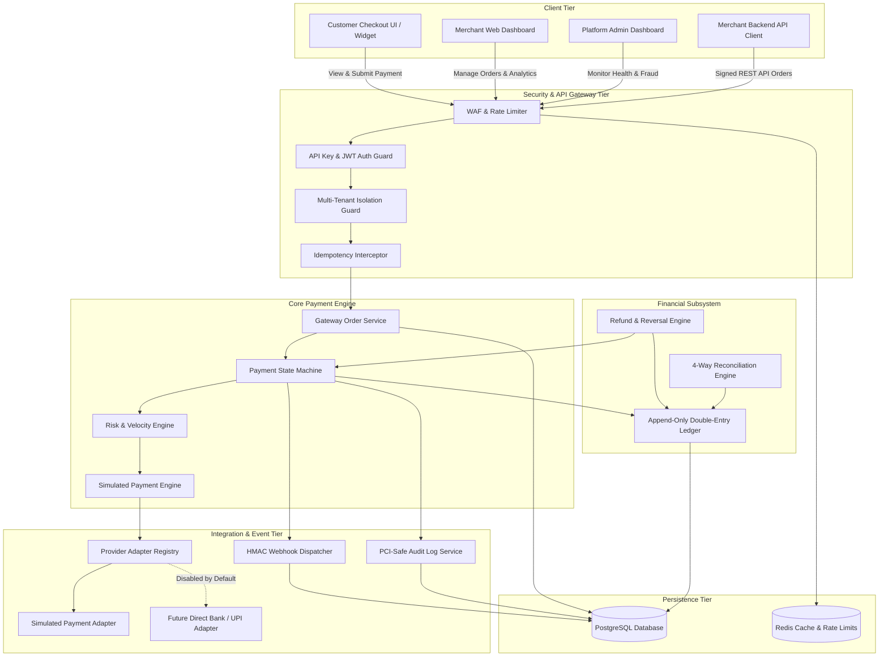

# BHARATGATEWAY™ — INDEPENDENT PAYMENT PLATFORM ARCHITECTURE SPECIFICATION
**Version:** 1.0.0 (Production-Ready Simulated Foundation)  
**Status:** Approved & Enforced  
**Classification:** Fintech Infrastructure Architecture  

---

## 1. System Vision & Zero-Vendor-Lockin Principle

BharatGateway is an independently branded, provider-agnostic payment platform engineered from first principles to process merchant payments, manage settlement ledgers, conduct automated reconciliation, enforce fraud defenses, and dispatch signed webhooks.

### Core Strategic Mandates:
1. **Commercial Independence**: Architecture is decoupled from any commercial payment aggregator (e.g., Razorpay, Cashfree, Stripe). The core gateway operates autonomously.
2. **Safe Simulation Mode**: The primary system operates in a deterministic, cryptographically signed simulation environment. No real fiat money is moved, and simulation indicators are strictly separated from real-world banking rails.
3. **Integer Minor Units**: All monetary calculations, ledger entries, orders, and refunds strictly use integer minor units (e.g. INR paise: ₹100.00 = `10000`) to prevent floating-point rounding errors and precision vulnerabilities.
4. **Append-Only Double-Entry Ledger**: Financial integrity is maintained via immutable, balanced double-entry accounting (`DEBIT == CREDIT`). Reversals and corrections strictly utilize compensating journal entries.
5. **PCI-DSS & Data Safety by Design**: Card numbers (PAN) and UPI PINs are never collected or stored in plaintext. Sensitive authentication materials are masked and redacted in logs.

---

## 2. High-Level Architecture Diagram



---

## 3. Modular Architecture Breakdown

| Module ID | Module Name | Responsibility | Key Invariants |
| :--- | :--- | :--- | :--- |
| **MOD-01** | **Identity & Access** | Merchant signup, multi-tenant scoping, API key generation (`pk_test_`, `sk_test_`). | Secrets stored as SHA-256 hashes. Cross-tenant queries strictly rejected. |
| **MOD-02** | **Payment Orders** | Merchant order creation, expiry, metadata, amount validation. | Server-authoritative integer minor units (`amount_minor`). Client cannot modify amount. |
| **MOD-03** | **State Machine** | Strict transaction transition lifecycle management. | Rejects invalid transitions (e.g. `FAILED` -> `CAPTURED`). Enforces idempotency. |
| **MOD-04** | **Payment Simulator** | Deterministic simulation of card, UPI, NetBanking rails with realistic error codes. | Clear `SIMULATION` marker. Cryptographic test signatures. |
| **MOD-05** | **Provider Registry** | Pluggable provider adapter interface (`PaymentProvider`). | Decoupled abstraction. Future bank adapters remain disabled until regulatory approval. |
| **MOD-06** | **Double-Entry Ledger** | Immutable append-only accounting ledger. | Balance equation: $\sum \text{Debit} = \sum \text{Credit}$. Zero floating-point numbers. |
| **MOD-07** | **Webhook Subsystem** | Cryptographically signed asynchronous event dispatch. | HMAC-SHA256 signature with timestamp replay protection (drift $\le 300\text{s}$). |
| **MOD-08** | **Refund Engine** | Full & partial refund orchestration with ledger reversals. | Total refunded $\le$ Captured amount. Compensating entries only. |
| **MOD-09** | **Fraud & Risk** | Velocity checks, card test attack blocking, high-value heuristics. | Risk score 0-100. Auto-blocks high-risk velocity spikes. |
| **MOD-10** | **Reconciliation** | 4-way matching of orders, transactions, ledger, and settlements. | Automatic discrepancy classification (`MATCHED`, `DISCREPANT`, `UNSETTLED`). |
| **MOD-11** | **Audit & Observability**| Sanitized event logging, health probes, performance metrics. | Redaction of card PANs, CVVs, and API keys. ISO-8601 timestamps. |
| **MOD-12** | **Frontend Portals** | Checkout UI, Merchant Dashboard, Admin Panel, Developer Docs. | Modern responsive UI, dark/light theme, accessible inputs, copyable code snippets. |

---

## 4. Payment Lifecycle State Machine

```
[CREATED] ──(Customer Opens Checkout)──> [PENDING]
    │                                        │
    │ (Expired / Abandoned)                  ├──(Auth Passed)──> [AUTHORIZED] ──(Auto-Capture)──> [CAPTURED / PAID]
    ▼                                        │                                                          │
[CANCELLED]                                  ├──(Declined/Risk/Timeout)                                 ├──(Partial Refund)──> [PARTIALLY_REFUNDED]
                                             ▼                                                          │
                                         [FAILED]                                                       └──(Full Refund)─────> [REFUNDED]
```

### Transition Invariants:
1. An order in `CAPTURED` status can only transition to `PARTIALLY_REFUNDED` or `REFUNDED`.
2. A `FAILED` transaction can never be captured or refunded.
3. Every terminal state transition automatically emits a signed webhook event to the merchant.
