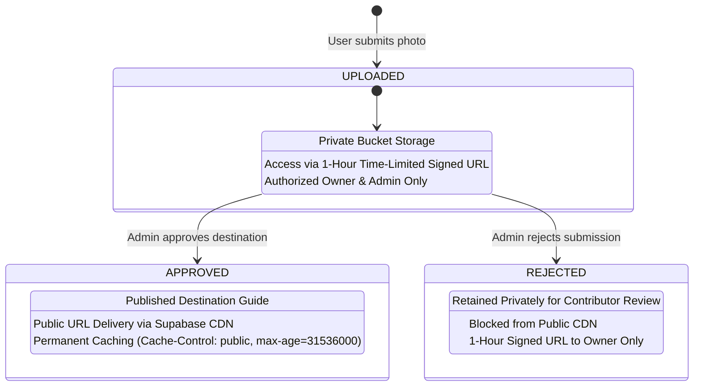

# BharatYatra — Contribution Image Storage Security & Privacy Architecture

**Status:** IMPLEMENTED IN CODEBASE (REQUIRES REMOTE SUPABASE BUCKET PROVISIONING)  
**Security Level:** HIGH CONFIDENTIALITY — PERSONAL MEDIA & USER CONTRIBUTIONS  
**Audience:** Security Architects, Cloud Infrastructure Engineers, Compliance Officers  
**Key Migration:** `supabase/migrations/20261118_secure_contributions_storage_privacy.sql`  
**Service Layer:** `lib/storage/cloud-storage-service.ts`

---

## 1. Problem Statement & Threat Model

In the legacy architecture:
1. Destination photographs uploaded by users during community place submissions were stored in a bucket configured with `public: true`.
2. Anyone guessing or scraping the photo URL could view photographs for places that were still **pending review**, **drafts**, or **rejected for copyright/inappropriate content**.
3. In serverless environments (Vercel), attempts to write to local disk resulted in `ENOENT: /var/task/public/uploads/contributions`.

### Threat Mitigation Objectives
- **Confidentiality:** Pending and rejected submission photographs must remain private. Only the contributor who uploaded them and platform administrators may access them.
- **Integrity:** Approved photographs must be permanently accessible via high-performance CDN URLs for public viewing on destination guides.
- **Serverless Resilience:** All binary transfers must stream directly to cloud object storage (Supabase Storage) without touching the local ephemeral container filesystem.

---

## 2. Privacy Lifecycle & Access State Machine



---

## 3. Storage Security Policies (Row Level Security)

The migration `supabase/migrations/20261118_secure_contributions_storage_privacy.sql` enforces four strict RLS policies on `storage.objects`:

### Policy 1: Private Bucket Isolation
Sets the `contributions` bucket to `public = false`. Public unauthenticated `GET` requests to raw bucket objects return HTTP 403 Forbidden.

### Policy 2: Public Access for Approved Destinations Only
```sql
CREATE POLICY "Public Read for Approved Destination Photos"
ON storage.objects FOR SELECT
USING (
  bucket_id = 'contributions'
  AND (
    EXISTS (
      SELECT 1 FROM public.published_destinations pd
      JOIN public.contribution_photos cp ON cp.submission_id = pd.submission_id
      WHERE cp.storage_path = storage.objects.name
    )
  )
);
```

### Policy 3: Contributor Ownership Access
```sql
CREATE POLICY "Contributor View Own Uploads"
ON storage.objects FOR SELECT
USING (
  bucket_id = 'contributions'
  AND auth.uid() IS NOT NULL
  AND (storage.foldername(name))[1] = auth.uid()::text
);
```

### Policy 4: Administrative Full Access
```sql
CREATE POLICY "Admin Full Access to Contributions Storage"
ON storage.objects FOR ALL
USING (
  bucket_id = 'contributions'
  AND (
    auth.jwt() ->> 'role' = 'ADMIN'
    OR auth.jwt() -> 'app_metadata' ->> 'role' = 'ADMIN'
  )
);
```

---

## 4. Application Implementation (`CloudStorageService`)

In `lib/storage/cloud-storage-service.ts`, the method `getSecurePhotoUrl` dynamically calculates the appropriate delivery mechanism:

```typescript
static async getSecurePhotoUrl(
  photoId: string,
  storagePath: string,
  status: 'PENDING' | 'APPROVED' | 'REJECTED',
  requestingUserId?: string,
  isAdmin: boolean = false
): Promise<string | null> {
  // 1. Approved photos: serve directly via CDN
  if (status === 'APPROVED') {
    return CloudStorageService.getPublicUrl(storagePath);
  }

  // 2. Pending or Rejected: enforce server-side ownership or admin privileges
  if (!isAdmin && (!requestingUserId || !storagePath.includes(requestingUserId))) {
    return null; // Forbidden: anonymous or cross-user access rejected
  }

  // 3. Generate 1-hour time-limited signed URL
  const supabase = getSupabaseServerClient();
  const { data, error } = await supabase.storage
    .from('contributions')
    .createSignedUrl(storagePath, 3600); // 3600 seconds = 1 hour

  if (error || !data?.signedUrl) {
    return null;
  }

  return data.signedUrl;
}
```

---

## 5. Media Binary Backup & Preservation

Database text dumps record only image URLs. If cloud storage is deleted, raw images are lost.
To guarantee permanent zero data loss, `scripts/zero-data-loss/db-backup-engine.ts` implements automated media binary downloading:
1. Scans `data/community_photos.json` and `place_submissions`.
2. Downloads binary images (`.jpg`, `.png`, `.webp`) into the snapshot archive `media/` folder.
3. Computes SHA-256 hashes of the binaries and records them in `manifest.json`.
4. Encrypts the entire snapshot package with AES-256-GCM.

---

## 6. Access Verification Matrix

| Actor / Client | Pending Image | Approved Image | Rejected Image | Deleted Photo |
|---|---|---|---|---|
| **Anonymous Web Visitor** | **403 FORBIDDEN** (Null URL) | **200 OK** (Public CDN) | **403 FORBIDDEN** (Null URL) | **404 NOT FOUND** |
| **Different Authenticated User (User B)** | **403 FORBIDDEN** (IDOR Blocked) | **200 OK** (Public CDN) | **403 FORBIDDEN** (IDOR Blocked) | **404 NOT FOUND** |
| **Uploading Contributor (User A)** | **200 OK** (Signed URL - 1 hr) | **200 OK** (Public CDN) | **200 OK** (Signed URL - 1 hr) | **404 NOT FOUND** |
| **Operations Administrator** | **200 OK** (Signed URL - 1 hr) | **200 OK** (Public CDN) | **200 OK** (Signed URL - 1 hr) | **404 NOT FOUND** |
