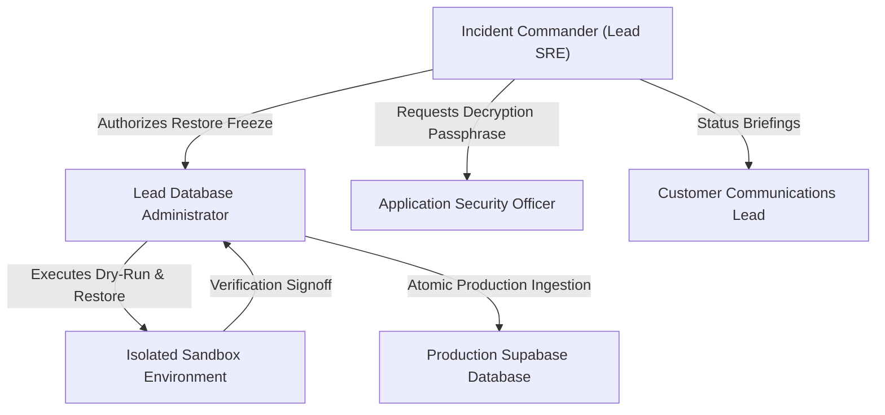

# BharatYatra — Production Disaster Recovery & Restoration Runbook

**Document Version:** 2.0 (PostgreSQL & AES-256-GCM Authenticated Architecture)  
**Target Platform:** BharatYatra (`https://www.bharatyatra.in`)  
**Audience:** Database Administrators, Site Reliability Engineers, DevOps Incident Commanders  
**Classification:** Confidential — Core Engineering Operations

---

## 1. Disaster Recovery Objectives & Service Level Indicators

| Metric | Target | Technical Mechanism |
|---|---|---|
| **RPO (Recovery Point Objective)** | **≤ 24 Hours** (Automated Daily)<br/>**≤ 1 Hour** (with WAL archiving) | Daily cron execution at `02:00 UTC` via GitHub Actions (`production-zero-data-loss-backup.yml`) + On-demand pre-migration snapshots. |
| **RTO (Recovery Time Objective)** | **≤ 15 Minutes** (Logical Data)<br/>**≤ 30 Minutes** (Media Binaries) | Automated decrypter and batch-inserter (`db-restore-engine.ts`) with SHA-256 parallel checksum streaming. |
| **Data Integrity Guarantee** | **100% Zero Data Loss** | Strict refusal to restore if any file checksum or AES-GCM authentication tag is invalid or tampered. |

---

## 2. Roles & Incident Response Team



- **Incident Commander:** Declares emergency state, coordinates operational timeline, and gives final production restore authorization.
- **Lead Database Administrator (DBA):** Selects snapshot, validates manifest, runs isolated dry-run, and executes database restoration.
- **Application Security Officer:** Manages master backup passphrases (`BACKUP_ENCRYPTION_KEY`) in secure KMS/Secret Manager; audits integrity logs.
- **Customer Communications Lead:** Notifies users if scheduled maintenance window is declared.

---

## 3. Cryptographic Key Architecture & Tamper Defense

### 3.1 Encryption Algorithm
- **Cipher:** `AES-256-GCM` (Galois/Counter Mode) authenticated encryption.
- **Key Derivation:** `scrypt` with a cryptographically random 16-byte salt per snapshot.
- **Initialization Vector:** 12-byte cryptographically secure random IV generated per file.
- **Tamper Resistance:** 16-byte GCM authentication tag appended to the payload. Any bit-flip or payload alteration triggers `Unsupported state or unable to authenticate data` and halts execution immediately.

```
+--------------------------------------------------------------------------+
|                        ENCRYPTED SNAPSHOT LAYOUT                         |
+---------------------+-------------------+-------------------+------------+
| 16-byte Salt        | 12-byte IV        | 16-byte Auth Tag  | Ciphertext |
+---------------------+-------------------+-------------------+------------+
```

### 3.2 Secret Separation Rule
> [!IMPORTANT]
> The encryption passphrase (`BACKUP_ENCRYPTION_KEY`) must **NEVER** be committed to the repository, stored in plaintext alongside backup archives, or output in workflow logs. It must reside strictly in GitHub Secrets, AWS Secrets Manager, or Supabase Vault.

---

## 4. Step-by-Step Disaster Recovery Procedure

### Step 1: Pre-Restoration Safety Freeze
Before initiating any restore, freeze all write access to prevent conflicting writes:
1. Place application in Maintenance Mode via Vercel Edge Config or environment flag:
   ```bash
   MAINTENANCE_MODE=true
   ```
2. Confirm zero active migration tasks are executing.

### Step 2: Snapshot Selection & Checksum Validation
List available snapshots sorted by timestamp:
```bash
npx tsx -e "
import { DatabaseRestoreEngine } from './scripts/zero-data-loss/db-restore-engine';
console.log(DatabaseRestoreEngine.listSnapshots());
"
```
Select the latest healthy snapshot ID (e.g., `BKP-2026-11-18T12-22-05-181Z-manual-cli`).

### Step 3: Decryption & Manifest Verification
Inspect the snapshot manifest and verify its cryptographic integrity:
```bash
# Validate manifest integrity and SHA-256 checksums
npx tsx scripts/zero-data-loss/test-restore-runner.ts
```
The restore engine automatically computes:
$$\text{SHA-256}(\text{DecryptedFile}) \stackrel{?}{=} \text{ManifestHash}$$
If any hash differs, the engine throws `CHECKSUM_MISMATCH` and aborts.

### Step 4: Sandbox Isolated Dry-Run Restoration
Always verify restoration in an isolated sandbox directory first without touching production:
```bash
npx tsx -e "
import { DatabaseRestoreEngine } from './scripts/zero-data-loss/db-restore-engine';
import path from 'path';

async function runDryRun() {
  const result = await DatabaseRestoreEngine.restoreFromSnapshot({
    snapshotId: 'BKP-2026-11-18T12-22-05-181Z-manual-cli',
    targetDirectory: path.resolve(process.cwd(), 'backups/sandbox_restore_verification'),
    dryRun: true
  });
  console.log('Sandbox Dry-Run Output:', result);
}
runDryRun();
"
```

### Step 5: Data Parity & Schema Health Check
Run the Data Integrity Monitor against the restored sandbox records:
```bash
npm run db:integrity-check
```
Verify:
1. All 9 entity tables meet or exceed baseline counts.
2. All 22 relational foreign-key references are 100% intact.
3. Zero orphan rewards, zero orphan photos, zero dangling user bookings.

### Step 6: Atomic Production Ingestion (Human Authorization Gate)
> [!CAUTION]
> Applying records to live PostgreSQL requires explicit human authorization.
Execute the idempotent PostgreSQL ingestion script:
```bash
# Dry-run reconciliation first:
npx tsx scripts/zero-data-loss/migrate-json-to-postgres.ts --dry-run

# Execute live ingestion only with explicit authorization:
npx tsx scripts/zero-data-loss/migrate-json-to-postgres.ts --execute
```

### Step 7: Post-Restoration Verification & Release
1. Run full type-check: `npm run type-check`.
2. Run automated regression suite: `npx tsx --test __tests__/zero-data-loss-enforcement.test.ts`.
3. Disable maintenance mode (`MAINTENANCE_MODE=false`).
4. Perform live smoke test on `https://www.bharatyatra.in/dashboard/contribute-place/` and `/admin/`.

---

## 5. Specific Disaster Scenarios & Playbooks

### Playbook A: Accidental Table Dropped or Truncated
1. **Diagnosis:** `PGRST205` or query returning 0 records on critical table.
2. **Action:**
   - HALT all writes immediately.
   - Run `supabase/migrations/20261118_production_data_architecture_schema.sql` to re-create schema structures if dropped.
   - Run `DatabaseRestoreEngine.restoreFromSnapshot()` using the most recent backup.
   - Ingest records using `migrate-json-to-postgres.ts` with `--execute`.

### Playbook B: Ransomware / Storage Tampering Detected
1. **Diagnosis:** `Integrity check failed: Checksum mismatch detected!`
2. **Action:**
   - Quarantine corrupted storage directory.
   - Pull immutable backup from offsite replication provider (AWS S3 Glacier / Cloudflare R2 bucket).
   - Verify GCM authentication tag with master encryption key.
   - Restore clean replica into sandbox.

### Playbook C: Vercel Ephemeral Filesystem Crash (`ENOENT`)
1. **Diagnosis:** Serverless error `ENOENT: no such file or directory, mkdir '/var/task/public/uploads/contributions'`.
2. **Action:**
   - Confirm application routing uses `CloudStorageService` (Supabase Storage) rather than local `public/uploads/`.
   - Ensure `SUPABASE_SERVICE_ROLE_KEY` is present in Vercel environment variables.
   - Trigger zero-downtime redeploy via Vercel dashboard.
