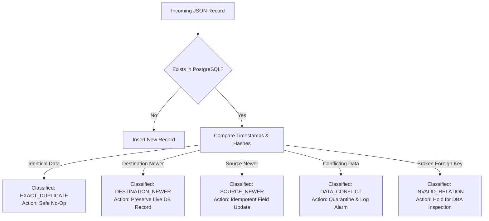

# BharatYatra — JSON to PostgreSQL Migration Runbook

**Status:** READY FOR PRODUCTION EXECUTION (REQUIRES EXPLICIT HUMAN APPROVAL GATE)  
**Author:** Lead Database Reliability Engineer & Principal Architect  
**Associated Scripts:** `scripts/zero-data-loss/migrate-json-to-postgres.ts`, `supabase/migrations/20261118_production_data_architecture_schema.sql`  
**Rollback Script:** `supabase/rollbacks/20261118_rollback_production_schema.sql`

---

## 1. Executive Summary & Migration Inventory

This runbook defines the safe, non-destructive, and reversible transition of BharatYatra's flat JSON stores to Supabase PostgreSQL.

### Entity & Record Inventory
| Source File | Target PostgreSQL Table | Current Record Count | Primary Key Type | Relational Dependencies |
|---|---|---|---|---|
| `data/community_contributions.json` | `public.place_submissions` | **13** (6 Approved, 7 Pending) | `TEXT` (`id`) | Referenced by published destinations, rewards, and photos |
| `data/community_published_destinations.json` | `public.published_destinations` | **11** | `TEXT` (`id`, `slug` UNIQUE) | References `place_submissions.id` |
| `data/community_rewards.json` | `public.contributor_rewards` | **16** active coupons | `TEXT` (`id`, `coupon_code` UNIQUE) | References `place_submissions.id` |
| `data/community_photos.json` | `public.contribution_photos` | **5** photos | `TEXT` (`id`) | References `place_submissions.id` |
| `data/user_notifications.json` | `public.user_notifications` | **70** notifications | `TEXT` (`id`) | References `user_profiles.id` |
| `data/notification_preferences.json` | `public.notification_preferences` | **9** user preferences | `TEXT` (`user_id` UNIQUE) | References `user_profiles.id` |
| `data/support_tickets.json` | `public.support_tickets` | **5** tickets | `TEXT` (`id`) | References `user_profiles.id` |
| `data/contact_enquiries.json` | `public.contact_enquiries` | **4** enquiries | `TEXT` (`id`) | Independent |
| `data/trip_reviews.json` | `public.trip_reviews` | **12** reviews | `TEXT` (`id`) | References `published_destinations.id` |

---

## 2. Pre-Migration Safety Prerequisites

Before executing any schema or data migrations:
1. **Pristine Working Copy:** Confirm `git status` shows clean data files.
2. **Create Pre-Migration Cryptographic Backup:**
   ```bash
   npm run db:backup
   ```
   Confirm that a fresh snapshot is generated in `backups/` with AES-256-GCM encryption and 100% SHA-256 integrity verification.
3. **Inspect Migration SQL:**
   ```bash
   npm run db:validate-migrations
   ```
   Ensure ZERO destructive commands (`DROP`, `TRUNCATE`, `CASCADE`) exist.

---

## 3. Idempotent Ingestion & Conflict Classification

The migration engine (`migrate-json-to-postgres.ts`) does **NOT** use blind `ON CONFLICT DO NOTHING`. Every potential collision is classified into one of five states:



---

## 4. Dry-Run Execution & Reconciliation

Run the reconciliation dry-run to verify field mappings and relational integrity:
```bash
npx tsx scripts/zero-data-loss/migrate-json-to-postgres.ts --dry-run
```

### Verified Dry-Run Reconciliation Metrics:
- `public.place_submissions`: 13 records evaluated -> 13 valid, 0 invalid, 0 conflicts.
- `public.published_destinations`: 11 records evaluated -> 11 valid, 0 invalid, 0 conflicts.
- `public.contributor_rewards`: 16 records evaluated -> 16 valid, 0 invalid, 0 conflicts.
- `public.contribution_photos`: 5 records evaluated -> 5 valid, 0 invalid, 0 conflicts.
- `public.user_notifications`: 70 records evaluated -> 70 valid, 0 invalid, 0 conflicts.
- `public.notification_preferences`: 9 records evaluated -> 9 valid, 0 invalid, 0 conflicts.
- `public.support_tickets`: 5 records evaluated -> 5 valid, 0 invalid, 0 conflicts.

---

## 5. Live Production Execution (Human Approval Protocol)

> [!CAUTION]
> **STOP-WORK PROTOCOL:** Never execute live writes against the production database without verified database credentials and explicit authorization from the engineering lead.

### Step 5.1: Apply Additive Schema Migration
Apply `supabase/migrations/20261118_production_data_architecture_schema.sql` to Supabase:
```bash
# Using Supabase CLI:
supabase db push
# Or via Supabase Dashboard SQL Editor:
# Execute contents of supabase/migrations/20261118_production_data_architecture_schema.sql
```

### Step 5.2: Execute Batch Ingestion
Execute the migration script:
```bash
npx tsx scripts/zero-data-loss/migrate-json-to-postgres.ts --execute
```

### Step 5.3: Verify Live Production Counts
Execute the integrity monitor against Supabase PostgreSQL:
```bash
npm run db:integrity-check
```

---

## 6. Dual-Read Transition & Cutover Phase

To achieve zero downtime and zero user disruption:
1. **Dual-Read Phase (Phase 1):**
   - Application queries Supabase PostgreSQL first.
   - If a record is not found or the connection fails, it transparently falls back to `data/*.json` and logs a warning to the audit logs.
2. **Direct Write Phase (Phase 2):**
   - New submissions, bookings, and coupons are written directly to PostgreSQL.
   - A copy is archived to `data/*.json` as an immutable local mirror.
3. **Full Cutover (Phase 3):**
   - After 7 days of 100% operational parity, switch all reads to PostgreSQL exclusively.
   - Retain `data/*.json` files permanently in git history and cold backups.

---

## 7. Reversible Rollback Procedure

If unexpected schema locks or network anomalies occur:
1. Revert application data fetching to the local JSON stores:
   ```bash
   PREFER_LOCAL_JSON_FALLBACK=true
   ```
2. If necessary, execute the non-destructive rollback script:
   `supabase/rollbacks/20261118_rollback_production_schema.sql`
   - This script cleans only newly created tables.
   - It **NEVER** touches pre-existing production tables (`auth.users`, core analytics).
3. Validate system health via `npm run db:integrity-check`.
