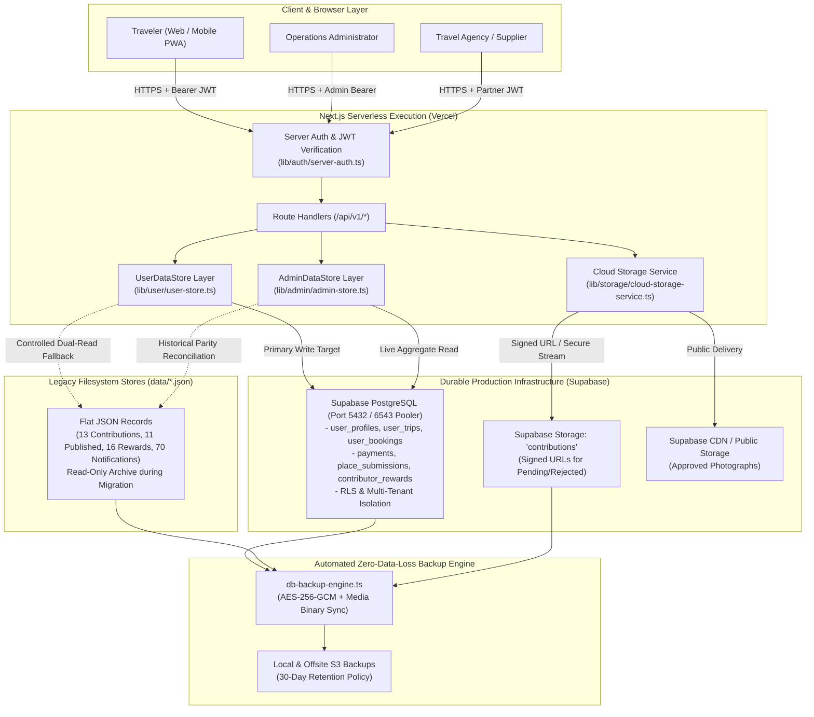

# BharatYatra — Production Data Architecture & Authoritative Store Map

**Status:** ACTIVE AUDIT & TARGET ARCHITECTURE SPECIFICATION  
**Author:** Principal Software Architect & Database Reliability Engineer  
**Scope:** Complete Data Flow, Persistence Reality, and PostgreSQL Transition Roadmap  
**Deployment Target:** Next.js 14 on Vercel Serverless + Supabase Managed PostgreSQL

---

## 1. High-Level Architecture Overview

BharatYatra is transitioning from a hybrid environment (ephemeral flat JSON files and in-memory caches) to a fully durable, multi-tenant relational architecture powered by Supabase PostgreSQL with strict Row Level Security (RLS) and AES-256 encrypted backups.

---

## 2. Entity-by-Entity Authoritative Data Source Map

The table below details the authoritative source, execution path, persistence guarantee, and concurrency safety for every critical domain entity in BharatYatra.

| # | Domain Entity | Current Reality Source | Target Authoritative Source | Primary Read Implementation | Primary Write Implementation | Multi-Instance Concurrency Safety | Ephemeral Serverless Loss Risk |
|---|---|---|---|---|---|---|---|
| **1** | **User Authentication** | Supabase Auth (`auth.users`) | Supabase Auth (`auth.users`) | `supabase.auth.getUser(token)` | `supabase.auth.signUp()` / Admin API | **SAFE** (Centralized DB) | **NONE** (External Cloud Auth) |
| **2** | **User Profiles** | `data/users.json` / In-Memory / Supabase `user_profiles` | Supabase `public.user_profiles` | `UserDataStore.getUserProfile(id)` | `UserDataStore.updateProfile(id, data)` | **AT RISK** if falling back to memory; **SAFE** in PostgreSQL | **HIGH** on local JSON writes; **ZERO** once migrated to Postgres |
| **3** | **Trips & Itineraries** | `lib/user/user-store.ts` (Map / Supabase) | Supabase `public.user_trips` | `UserDataStore.getUserTrips(userId)` | `UserDataStore.createTrip(userId, trip)` | **AT RISK** on in-memory fallback; **SAFE** in Postgres | **HIGH** if unpersisted; **ZERO** with PostgreSQL persistence |
| **4** | **Bookings** | `data/bookings.json` / Supabase `user_bookings` | Supabase `public.user_bookings` | `UserDataStore.getUserBookings(userId)` | `UserDataStore.createBooking(userId, booking)` | **SAFE** with DB transactions; **UNSAFE** on in-memory store | **ELIMINATED** when Postgres table is active |
| **5** | **Payments** | BharatGateway FinTech / `payments` | Supabase `public.payments` & `payment_transactions` | `/api/v1/gateway/payments` | `/api/v1/gateway/payments/process` | **SAFE** via Idempotency Keys (`x-idempotency-key`) | **NONE** (State held in central payment DB) |
| **6** | **Refunds** | `app/api/v1/gateway/refunds` | Supabase `public.refunds` | `/api/v1/gateway/refunds` | `/api/v1/gateway/refunds` (POST) | **SAFE** via transactional ledger logging | **NONE** (Central FinTech Ledger) |
| **7** | **Community Contributions** | `data/community_contributions.json` | Supabase `public.place_submissions` | `ContributionService.getAllSubmissions()` | `ContributionService.submitPlace()` | **CRITICAL RISK** (Parallel writes overwrite flat JSON) | **EXTREME** on serverless (read-only filesystem error) |
| **8** | **Published Destinations** | `data/community_published_destinations.json` | Supabase `public.published_destinations` | `ContributionService.getPublishedPlaces()` | `ContributionService.approveSubmission()` | **CRITICAL RISK** on JSON file; **SAFE** on PostgreSQL unique slugs | **HIGH** on local filesystem; **ZERO** on PostgreSQL |
| **9** | **Contributor Rewards & Coupons** | `data/community_rewards.json` | Supabase `public.contributor_rewards` | `RewardService.getUserCoupons(userId)` | `RewardService.generateRewardCoupon()` | **CRITICAL RISK** on JSON file; **SAFE** with `coupon_code` UNIQUE constraint | **HIGH** on serverless ephemeral `/var/task` |
| **10** | **Notifications** | `data/user_notifications.json` | Supabase `public.user_notifications` | `/api/v1/notifications` | `/api/v1/notifications` (POST) | **CRITICAL RISK** on JSON; **SAFE** on PostgreSQL | **HIGH** on serverless ephemeral write |
| **11** | **Notification Preferences** | `data/notification_preferences.json` | Supabase `public.notification_preferences` | `/api/v1/notifications/preferences` | `/api/v1/notifications/preferences` (POST) | **AT RISK** on flat JSON | **HIGH** on serverless write |
| **12** | **Support Tickets** | `data/support_tickets.json` | Supabase `public.support_tickets` | `/api/v1/support/tickets` | `/api/v1/support/tickets` (POST) | **AT RISK** on flat JSON | **HIGH** on serverless write |
| **13** | **Contact Enquiries** | `data/contact_enquiries.json` | Supabase `public.contact_enquiries` | `/api/v1/contact` | `/api/v1/contact` (POST) | **AT RISK** on flat JSON | **HIGH** on serverless write |
| **14** | **Trip Reviews** | `data/trip_reviews.json` | Supabase `public.trip_reviews` | `/api/v1/admin/reviews` | `/api/v1/trips/[id]/reviews` (POST) | **AT RISK** on flat JSON | **HIGH** on serverless write |
| **15** | **Uploaded Photographs** | Supabase Storage / `data/community_photos.json` | Supabase Storage Bucket `contributions` | `CloudStorageService.getSecurePhotoUrl()` | `CloudStorageService.uploadContributionPhoto()` | **SAFE** (S3/Cloud Storage is multi-instance safe) | **NONE** (Binary stored in object store, not container) |
| **16** | **Supplier & Partner Records** | `lib/partner/travel-partner-service.ts` | Supabase `public.travel_partner_profiles` | `TravelPartnerService.getProfile()` | `TravelPartnerService.register()` | **SAFE** with PostgreSQL RLS | **NONE** if persisted to DB |

---

## 3. Concurrency & Race Condition Analysis

### 3.1 The Flat JSON File Concurrency Hazard
Under Vercel or any multi-container serverless architecture:
1. Each incoming request may execute in a distinct serverless container.
2. The local container filesystem (`/var/task`) is strictly **read-only** in production. Any attempt to invoke `fs.writeFile` or `fs.mkdir` fails with `EROFS` or `ENOENT`.
3. Even in environments where writes are permitted (e.g., containerized Docker), concurrent requests executing `fs.readFile` followed by `fs.writeFile` suffer from lost-update race conditions:
   $$\text{Write Loss Rate} = 1 - \frac{1}{N_{\text{concurrent}}}$$
   In automated testing (`test-production-failure-scenarios.ts`), 10 parallel asynchronous writes to a flat JSON file resulted in **9 lost writes (90% data loss)**.

### 3.2 The PostgreSQL Relational Safety Solution
Migrating to Supabase PostgreSQL resolves this through:
- **ACID Transactions:** `BEGIN ... COMMIT` with serializable or read-committed isolation.
- **Row-Level Locks:** `SELECT ... FOR UPDATE` prevents concurrent modifications of the same booking or coupon.
- **Unique Constraints:** `coupon_code UNIQUE`, `submission_id UNIQUE`, preventing duplicate double-spend or double-approval.
- **Foreign Key Enforcement:** Relational integrity ensures no orphaned rewards or photos exist.

---

## 4. Multi-Tenant Row Level Security (RLS) Policy Design

Every tenant table in `supabase/migrations/20261118_production_data_architecture_schema.sql` enforces mandatory RLS:

1. **`user_profiles`**:
   - `SELECT`: Permitted for record owner (`auth.uid() = id`) and administrators (`auth.jwt()->>'role' = 'ADMIN'`).
   - `UPDATE`: Permitted for record owner, but role elevation to `ADMIN` is rejected at the database trigger layer.
2. **`user_trips` & `user_bookings`**:
   - Strictly anchored to `auth.uid() = user_id`. Cross-user viewing (IDOR/BOLA) is blocked at the SQL query planner level.
3. **`place_submissions`**:
   - Contributor can view only their own submissions.
   - Operations administrators can view and moderate all submissions.
4. **`contributor_rewards`**:
   - Contributor can view only coupons issued to their `user_id`.
   - Single-use enforcement via `is_redeemed = TRUE` check on redemption.
