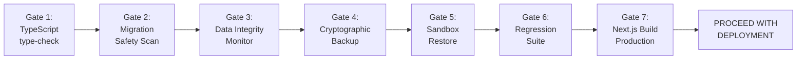

# BharatYatra — Production Deployment Checklist & Safety Gates

**Policy Authority:** AGENTS.md & Zero Data Loss Policy  
**Scope:** All deployments to Vercel Production (`https://www.bharatyatra.in`) and Supabase  
**Enforcement:** Mandatory Pre-Deployment Gate (Automatic Block on Failure)

---

## 1. Automated Deployment Safety Gates

Every deployment pipeline (GitHub Actions CI/CD and manual release runs) must pass all seven consecutive gates:

| Gate # | Check Description | Required Command | Success Condition | Action on Failure |
|---|---|---|---|---|
| **Gate 1** | **Static Type Validation** | `npm run type-check` | `tsc --noEmit` exits with code 0 | **ABORT:** Fix compile errors before merging. |
| **Gate 2** | **Migration Safety Analysis** | `npm run db:validate-migrations` | 0 destructive SQL commands detected | **ABORT & BLOCK:** Destructive SQL (`DROP`, `TRUNCATE`) strictly forbidden. |
| **Gate 3** | **Data Integrity Baseline** | `npm run db:integrity-check` | All 9 tables stable/growing; 0 broken relations | **STOP WORK:** Data loss alert triggered. |
| **Gate 4** | **Cryptographic Backup** | `npm run db:backup` | Fresh encrypted snapshot in `backups/` with 100% SHA-256 parity | **ABORT:** Never deploy without a verified recovery snapshot. |
| **Gate 5** | **Sandbox Restoration** | `npx tsx scripts/zero-data-loss/test-restore-runner.ts` | 100% hash parity in isolated sandbox | **ABORT:** Snapshot is corrupt or engine cannot restore. |
| **Gate 6** | **Security Regression Tests** | `npx tsx --test __tests__/zero-data-loss-enforcement.test.ts` | 19/19 tests pass | **ABORT:** Regression detected in security or auth boundaries. |
| **Gate 7** | **Next.js Production Build** | `npm run build` | Optimized Next.js build created with code 0 | **ABORT:** Runtime or page generation error. |

---

## 2. Stop-Work Triggers

If any of the following events occur during deployment or staging, engineers must **HALT IMMEDIATELY**:

1. **Entity Count Drop:** Any table in `npm run db:integrity-check` drops below its registered baseline.
2. **Checksum Mismatch:** Any backup file's SHA-256 does not match its manifest.
3. **Decryption Exception:** AES-256-GCM authentication tag verification fails.
4. **Relational Inconsistency:** A foreign key constraint fails between contributions, rewards, or bookings.
5. **Database Reset Detected:** Any script attempting `prisma migrate reset` or `db push --force-reset`.
6. **Authentication Bypass:** Any endpoint returning user or admin data without valid JWT verification.

---

## 3. Pre-Deployment Operational Checklist

- [ ] Confirm `git status` has no dirty `data/*.json` files.
- [ ] Verify `BACKUP_ENCRYPTION_KEY` is configured in GitHub Secrets and production environment.
- [ ] Confirm Supabase connection strings point to production pooler (Port 6543) or direct DB (Port 5432).
- [ ] Confirm no mock payment keys (`sk_test_*`) are active in live customer payment processing.
- [ ] Verify storage bucket `contributions` exists and RLS policies are applied.
- [ ] Review git diff: ensure only additive code changes exist.

---

## 4. Post-Deployment Verification (Smoke Testing)

Within 5 minutes of production deployment to `https://www.bharatyatra.in`:

- [ ] **Home & Exploration:** Verify `https://www.bharatyatra.in/` loads with 200 OK.
- [ ] **User Auth:** Test customer login via `https://www.bharatyatra.in/login`.
- [ ] **Community Contributions:** Load `https://www.bharatyatra.in/dashboard/contribute-place/` and confirm form renders.
- [ ] **Admin Dashboard:** Access `https://www.bharatyatra.in/admin/` with admin credentials and verify live metrics.
- [ ] **Admin Community Contributions:** Check `https://www.bharatyatra.in/admin/community-contributions/` displays genuine 13 submissions.
- [ ] **Admin Rewards:** Check `https://www.bharatyatra.in/admin/rewards/` displays 16 active coupons.
- [ ] **Database Health API:** Fetch `https://www.bharatyatra.in/api/v1/health` and verify database and storage status.

---

## 5. Rollback Protocol

If post-deployment smoke tests fail or user complaints occur:
1. Trigger instant rollback in Vercel Dashboard to previous deployment hash.
2. In Supabase, if a migration caused issues, execute:
   `supabase/rollbacks/20261118_rollback_production_schema.sql`
3. Restore previous data snapshot using:
   `npx tsx scripts/zero-data-loss/test-restore-runner.ts`
4. Post incident notice to operations team and initiate root-cause investigation.
