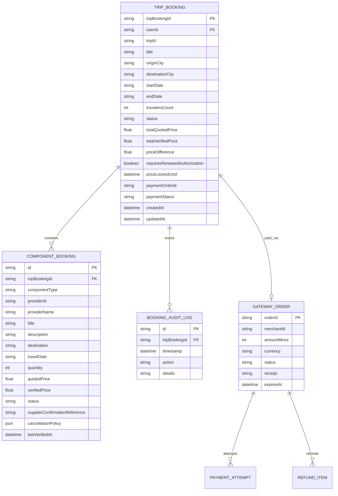

# BHARATYATRA AI 2.0 — PHASE 10
# Booking Lifecycle Database Schema & Data Models

**Specification Level:** Relational & In-Memory Entity Definition  
**Core Reference:** `lib/booking/unified-booking-orchestrator.ts` & `18_DEVELOPMENT/Backend/src/bookings/`  

---

## 1. Entity-Relationship Architecture

---

## 2. Table Specifications & Fields

### 2.1 Table: `trip_bookings` (Master Itinerary Record)
| Column | Type | Nullable | Constraints & Description |
| :--- | :--- | :--- | :--- |
| `trip_booking_id` | `VARCHAR(64)` | No | **Primary Key** (Format: `BY-TRIP-YYYY-XXXXXX`). |
| `user_id` | `VARCHAR(64)` | No | Foreign Key $\to$ `users.id` with strict IDOR ownership check. |
| `trip_id` | `VARCHAR(64)` | Yes | Optional link to AI Planner saved trip plan. |
| `title` | `VARCHAR(255)` | No | User-facing descriptive package title. |
| `origin_city` | `VARCHAR(100)` | No | Journey origin (e.g. Ahmedabad). |
| `destination_city` | `VARCHAR(100)` | No | Destination hub (e.g. Gir National Park). |
| `start_date` | `DATE` | No | YYYY-MM-DD journey start. |
| `end_date` | `DATE` | No | YYYY-MM-DD journey conclusion. |
| `travelers_count` | `INT` | No | Total passenger count ($\ge 1$). |
| `status` | `VARCHAR(32)` | No | Enum: `DRAFT`, `AVAILABILITY_VERIFIED`, `PRICE_CHANGED`, `USER_AUTHORIZED`, `PAYMENT_CONFIRMED`, `BOOKING_PENDING`, `CONFIRMED`, `PARTIALLY_CONFIRMED`, `CANCELLED`, `REFUNDED`. |
| `total_quoted_price` | `NUMERIC(10,2)` | No | Initial quoted total in INR. |
| `total_verified_price` | `NUMERIC(10,2)` | No | Revalidated live supplier total in INR. |
| `price_difference` | `NUMERIC(10,2)` | No | Computed delta ($\text{Verified} - \text{Quoted}$). |
| `requires_renewed_auth`| `BOOLEAN` | No | Flag indicating rate drift exceeded tolerance. |
| `price_locked_until` | `TIMESTAMP` | Yes | 10-minute validity timestamp for checkout. |
| `payment_order_id` | `VARCHAR(64)` | Yes | Foreign Key $\to$ `gateway_orders.order_id`. |
| `payment_status` | `VARCHAR(32)` | Yes | Enum: `PENDING`, `CAPTURED`, `FAILED`, `REFUNDED`. |
| `created_at` | `TIMESTAMP` | No | Record initialization timestamp. |
| `updated_at` | `TIMESTAMP` | No | Last mutation timestamp. |

---

### 2.2 Table: `component_bookings` (Constituent Items)
| Column | Type | Nullable | Description |
| :--- | :--- | :--- | :--- |
| `id` | `VARCHAR(64)` | No | **Primary Key** (Format: `comp-XXXXXX`). |
| `trip_booking_id` | `VARCHAR(64)` | No | Foreign Key referencing parent `trip_bookings`. |
| `component_type` | `VARCHAR(32)` | No | Enum: `HOTEL`, `BUS`, `FLIGHT`, `TRAIN`, `ACTIVITY`, `CAB`, `PACKAGE`. |
| `provider_id` | `VARCHAR(64)` | No | Unique supplier identifier (e.g. `prov-hbx-hotelbeds`). |
| `provider_name` | `VARCHAR(128)` | No | Commercial supplier name. |
| `title` | `VARCHAR(255)` | No | Item title (e.g. "The Fern Gir Forest Resort"). |
| `destination` | `VARCHAR(100)` | No | Geographic location of service. |
| `travel_date` | `DATE` | No | Date of service execution. |
| `quantity` | `INT` | No | Units booked (rooms, berths, passes). |
| `quoted_price` | `NUMERIC(10,2)` | No | Quoted item rate. |
| `verified_price` | `NUMERIC(10,2)` | No | Live verified item rate. |
| `status` | `VARCHAR(32)` | No | Component lifecycle status. |
| `supplier_conf_ref` | `VARCHAR(64)` | Yes | Verified supplier reference (PNR / Voucher Code). |
| `cancellation_policy` | `JSONB` | No | Structured cancellation terms (penalty %, deadline, refundable amt). |

---

### 2.3 Table: `booking_audit_logs` (Immutable Audit Trail)
| Column | Type | Nullable | Description |
| :--- | :--- | :--- | :--- |
| `id` | `BIGSERIAL` | No | **Primary Key**. |
| `trip_booking_id` | `VARCHAR(64)` | No | Foreign Key to `trip_bookings`. |
| `timestamp` | `TIMESTAMP` | No | Exact event timestamp with timezone. |
| `action` | `VARCHAR(64)` | No | Action type (`PRICE_REVALIDATED`, `PAYMENT_CAPTURED`, `SUPPLIER_CONFIRMED`, `COMPONENT_CANCELLED`, etc.). |
| `details` | `TEXT` | No | Detailed description and delta values. |
