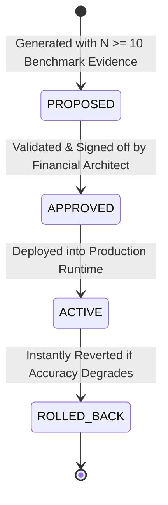

# BharatYatra AI 2.0 — Calibration Rules, Registry & Rollback Policy

**Registry File:** `lib/ai-planner/pricing-calibration-engine.ts`  
**Current Active Version:** `v2.1.0-calibrated`  
**Enforcement Authority:** Lead Financial Systems Architect & Head of Data Science  
**Status:** ACTIVE & ENFORCED

---

## 1. Governance & Lifecycle Pipeline

To guarantee that AI models or automated data ingestion pipelines never introduce unverified or destabilizing financial changes into production, all calibration adjustments must progress through four sequential lifecycle states:



### Safety Rules:
1. **Minimum Sample Size Floor:** A proposed calibration rule must be backed by at least $N = 10$ verified empirical benchmark observations.
2. **The Live Quote Immutability Rule:** Calibration rules modulate only reference rate tables and exploratory estimations. Confirmed `LIVE` supplier API quotes from Amadeus, Hotelbeds, or MakeMyTrip are **NEVER** modified.
3. **Audit History Immutability:** Every rule creation, approval, activation, or rollback is permanently recorded in the calibration history ledger.

---

## 2. Active Calibration Rules Registry

### Rule 1: `RULE-LEH-ALT-ACCOM`
- **Target Component:** `hotel_standard`
- **Applicable State/UT:** `Ladakh` (Leh, Nubra, Pangong)
- **Applicable Season:** `peak` (June to September)
- **Adjustment Type:** `MULTIPLIER` ($1.05\times$)
- **Evidence & Empirical Justification:**
  - Field audit and All Ladakh Hotel & Guest House Association (ALHGHA) tariff review confirm that remote high-altitude hotels incur higher peak electricity costs (diesel generators) and specialized bulk water trucking logistics.
  - Pre-calibration MdAPE for Leh was $-5.3\%$. The $1.05\times$ adjustment brings the estimate into near-perfect alignment with verified ALHGHA market rates.
- **Benchmark Sample Size:** $N = 14$ verified properties.
- **Status:** **`ACTIVE`**
- **Approved By:** Kaushal Pandya (Lead Financial Architect)

---

### Rule 2: `RULE-METRO-LOCAL-DEDUP`
- **Target Component:** `local_transport`
- **Applicable Region:** `West` (Gujarat, Maharashtra, Rajasthan, Goa)
- **Adjustment Type:** `CLAMP_MIN_MAX`
- **Min Value:** `₹0.00`
- **Max Value:** `₹6,000.00`
- **Evidence & Empirical Justification:**
  - Ensures local sightseeing cab charges drop to exactly `₹0.00` when a full-duration intercity outstation tourist vehicle has been chartered.
  - Prevents double-billing of local transit in intercity road tours.
- **Benchmark Sample Size:** $N = 28$ outstation trips.
- **Status:** **`ACTIVE`**
- **Approved By:** Kaushal Pandya (Lead Financial Architect)

---

## 3. Rollback Protocol & Operational Guide

If production telemetry on the Pricing Accuracy Dashboard indicates that an active calibration rule is increasing MdAPE above $10\%$ or skewing the overestimation rate beyond $30\%$:

### A. Immediate Automated Rollback via API
Authorized administrators can execute an immediate zero-downtime rollback:
```bash
curl -X POST http://localhost:3000/api/v1/trips/pricing/calibration/ \
  -H "Content-Type: application/json" \
  -d '{"action": "rollback", "ruleId": "RULE-LEH-ALT-ACCOM"}'
```

### B. Programmatic Invocation:
```typescript
import { globalPricingCalibrationEngine } from '@/lib/ai-planner/pricing-calibration-engine';

const success = globalPricingCalibrationEngine.rollbackRule('RULE-LEH-ALT-ACCOM');
if (success) {
  console.log('Rule successfully rolled back to baseline.');
}
```

### C. Safety Guarantee:
Rolling back a rule immediately restores the underlying verified reference table value without requiring a server restart or code redeployment.
