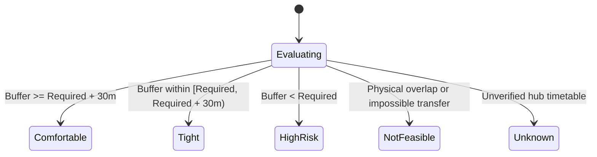

# BHARATYATRA AI 2.0 — CONNECTION & TRANSFER FEASIBILITY RULES
## Transfer Protocols, Minimum Connection Times (MCT), Terminal Changes & Independent PNR Protections

**Document Version**: 2.0.0  
**Phase**: AI 2.0 — Phase 7 Master Implementation  
**Status**: ENFORCED IN CODE  
**Author**: Principal Transport Logistics Engineer  

---

## 1. Connection Feasibility Taxonomy

Connections in BharatYatra are classified into five explicit ratings based on objective temporal and physical parameters:

1. **Comfortable**: Buffer exceeds minimum required time by $\ge 30$ minutes. Negligible stress, baggage retrieval fully accounted for.
2. **Tight**: Buffer meets the minimum requirement with less than 30 minutes of margin. Minor delays on Leg 1 may endanger Leg 2.
3. **High-Risk**: Buffer is below safe minimum connection times. Passenger is highly likely to miss onward departure in event of routine airline/rail delay.
4. **Not Feasible**: Arrival of Leg 1 is chronologically later than or within 15 minutes of Leg 2 departure.
5. **Unknown**: Insufficient timetable provenance for local transport to guarantee connection window.

---

## 2. Standard Minimum Connection Time (MCT) Matrix

| Transfer Type | Transit Hub / Context | Minimum Safe Buffer | Terminal Change Addition | Recommended Buffer |
| :--- | :--- | :--- | :--- | :--- |
| **Flight $\rightarrow$ Flight (Domestic)** | Tier-1 Hub (DEL / BOM) | $75\text{ min}$ | $+45\text{ min}$ (T1 to T2/T3) | **$120\text{ min}$** |
| **Flight $\rightarrow$ Flight (Domestic)** | Tier-2 Regional Airport | $60\text{ min}$ | None | **$60\text{ min}$** |
| **Flight $\rightarrow$ Road Cab** | Any Commercial Airport | $30\text{ min}$ (Baggage) | $+15\text{ min}$ (App cab zone) | **$45\text{ min}$** |
| **Rail $\rightarrow$ Road Cab** | Major Junction (NDLS, ADI, CSMT) | $20\text{ min}$ (Platform exit) | $+10\text{ min}$ (Circulating area) | **$30\text{ min}$** |
| **Rail $\rightarrow$ Inter-State Bus** | Intermodal switch (NDLS $\leftrightarrow$ ISBT) | $30\text{ min}$ | $+30\text{ min}$ (Metro/cab commute) | **$60\text{ min}$** |
| **Road/Rail $\rightarrow$ Passenger Ferry** | Port/Wharf (Gateway of India, Phoenix Bay) | $30\text{ min}$ | $+15\text{ min}$ (Security manifest) | **$45\text{ min}$** |

---

## 3. Independent PNR & Unprotected Separate Ticket Guardrail

When an itinerary comprises multiple transport carriers booked on separate tickets (e.g., IndiGo Flight Leg 1 + HRTC Volvo Bus Leg 2):

> [!WARNING]
> **Independent Carrier Liability Notice:**  
> Leg 1 and Leg 2 are operated by independent service providers under separate contracts of carriage. A delay or cancellation on Leg 1 does **not** entitle the traveler to compensation, re-accommodation, or free rescheduling on Leg 2. The BharatYatra engine flags `unprotectedTicketWarning: true` and mandates a minimum **60-to-120 minute defensive buffer**.

---

## 4. High-Altitude Morning Departure Constraint

- **Leh Kushok Bakula Rimpochee Airport (IXL)**:
  - Altitude: $3,256\text{ meters}$.
  - Atmospheric Condition: Intense thermal heating in the afternoon generates severe trans-Himalayan crosswinds and thin air density.
  - **Rule**: All commercial outbound and inbound flights must depart between **05:30 AM and 09:30 AM**. Flights scheduled after 11:30 AM are flagged as `HIGH_RISK_OF_WEATHER_ABORT`.
