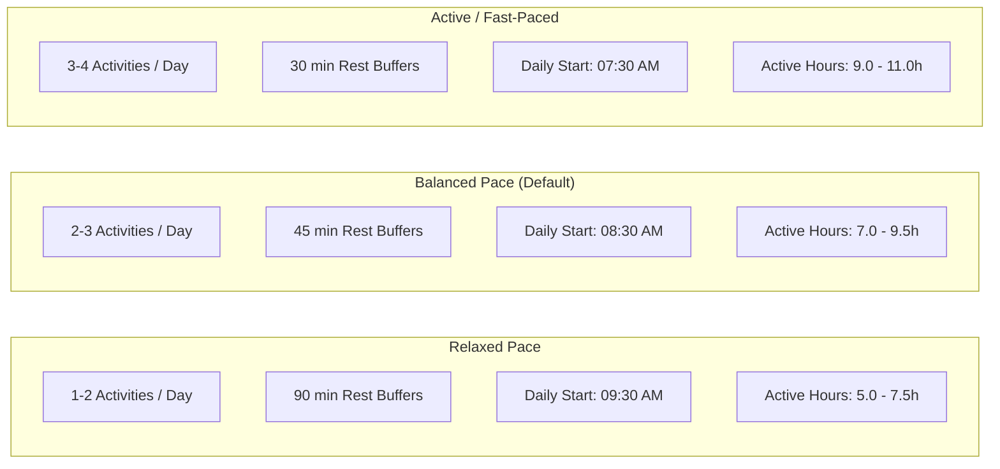

# BharatYatra AI 2.0 — Day-by-Day Scheduling Algorithm & Human Feasibility Model

## 1. Scheduling Philosophy

Travel itineraries in generative AI tools often fail because they treat human beings like non-stop teleporting computation agents. They schedule 14 continuous hours of walking, ignore hotel check-in procedures, overlook intercity transit fatigue, and disregard the human body's biological need for rest, hydration, and nutrition.

The **BharatYatra Day Scheduling Algorithm** is built on human physiological reality, Indian urban transit conditions, and tourism physics. It enforces hard active-hour caps, dedicated transit buffers, structured dining intervals, and mandatory high-altitude acclimatization safeguards.

---

## 2. Daily Time Slot Framework

Each day in a BharatYatra itinerary is partitioned into three primary operational sightseeing slots plus dedicated meal and rest intervals:

```
┌────────────────────────────────────────────────────────────────────────┐
│                        BHARATYATRA DAILY TIMELINE                      │
├─────────────┬──────────────────────────────────────────┬───────────────┤
│ 07:30-08:30 │ Breakfast & Morning Preparation          │ 60 min        │
│ 08:30-12:30 │ MORNING SLOT (Primary Sightseeing)       │ Up to 240 min │
│ 12:30-13:30 │ Lunch & Regional Cultural Dining         │ 60 min        │
│ 13:30-14:30 │ Midday Rest / Travel Buffer / Siesta     │ 60 min        │
│ 14:30-17:00 │ AFTERNOON SLOT (Secondary Sightseeing)   │ Up to 150 min │
│ 17:00-17:30 │ Evening Tea / Local Refreshment Break    │ 30 min        │
│ 17:30-20:30 │ EVENING SLOT (Cultural / Sunset / Market)│ Up to 180 min │
│ 20:30-22:00 │ Dinner & Overnight Hotel Rest            │ 90 min        │
└─────────────┴──────────────────────────────────────────┴───────────────┘
```

---

## 3. Human Active-Hour Limits by Day Type

To prevent vacation burnout and physical exhaustion, the algorithm enforces strict daily active-hour thresholds:

| Day Type | Operational Role | Max Active Hours | Maximum Activities | Transit Buffer |
|---|---|---|---|---|
| **Arrival Day (Day 1)** | Outbound transit, arrival in destination, hotel check-in, orientation | $\le 8.5\text{h}$ | Outbound Transit + 1-2 Light Activities | $\ge 90\text{ min}$ |
| **Exploration Day** | Peak sightseeing, temple visits, monuments, natural attractions | $\le 11.0\text{h}$ | 2-3 (Balanced) / 3-4 (Active) | $\ge 45\text{ min}$ |
| **Departure Day (Day N)** | Morning leisure, packing, check-out, return intercity journey | $\le 8.5\text{h}$ | 1 Morning Activity + Return Transit | $\ge 120\text{ min}$ |
| **High-Altitude Day 1** | Leh, Ladakh, Spiti ($\ge 2,800\text{m}$) Arrival | $\le 4.5\text{h}$ | Outbound Transit + Mandatory Bed Rest | Complete Rest |
| **High-Altitude Day 2** | Altitude adaptation and light orientation | $\le 6.0\text{h}$ | Morning Rest + 1 Afternoon Local Walk | Light walking |

Active hours are calculated using the exact formula:
$$\text{ActiveHours} = \frac{\sum \text{ActivityDurationMinutes} + \sum \text{TransitLegDurationMinutes}}{60}$$

If an itinerary's daily active hours exceed the ceiling, `isFeasible` drops to `false`, a feasibility warning is flagged, and the score drops in the validation layer.

---

## 4. High-Altitude AMS Acclimatization Safeguard

When a destination's elevation exceeds $2,800\text{ meters}$ above mean sea level (e.g. Leh at $3,524\text{m}$, Gulmarg at $2,650\text{m}-3,950\text{m}$, Kaza at $3,800\text{m}$), the engine automatically triggers the **High-Altitude Acute Mountain Sickness (AMS) Protocol**:

### Mandatory Algorithmic Rules:
1. **Day 1 Afternoon & Evening**: All strenuous sightseeing (monasteries with long stairs, mountain passes, adventure sports) is **strictly blocked**. The engine automatically schedules `Mandatory Altitude Acclimatization & Rest` (`ACT_AMS_REST`) with instructions for hydration (3-4 liters of water), O2 saturation monitoring, and complete horizontal rest.
2. **Day 2 Morning**: Continues acclimatization with light indoor/level-ground activities only (e.g. Leh Main Bazaar stroll, Shanti Stupa viewpoint with taxi drop-off). No high passes (Khardung La, Chang La) are permitted until Day 3 or later.
3. **Explanations Advisory**: Injects an explicit health notice into the master plan:
   > *"Mandatory High-Altitude Acclimatization Protocol Active: Destination elevation (3,524m) exceeds 2,800m. Day 1 afternoon/evening and Day 2 morning are strictly reserved for rest and hydration to mitigate Acute Mountain Sickness (AMS)."*

---

## 5. Travel Pace Modulation

The user's chosen travel pace (`relaxed`, `balanced`, `active`/`fast-paced`) directly influences the scheduling algorithm:



When a user switches pace via the dynamic customization API (`changeTravelPace`), the entire itinerary is re-synthesized according to these exact density rules while preserving user-locked preferences.
