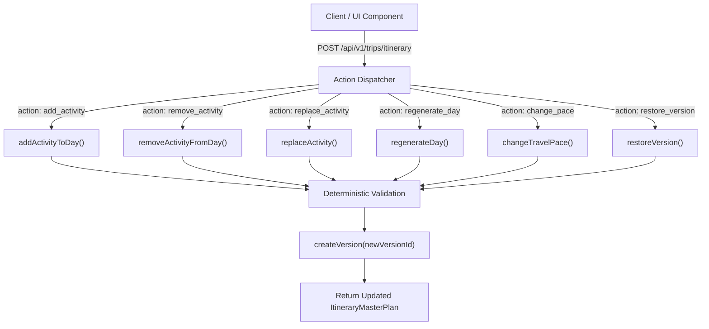

# BharatYatra AI 2.0 — Dynamic Customization Workflow & Interaction API

## 1. Overview

BharatYatra's itineraries are not static PDF documents; they are dynamic, stateful entities that users can freely customize in real time. The **Universal Dynamic Customization API** allows travelers to add attractions, remove unwanted items, swap activities, regenerate entire days with fresh themes, alter travel pace, and undo changes back to any prior version.

Every customization action executes deterministically through `DynamicItineraryEngine`, recalculates daily active hours, validates constraints, and writes an immutable version snapshot into `versionHistory`.

---

## 2. API Endpoint Specification

All dynamic customizations are exposed over REST via:
- Primary: `POST /api/v1/trips/itinerary`
- Compatibility Alias: `POST /api/trips/itinerary`

### Supported Customization Actions:



---

## 3. Action Payloads & Usage Examples

### Action 1: Add Activity (`add_activity`)
Inserts a new verified or custom activity into a designated day and slot (morning, afternoon, or evening).
```json
{
  "action": "add_activity",
  "plan": { /* Current ItineraryMasterPlan */ },
  "dayNumber": 2,
  "slot": "evening",
  "activity": {
    "id": "act_custom_sunset",
    "activityId": "custom_sunset_walk",
    "destinationId": "Dwarka",
    "name": "Sunset Point & Beach Walk",
    "displayName": "Arabian Sea Sunset Stroll",
    "location": "Dwarka",
    "state": "Gujarat",
    "startTime": "17:30",
    "endTime": "19:00",
    "durationMinutes": 90,
    "category": "Nature & Relaxation",
    "estimatedCostInr": 0,
    "priority": "recommended",
    "reason": "Scenic evening walk overlooking the Dwarka lighthouse",
    "openingHours": { "open": "06:00", "close": "20:00", "closedDays": [] },
    "entryFeeStatus": "free",
    "bookingRequired": false,
    "travelDistanceFromPrevKm: 2.0,
    "travelTimeFromPrevMinutes: 10,
    "suitabilityInterests": ["Nature", "Relaxation"],
    "accessibility": { "wheelchairAccessible": true, "seniorFriendly": true },
    "evidenceStatus": "USER_CUSTOM"
  }
}
```

### Action 2: Remove Activity (`remove_activity`)
Removes an activity by ID, shifts subsequent activities, and recalculates active hours for the day.
```json
{
  "action": "remove_activity",
  "plan": { /* Current ItineraryMasterPlan */ },
  "dayNumber": 2,
  "activityId": "act_custom_sunset"
}
```

### Action 3: Replace Activity (`replace_activity`)
Swaps an existing activity for a new attraction without altering the surrounding timeline.
```json
{
  "action": "replace_activity",
  "plan": { /* Current ItineraryMasterPlan */ },
  "dayNumber": 2,
  "oldActivityId": "act-2-JAI_JANTAR_MANTAR",
  "newActivity": {
    "id": "act-2-JAI_CITY_PALACE",
    "activityId": "JAI_CITY_PALACE",
    "destinationId": "Jaipur",
    "name": "City Palace of Jaipur & Museum",
    "displayName": "City Palace Complex & Mubarak Mahal",
    "location": "Jaipur",
    "state": "Rajasthan",
    "startTime": "14:30",
    "endTime": "16:30",
    "durationMinutes": 120,
    "category": "Royal Palaces & Architecture",
    "estimatedCostInr": 300,
    "priority": "must-do",
    "reason": "Replaced user selection with royal museum tour",
    "openingHours": { "open": "09:30", "close": "17:00", "closedDays": [] },
    "entryFeeStatus": "verified_fee",
    "bookingRequired": false,
    "travelDistanceFromPrevKm": 1.5,
    "travelTimeFromPrevMinutes": 8,
    "suitabilityInterests": ["History", "Heritage", "Culture"],
    "accessibility": { "wheelchairAccessible": true, "seniorFriendly": true },
    "evidenceStatus": "USER_CUSTOM"
  }
}
```

### Action 4: Regenerate Day (`regenerate_day`)
Wipes and reschedules a single day with unvisited attractions from the destination registry.
```json
{
  "action": "regenerate_day",
  "plan": { /* Current ItineraryMasterPlan */ },
  "dayNumber": 3
}
```

### Action 5: Change Travel Pace (`change_pace`)
Re-synthesizes the entire trip schedule conforming to new density constraints (`relaxed`, `balanced`, or `active`).
```json
{
  "action": "change_pace",
  "plan": { /* Current ItineraryMasterPlan */ },
  "newPace": "relaxed"
}
```

### Action 6: Restore Version (`restore_version`)
Restores an exact prior version from history.
```json
{
  "action": "restore_version",
  "plan": { /* Current ItineraryMasterPlan */ },
  "targetVersionId": "v1.0.0"
}
```

---

## 4. Frontend Component Integration

The client-side component `DynamicItineraryPlanner.tsx` provides full graphical controls for these operations:
1. **Pace Switcher Pills**: Instant switching between Relaxed, Balanced, and Active modes.
2. **Day Tabs**: Horizontal scrollable day selector displaying day numbers, locations, and active hours badges.
3. **Slot Action Buttons**:
   - `+ Add Activity` opens modal showing all unused verified attractions in that city.
   - `Replace` button swaps out the item with a replacement card.
   - `Trash` icon removes the activity with instant timeline re-rendering.
4. **History Drawer**: Shows version list with author (`AI_GENERATOR`, `USER_CUSTOMIZATION`, `REVERT_ACTION`), timestamp, change summary, and a single-click "Restore" button.
