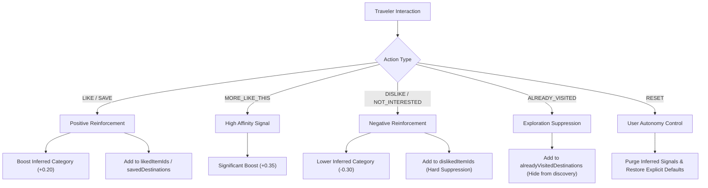

# BharatYatra AI 2.0 — Feedback & Learning Interaction Workflow

## 1. Overview

The BharatYatra Personalization Engine improves continuously as travelers interact with recommendations. Rather than requiring users to repeatedly fill out static questionnaires, the system learns from intuitive UI actions: liking, bookmarking, disliking, or hiding recommendations.

All feedback events flow through a deterministic, auditable interaction pipeline exposed over REST via:
- `POST /api/v1/trips/recommendations/feedback`
- `POST /api/trips/recommendations/feedback` (compatibility alias)

---

## 2. Feedback Action Taxonomy



---

## 3. Feedback Processing Lifecycle

1. **Payload Ingestion**:
   ```json
   {
     "userId": "user_1730279012",
     "itemType": "destination",
     "itemId": "Somnath",
     "action": "LIKE",
     "context": { "category": "religious" }
   }
   ```
2. **Deduplication Check**:
   The engine checks `interactionHistory` for identical events on `itemId` within the last 5,000 milliseconds. Rapid accidental clicks are filtered out.
3. **Bucket State Transition**:
   - `LIKE`: Adds `itemId` to `likedItemIds`. If `itemId` was previously in `dislikedItemIds`, it is automatically removed.
   - `DISLIKE`: Adds `itemId` to `dislikedItemIds`. If `itemId` was previously in `likedItemIds` or `savedDestinations`, it is cleanly stripped out.
   - `SAVE`: Adds `itemId` to `savedDestinations`.
   - `ALREADY_VISITED`: Adds `itemId` to `alreadyVisitedDestinations`. Future destination queries filter out this destination from the discovery carousel.
4. **Inferred Weight Modulation**:
   If `context.category` is provided, `inferredInterests[category]` is updated:
   $$W_{\text{new}} = \max\left(0.0, \min\left(1.0, W_{\text{current}} + \Delta\right)\right)$$
5. **Audit Logging**:
   The event is appended to `profile.interactionHistory` with an ISO timestamp.

---

## 4. Reset Personalization Workflow

Travelers retain complete sovereignty over their data. When a user changes travel style (e.g. from solo backpacking to a family vacation with elderly parents) or simply wants a clean slate:

### Client Request:
```json
POST /api/v1/trips/recommendations/feedback
{
  "userId": "user_1730279012",
  "action": "RESET_PERSONALIZATION"
}
```

### Server Execution:
1. Clears `inferredInterests = {}`.
2. Empties `likedItemIds = []`.
3. Empties `dislikedItemIds = []`.
4. Empties `notInterestedIds = []`.
5. Empties `interactionHistory = []`.
6. Preserves `explicitProfile` (the user's explicit profile selections remain intact).
7. Returns HTTP 200 with refreshed clean baseline recommendations.
