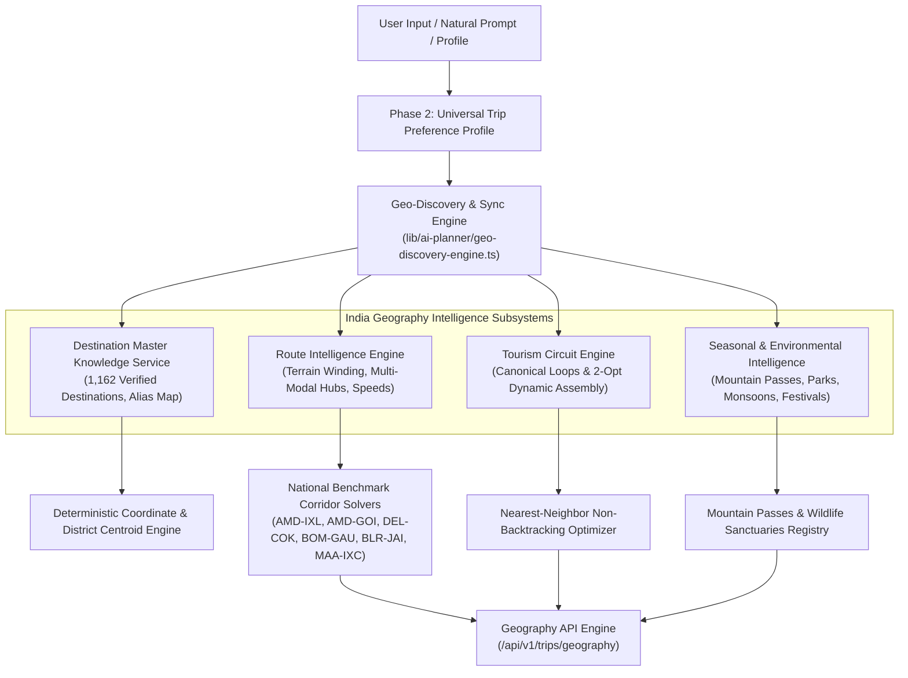

# BharatYatra AI 2.0 — India Geography & Destination Intelligence Architecture
## Technical Architecture Blueprint & Geospatial Systems Specification

**Document Version:** 2.0.0  
**Status:** IMPLEMENTED & PRODUCTION VERIFIED  
**Author:** Principal Geospatial AI Architect & Travel Systems Engineering Team  
**Repository Path:** [`lib/ai-planner/destination-master-service.ts`](file:///c:/Users/Pandya%20Kaushal/Desktop/BhartYatra_5/lib/ai-planner/destination-master-service.ts), [`lib/ai-planner/route-intelligence-engine.ts`](file:///c:/Users/Pandya%20Kaushal/Desktop/BhartYatra_5/lib/ai-planner/route-intelligence-engine.ts), [`lib/ai-planner/seasonal-intelligence.ts`](file:///c:/Users/Pandya%20Kaushal/Desktop/BhartYatra_5/lib/ai-planner/seasonal-intelligence.ts), [`lib/ai-planner/tourism-circuit-engine.ts`](file:///c:/Users/Pandya%20Kaushal/Desktop/BhartYatra_5/lib/ai-planner/tourism-circuit-engine.ts), [`lib/ai-planner/geo-discovery-engine.ts`](file:///c:/Users/Pandya%20Kaushal/Desktop/BhartYatra_5/lib/ai-planner/geo-discovery-engine.ts)

---

### Executive Summary

The **BharatYatra India Geography & Destination Intelligence Engine (Phase 3)** upgrades BharatYatra's travel intelligence from static city lookups into an authoritative, multi-layered geographic knowledge platform. Covering all **28 Indian States and 8 Union Territories**, it manages **1,162 verified destinations**, incorporates terrain-aware road speeds, distinguishes geographic straight-line distance from real-world winding routes, detects mountain pass closures, enforces high-altitude acclimatization protocols ($\ge 2,800$m), and evaluates practical multi-modal connectivity across air, rail, road, and ferry hubs.

---

### 1. Architectural Layers & File Directory

| Layer | Implementation File | Key Role | Core Exports |
|---|---|---|---|
| **1. Knowledge Master** | [`lib/ai-planner/destination-master-service.ts`](file:///c:/Users/Pandya%20Kaushal/Desktop/BhartYatra_5/lib/ai-planner/destination-master-service.ts) | In-memory indexing of 1,162 verified destinations, alias mapping, coordinate bounds validation | `findDestinationMaster()`, `searchDestinations()`, `getDestinationsByState()`, `getNearbyDestinations()`, `getAllStatesCoverageSummary()`, `ALIAS_MAP`, `ALL_36_STATES_AND_UTS` |
| **2. Route Intelligence** | [`lib/ai-planner/route-intelligence-engine.ts`](file:///c:/Users/Pandya%20Kaushal/Desktop/BhartYatra_5/lib/ai-planner/route-intelligence-engine.ts) | Terrain winding factors, average speeds, multi-modal modal options, 6 benchmark corridors | `evaluateRouteFeasibility()`, `evaluateCoVisitFeasibility()`, `NATIONAL_BENCHMARK_CORRIDORS`, `TERRAIN_DETOUR_MULTIPLIERS`, `TERRAIN_AVERAGE_SPEED_KMH` |
| **3. Seasonal Intelligence** | [`lib/ai-planner/seasonal-intelligence.ts`](file:///c:/Users/Pandya%20Kaushal/Desktop/BhartYatra_5/lib/ai-planner/seasonal-intelligence.ts) | Mountain pass closures, wildlife breeding closures, monsoon warnings, extreme heat, festivals | `evaluateSeasonalSuitability()`, `MOUNTAIN_PASSES_REGISTRY`, `WILDLIFE_PARKS_REGISTRY`, `CULTURAL_FESTIVALS_CALENDAR` |
| **4. Circuit Engine** | [`lib/ai-planner/tourism-circuit-engine.ts`](file:///c:/Users/Pandya%20Kaushal/Desktop/BhartYatra_5/lib/ai-planner/tourism-circuit-engine.ts) | 12 curated canonical tourism circuits + dynamic nearest-neighbor 2-opt sequence generator | `CANONICAL_CIRCUITS`, `generateDynamicCircuit()` |
| **5. Discovery & Sync** | [`lib/ai-planner/geo-discovery-engine.ts`](file:///c:/Users/Pandya%20Kaushal/Desktop/BhartYatra_5/lib/ai-planner/geo-discovery-engine.ts) | Intelligent recommendation based on origin, duration, budget, month; Phase 2 Profile sync | `discoverDestinations()`, `syncPreferencesWithGeography()` |
| **6. Integration Facade** | [`lib/ai-planner/destination-intelligence.ts`](file:///c:/Users/Pandya%20Kaushal/Desktop/BhartYatra_5/lib/ai-planner/destination-intelligence.ts) | Central facade re-exporting all subsystems with backward compatibility for existing planners | `resolveDestinationCoordinates()`, `getDestinationsForTarget()`, `calculateHaversineDistanceKm()` |
| **7. REST API Endpoints** | [`app/api/v1/trips/geography/route.ts`](file:///c:/Users/Pandya%20Kaushal/Desktop/BhartYatra_5/app/api/v1/trips/geography/route.ts) | Unified JSON API supporting search, route feasibility, seasonal check, circuits, and sync | `GET`, `POST` (search, resolve, route, seasonal, corridor, dynamic-circuit, discovery, sync) |

---

### 2. Terrain-Aware Routing vs Straight-Line Fallacies

A primary architectural upgrade in Phase 3 is the strict elimination of Euclidean straight-line distance assumptions for travel schedules. Indian geography exhibits extreme elevation gradients, from sea level in coastal Kerala/Goa to 5,359m at Khardung La in Ladakh:

$$\text{Actual Route Distance} = \text{Haversine Distance} \times \text{Terrain Detour Multiplier}$$

$$\text{Estimated Travel Duration (hours)} = \frac{\text{Actual Route Distance}}{\text{Terrain Average Speed (km/h)}} + \text{Mandatory Rest Buffer}$$

#### Terrain Dynamics Matrix

| Terrain Type | Winding Multiplier | Average Road Speed | Rest Buffer Frequency | Representative Regions |
|---|---|---|---|---|
| **Plains** | $1.20\times$ | 60 km/h (Expressways up to 90 km/h) | 1.5h per 400 km | Gujarat, Rajasthan (NH-48), UP (Yamuna/Purvanchal), Punjab, Haryana |
| **Coastal / Ghats** | $1.35\times$ | 45 km/h | 1.0h per 250 km | Western Ghats (Munnar, Coorg), Konkan (Goa, Ratnagiri), Odisha Coast |
| **Hills / Mountain** | $1.65\times$ | 30 km/h | 1.0h per 150 km | Himachal Pradesh (Shimla, Manali), Uttarakhand (Rishikesh, Nainital), Meghalaya (Shillong), Sikkim |
| **High-Altitude Pass** | $1.85\times$ | 24 km/h | 1.5h per 100 km | Ladakh (Leh-Khardung La-Nubra-Pangong), Spiti Valley (Kunzum Pass), Tawang (Sela Pass) |
| **Island** | $1.10\times$ (internal) | 35 km/h | Inter-island ferry | Andaman & Nicobar (Port Blair, Havelock, Neil), Lakshadweep |

---

### 3. High-Altitude Medical Safety Protocol

Any destination located at or above **2,800 meters** triggers an automatic system constraint:
1. **Mandatory 48-Hour Acclimatization**: In Leh (3,524m), Nubra Valley (3,048m), or Spiti (3,800m), Day 1 and Day 2 are restricted to low-exertion orientation and hydration. High-pass ascents (Khardung La 5,359m, Chang La 5,360m) are prohibited before Day 3.
2. **Minimum Duration Enforcement**: When a user selects Ladakh or Spiti with a trip duration under 5 days, the engine flags a medical safety warning (`recommendedMinDays: 6`) explaining the necessity of acclimatization.
3. **Protected Area Permits (ILP/PAP)**: Automatically attaches required permits (e.g., Ladakh Inner Line Permit, Arunachal Pradesh ILP, Lakshadweep Entry Permit) to the trip itinerary and budget.

---

### 4. Integration with Phase 2 Universal Trip Preferences

The Geography Engine links directly with the authoritative `TripPreferenceProfile`:
- **Destination Invalidation**: When `profile.identity.destination` changes, the engine recalculates coordinates, functional airport/rail hubs, permits, and acclimatization flags.
- **Seasonal Invalidation**: When `profile.identity.startDate` shifts, the engine re-evaluates mountain pass open/closed status, monsoon flood risks, and heat advisories.
- **Duration Adjustment**: When `profile.identity.tripDurationDays` is updated, the dynamic circuit generator recomputes viable sequential stops within daily driving time limits without touching unrelated food, hotel, or budget locked preferences.
