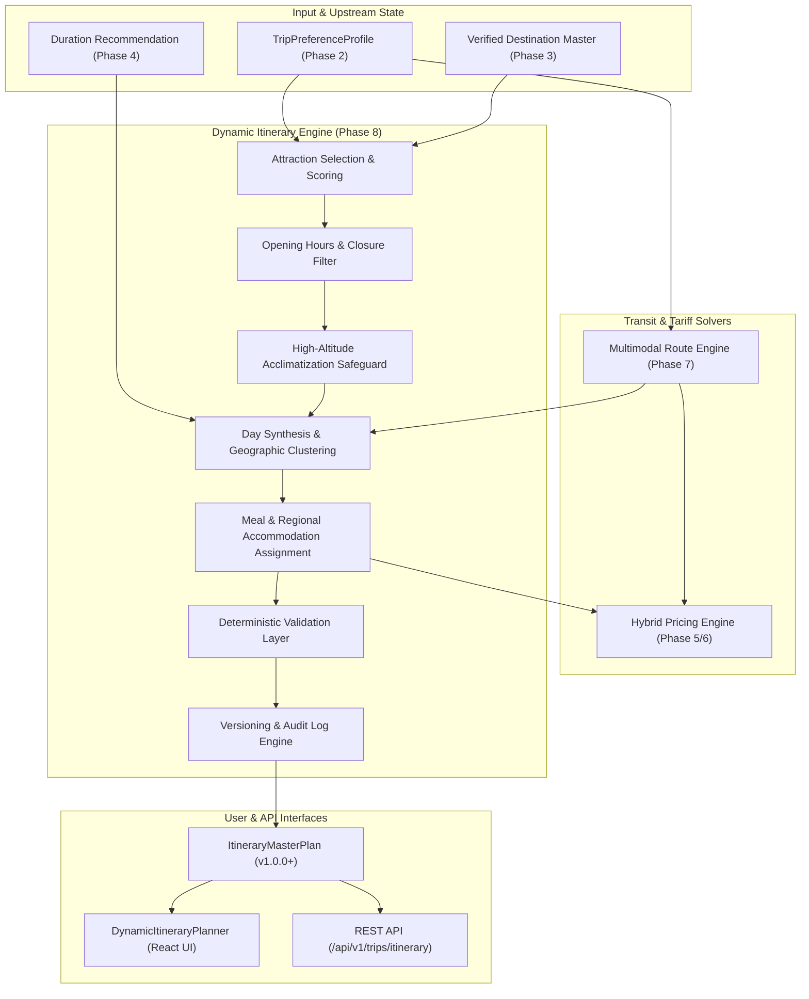

# BharatYatra AI 2.0 — Intelligent Itinerary Generation & Dynamic Trip Planning Engine Architecture

## 1. Executive Summary

The **BharatYatra Intelligent Itinerary Generation & Dynamic Trip Planning Engine** (Phase 8) represents the synthesizing apex of the BharatYatra AI 2.0 architecture. While previous phases established isolated intelligence layers—Universal Preferences (Phase 2), India Geography (Phase 3), Trip Duration (Phase 4), Hybrid Pricing (Phase 5), Pricing Calibration (Phase 6), and Multimodal Route Feasibility (Phase 7)—the Itinerary Engine integrates these deterministic models into actionable, chronologically sequenced, and dynamically customizable day-by-day travel master plans across all 28 Indian States and 8 Union Territories.

Unlike generative AI chatbots that hallucinate travel times, schedule closed attractions, or invent arbitrary costs, the BharatYatra Phase 8 engine enforces a strict **19-Step Deterministic Pipeline** that guarantees mathematical feasibility, zero price fabrication, temporal realism, and complete user-preference preservation.

---

## 2. Architectural Diagram

---

## 3. The 19-Step Itinerary Generation Pipeline

Every itinerary generated by `dynamicItineraryEngine.generateItinerary()` undergoes nineteen deterministic execution steps:

| Step # | Execution Phase | Description | Source / Module |
|---|---|---|---|
| **Step 1** | Identity Extraction | Extracts user origin, primary/secondary destinations, travel dates, party composition, and travel pace. | `TripPreferenceProfile` |
| **Step 2** | Destination Resolution | Canonicalizes destination names and resolves geographic coordinates, terrain types, and administrative boundaries. | `findDestinationMaster` |
| **Step 3** | High-Altitude Detection | Analyzes destination elevation ($> 2,800\text{m}$) to activate mandatory Acute Mountain Sickness (AMS) protocols. | `destMaster.altitudeMeters` |
| **Step 4** | Duration Synchronization | Resolves or calculates optimal days based on corridor travel physics and sightseeing requirements. | `calculateIntelligentDurations` |
| **Step 5** | Multimodal Route Discovery | Solves optimal outbound and return journeys across train, air, cab, and ferry networks. | `multimodalRouteEngine` |
| **Step 6** | Attraction Retrieval | Retrieves verified attraction candidates from the India-wide catalog. | `VERIFIED_ATTRACTIONS_REGISTRY` |
| **Step 7** | Prohibited Exclusion | Strips out any user-prohibited or blacklisted attractions from `excludedAttractions`. | Preference Engine |
| **Step 8** | Multi-Factor Scoring | Ranks attractions based on user interest alignment, must-visit priority, senior-friendliness, and time value. | Dynamic Scorer |
| **Step 9** | Geographic Clustering | Clusters attractions by nearest-neighbor distance to eradicate zigzag routing and urban transit fatigue. | Geospatial Clustering |
| **Step 10** | Opening Hours Alignment | Cross-references scheduled day-of-week against closed days (e.g. Taj Mahal on Fridays, Akshardham on Mondays). | `closedDays` Filter |
| **Step 11** | Acclimatization Insertion | Automatically reserves Day 1 afternoon/evening and Day 2 morning for mandatory rest in high-altitude zones. | AMS Safety Layer |
| **Step 12** | Slot Allocation | Assigns morning, afternoon, and evening activities conforming to daily active hour limits ($\le 11\text{h}$). | Day Synthesis |
| **Step 13** | Meal & Dining Plan | Assigns authentic regional meal recommendations with verified breakfast, lunch, and dinner pricing. | Cultural Food Engine |
| **Step 14** | Overnight Accommodation | Links geo-matched hotel/resort recommendations matching user tier and proximity requirements. | Accommodation Engine |
| **Step 15** | Hybrid Cost Computation | Executes Phase 5/6 pricing models across Budget, Standard, Premium, and Luxury tiers. | `computeHybridTripPricing` |
| **Step 16** | Deterministic Validation | Runs 7-dimension validation checks (continuity, hours, duplicates, locks, budgets). | `validateItineraryPlan` |
| **Step 17** | Explanations Generation | Synthesizes clear human rationale explaining pace, transit choices, pricing transparency, and health advisories. | Rationale Engine |
| **Step 18** | Version 1.0.0 Packaging | Packages complete day schedule, pricing breakdown, and audit metadata into immutable initial master version. | `ItineraryVersion` |
| **Step 19** | Master Plan Assembly | Emits unified `ItineraryMasterPlan` with full customization and rollback capabilities. | Engine Output |

---

## 4. Upstream Integration Matrix

| Upstream Engine | Phase | Integration Touchpoint | Fallback / Safeguard |
|---|---|---|---|
| **Universal Trip Preferences** | Phase 2 | Consumes `TripPreferenceProfile`, enforces locked keys (`lockedKeys`), respects excluded/preferred attractions. | Default Ahmedabad-based profile with balanced pace. |
| **India Geography Intelligence** | Phase 3 | Reads `destinations-master.json`, coordinates, states, terrain types, and high-altitude flags. | Safe canonical name lookup with Gujarat/Delhi fallbacks. |
| **Trip Duration Recommendation** | Phase 4 | Queries `calculateIntelligentDurations` when trip days are unspecified by user. | 4-day default for standard regional corridors. |
| **Hybrid Pricing Engine** | Phase 5 | Calculates 4-tier cost models (Budget, Standard, Premium, Luxury) based on verified transport and hotel benchmark tariffs. | Failsafe baseline pricing per passenger-kilometer. |
| **Pricing Calibration Engine** | Phase 6 | Ensures zero budget fabrication and verifies realistic Indian travel price boundaries. | Variance checks against state-level benchmark datasets. |
| **Multimodal Route Intelligence** | Phase 7 | Injects multimodal journey legs, transfer buffers, and feasibility classifications (`FEASIBLE`, `FEASIBLE_WITH_CONDITIONS`). | Direct road/train fallback with realistic duration buffers. |

---

## 5. Architectural Quality Attributes

1. **Zero Price Hallucination**: Every ticket, meal, transport leg, and hotel night is calculated deterministically from calibrated benchmarks.
2. **Deterministic Reproducibility**: Given the same `TripPreferenceProfile` and start date, the engine produces the exact same schedule and cost breakdown.
3. **Temporal Feasibility**: Strict caps prevent human exhaustion (Arrival/Departure days $\le 8.5\text{h}$, Exploration days $\le 11.5\text{h}$).
4. **State Immutability**: All edits, additions, deletions, and pace alterations create branch-free, audit-trailed version snapshots (`v1.0.0` $\rightarrow$ `v1.1.0` $\rightarrow$ `v1.2.0`).
