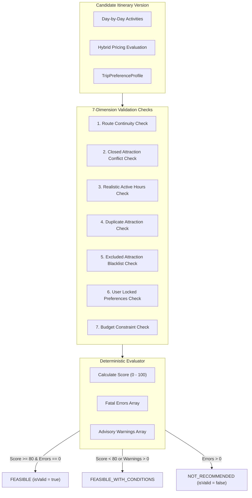

# BharatYatra AI 2.0 — Itinerary Validation Rules & Deterministic Feasibility Layer

## 1. Validation Architecture

To eliminate hallucinated travel plans, BharatYatra implements a strict **7-Dimension Deterministic Validation Layer** (`validateItineraryPlan`). Before any itinerary plan is returned to a user or persisted to database, it must pass through this evaluation suite.

---

## 2. The 7 Validation Checks

### Check 1: Route Continuity (`routeContinuity`)
- **Rule**: Every day's starting location must equal the previous day's ending location. No "teleportation" gaps between cities are permitted.
- **Enforcement**:
  $$\text{Day}[i].\text{startLocation} == \text{Day}[i-1].\text{endLocation} \quad \forall i \in [2, N]$$
- **Severity**: **FATAL ERROR** if broken.

### Check 2: Closed Attraction Conflict (`closedAttractionsAvoided`)
- **Rule**: No attraction may be scheduled on a day when it is officially closed by statutory authority (e.g. Taj Mahal on Fridays, Akshardham on Mondays).
- **Enforcement**: Checks `attr.closedDays.includes(dayOfWeek)`.
- **Severity**: **FATAL ERROR** if a closed attraction is scheduled.

### Check 3: Realistic Active Hours (`realisticActiveHours`)
- **Rule**: Total active hours (sightseeing duration + transit time) must not exceed human physical comfort limits.
  - Arrival Day (Day 1): $\le 8.5\text{ hours}$.
  - Full Exploration Days: $\le 11.5\text{ hours}$.
  - Departure Day (Day N): $\le 8.5\text{ hours}$.
  - High-Altitude Days ($\ge 2,800\text{m}$): Day 1 $\le 4.5\text{h}$, Day 2 $\le 6.0\text{h}$.
- **Severity**: **WARNING** (triggers fatigue advisory, reduces feasibility score by 8 points per infraction).

### Check 4: No Duplicate Attractions (`noDuplicateAttractions`)
- **Rule**: An attraction cannot be scheduled more than once across the entire journey unless it is a transit hub or hotel stay.
- **Enforcement**: Unique set of `activityId` excluding `ACT_AMS_REST` and `ACT_TR_*`.
- **Severity**: **WARNING** (reduces score by 8 points).

### Check 5: Excluded Attractions Respected (`excludedAttractionsRespected`)
- **Rule**: If a user specified attractions in `preferenceProfile.customization.excludedAttractions`, none of those names may appear in any scheduled activity.
- **Severity**: **FATAL ERROR** if user exclusion is violated.

### Check 6: Locked Preferences Honored (`lockedPreferencesHonored`)
- **Rule**: If a user locked a preference key in Phase 2 (e.g. `lockedKeys: ['transport.preferredTransport']`), the engine cannot alter or override that selection during itinerary synthesis.
- **Severity**: **FATAL ERROR** if a locked preference is changed without explicit user unlock.

### Check 7: Budget Bounds (`budgetWithinBounds`)
- **Rule**: If a user specified a hard total budget (`budget.totalBudget`), the recommended tier cost cannot exceed $125\%$ of the budget without generating an explicit deficit warning.
- **Severity**: **WARNING** (triggers budget shortfall advisory).

---

## 3. Scoring Function

The overall feasibility score ($0 - 100$) is computed deterministically:

$$\text{Score} = \max\left(40, 100 - (25 \times \text{ErrorCount}) - (8 \times \text{WarningCount})\right)$$

### Decision Thresholds:
- **Score $\ge 85$ and $\text{ErrorCount} == 0$**: `FEASIBLE` (Green badge). Itinerary is mathematically validated and ready for instant booking.
- **$70 \le \text{Score} < 85$ and $\text{ErrorCount} == 0$**: `FEASIBLE_WITH_CONDITIONS` (Amber badge). Itinerary has minor pace or budget considerations noted in explanations.
- **$\text{ErrorCount} > 0$ or $\text{Score} < 70$**: `NOT_RECOMMENDED` (Red badge). Engine automatically invokes rescheduling or alerts user.
