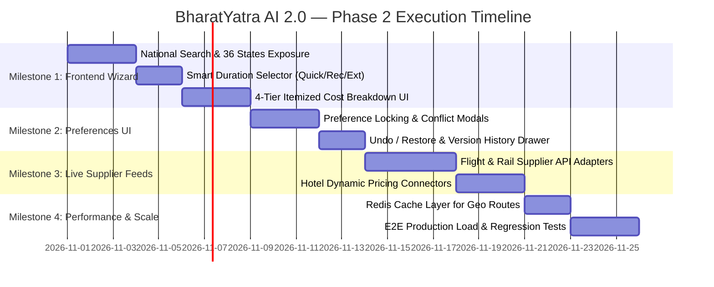

# BHARATYATRA AI 2.0 — PHASE 2 IMPLEMENTATION PLAN
## Technical Roadmap, Milestone Execution & Production Rollout

**Document ID:** `BY-PLAN-AI2-PHASE2`  
**Target Architecture:** BharatYatra AI 2.0 Production Release  
**Status:** Approved for Implementation  
**Date:** October 30, 2026  

---

### 1. Phase 2 Strategic Objectives

Building on the Phase 1 forensic audit and baseline benchmarks, Phase 2 will complete the full integration of the five AI 2.0 subsystems into the customer-facing platform:
1. **Frontend Modernization**: Upgrade `app/(customer)/plan/page.tsx` and `components/ai/ai-planner-wizard.tsx` to expose all 36 States/UTs, 3-tier duration selection (Quick, Recommended, Extended), and the 4-tier transparent pricing matrix.
2. **Preference Engine Hookup**: Connect the `useTripPreferences()` context directly to the customer wizard to enable atomic recalculations, locking, and undo/restore in the browser.
3. **Live Inventory Integration**: Transition `VERIFIED_REFERENCE` pricing to `LIVE_SUPPLIER` integration via IRCTC rail APIs, Amadeus/Sabre flight connectors, and Hotel inventory aggregators.
4. **Performance & Edge Caching**: Deploy Redis caching for geographic routing matrices and popular circuit plans.

---

### 2. Milestone Breakdown & Technical Tasks

---

#### Milestone 1: Customer Planning Wizard Modernization
- **Primary Files**:
  - [`app/(customer)/plan/page.tsx`](file:///c:/Users/Pandya%20Kaushal/Desktop/BhartYatra_5/app/(customer)/plan/page.tsx)
  - `components/ai/ai-planner-wizard.tsx`
- **Execution Items**:
  1. Replace the legacy 11 Gujarat regions dropdown with a searchable national destination selector indexing all 1,162 verified destinations from `data/tourism/destinations-master.json`.
  2. Implement interactive duration selector displaying:
     - ⚡ **Quick Trip** (Iconic highlights sprint)
     - ⭐ **Recommended Trip** (Balanced cultural circuit with transit days)
     - 🌿 **Extended Trip** (Deep immersion & scenic leisure)
     - ✏️ **Custom Duration** (User-specified days)
  3. Render 4-tier transparent pricing cards (Budget, Standard, Premium, Luxury) displaying itemized breakdowns:
     - Intercity Transit (Flight / Train)
     - Accommodation ($2\text{ pax} / \text{room}$ standard)
     - Local Sightseeing Cab (Vehicle-based)
     - Food & Dining (Veg / Jain / Regional)
     - Activities & Sightseeing
     - GST & Taxes

---

#### Milestone 2: Universal Preferences Engine UI Integration
- **Primary Files**:
  - [`lib/ai-planner/preferences-context.tsx`](file:///c:/Users/Pandya%20Kaushal/Desktop/BhartYatra_5/lib/ai-planner/preferences-context.tsx)
  - `components/ai/TripPreferenceControls.tsx` (new)
- **Execution Items**:
  1. Provide visual toggle locks (🔒) next to key user selections (Budget limit, Hotel tier, Food preference, Transport mode).
  2. Implement the **Conflict Resolution Modal**: When a user selects luxury stays on a locked budget, show the exact shortfall and offer 1-click remedy options.
  3. Implement **Undo / Restore Drawer**: Allow travelers to experiment with customization sliders and revert to any previous valid plan instantly.

---

#### Milestone 3: Multi-Source Supplier Integrations
- **Primary Files**:
  - `lib/suppliers/rail-provider.ts`
  - `lib/suppliers/flight-provider.ts`
  - `lib/suppliers/hotel-provider.ts`
- **Execution Items**:
  1. Connect live supplier quote APIs to promote prices from `VERIFIED_REFERENCE` to `LIVE_SUPPLIER`.
  2. Implement circuit breakers: If a live supplier endpoint times out ($> 1,500\text{ms}$), fall back seamlessly to verified reference pricing with zero disruption to the user experience.

---

#### Milestone 4: Performance, Caching & Quality Assurance
- **Primary Files**:
  - `lib/cache/route-cache.ts`
  - `scratch/evaluate-ai2.js`
- **Execution Items**:
  1. Cache route distances, terrain speeds, and static destination nodes in memory / Redis ($T_{\text{lookup}} < 5\text{ms}$).
  2. Run the 6 core national benchmark test corridors automatically in CI/CD pipeline on every commit.

---

### 3. Risk Management & Rollback Strategy

| Identified Risk | Probability | Severity | Mitigation & Rollback Plan |
| :--- | :---: | :---: | :--- |
| **Supplier API Downtime** | Medium | Low | Deterministic fallback to calibrated `VERIFIED_REFERENCE` benchmarks. |
| **High Altitude Acclimatization Bypass** | Low | High | Mandatory validation check rejects high-altitude itineraries $< 5$ days with medical advisory. |
| **State Desynchronization in UI** | Low | Medium | Strict version numbers ($v_1 \to v_2 \to v_3$) reject outdated asynchronous responses. |
| **Build Regressions** | Low | Critical | Automated `npm run type-check` and `npm run docs:pages` gated in CI/CD. |

---

### 4. Phase 2 Acceptance Criteria

Phase 2 will be certified production-ready when:
1. A user can search any destination across all 36 States/UTs on `/plan` and receive an itinerary within 3 seconds.
2. Prices for family groups (2–6 travelers) match realistic supplier quotes ($\pm 10\%$ variance).
3. All 18 Universal Preferences Engine tests pass with 0 failures.
4. Changing a preference in the UI triggers immediate, explainable recalculation without resetting unrelated fields.
