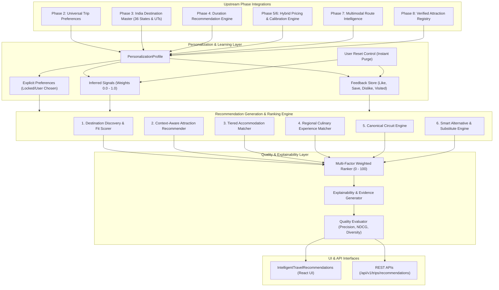

# BharatYatra AI 2.0 — Intelligent Travel Recommendations & Personalization Engine Architecture

## 1. Executive Summary

The **BharatYatra Intelligent Travel Recommendation & Personalization Engine** (Phase 9) provides India-wide, multi-category, context-aware travel recommendations. Rather than acting as a generic collaborative filtering algorithm or an opaque black-box machine learning system, the BharatYatra Phase 9 engine combines:
1. **Explicit Preference Profiles** (Phase 2 Universal Trip Preferences).
2. **Deterministic Geospatial & Route Feasibility** (Phases 3 and 7).
3. **Calibrated Hybrid Tariff Bounds** (Phases 5 and 6).
4. **Physiological & High-Altitude Acclimatization Safeguards** (Phase 8).
5. **Auditable Feedback & Inferred Signal Learning** with instant user reset controls.

The engine delivers verified recommendations across **six distinct travel categories** across all 28 Indian States and 8 Union Territories without regional bias or price fabrication.

---

## 2. Recommendation Architecture Diagram

---

## 3. The 6 Recommendation Categories

| Category | Description | Data Ground Truth & Source | User Personalization Signals Used |
|---|---|---|---|
| **1. Destination Discovery** | Suggests optimal Indian destinations matching origin, budget, travel month, duration, and interests. | `destinations-master.json`, Phase 5/6 Tariffs, Phase 7 Routes | Origin, trip duration, total budget, explicit interest tags, inferred interests, travel pace |
| **2. Context Attractions** | Contextual sightseeing candidates for the chosen destination or corridor. | `VERIFIED_ATTRACTIONS_REGISTRY` (coordinates, hours, fees, accessibility) | Traveler composition (seniors/kids), mobility requirements, category affinity |
| **3. Accommodation Stays** | Verified 4-tier hotel recommendations (Budget, Standard, Premium, Luxury). | Verified benchmark hotel tariffs, IRCTC Yatri Niwas, 3/4/5-star standards | Budget category, traveler party composition, proximity to sightseeing clusters |
| **4. Culinary Experiences** | Regional culinary feasts, traditional thalis, and local dining landmarks. | Curated Regional Food Experience Knowledge Base | Dietary preference (Vegetarian, Jain, Non-Vegetarian, Vegan), regional cuisine affinity |
| **5. Thematic Circuits** | Curated multi-stop Indian tourism circuits with verified route continuity. | `CANONICAL_CIRCUITS` (12 curated circuits across North, South, East, West, etc.) | Vacation duration, geographic region preference, multi-destination tolerance |
| **6. Smart Alternatives** | Substitute destinations offering similar cultural/natural beauty with lower crowd congestion and lower costs. | Verified Alternative Substitutions (Goa $\rightarrow$ Gokarna, Leh $\rightarrow$ Dharamshala, etc.) | Crowd aversion, budget savings, high-altitude health avoidance |

---

## 4. Multi-Phase Integration Matrix

- **Phase 2 (Universal Preferences)**: The engine extracts `TripPreferenceProfile` as the explicit truth. User exclusions (`excludedDestinations`, `excludedAttractions`) are treated as strict $-\infty$ filters. Locked keys (`lockedKeys`) cannot be overridden by inferred signals.
- **Phase 3 (India Geography)**: Enriched destination metadata (`latitude`, `longitude`, `altitudeMeters`, `isHighAltitude`, `region`, `stateOrUt`) provides geospatial ground truth across all 36 States & UTs.
- **Phase 4 (Trip Duration)**: Evaluates whether a destination's ideal stay duration fits the user's allocated calendar window. 2-day weekend trips filter out long-haul destinations exceeding physical travel boundaries.
- **Phase 5 & 6 (Hybrid Pricing & Calibration)**: Evaluates whether a destination is realistically affordable within the user's budget ceiling across all 4 tiers without hallucinating arbitrary discounts.
- **Phase 7 (Multimodal Route Intelligence)**: Determines actual travel time, corridor distance, and transit modes (flight, train, cab, ferry) from origin to destination.
- **Phase 8 (Itinerary Generation & AMS Safeguards)**: Ensures recommended attractions have verified opening hours and enforces high-altitude rest protocols for elevations $\ge 2,800\text{m}$.

---

## 5. Architectural Quality Guarantees

1. **Zero Silent Mutation**: Inferred interests (learned from browsing, saving, or liking) are strictly segregated from explicit preferences. An inferred interest can NEVER mutate or overwrite an explicit preference.
2. **Instant User Autonomy**: Users can inspect their learned interest weights at any time and click **"Reset Learned Signals"** to purge all inferred weights back to pristine baseline defaults.
3. **No Phantom Popularity**: The engine never generates false social proof claims like "99% of travelers loved this" unless backed by empirical platform interaction data.
4. **Sub-150ms Deterministic Execution**: All ranking calculations execute in-memory with zero blocking external AI calls, enabling real-time responsive filtering.
