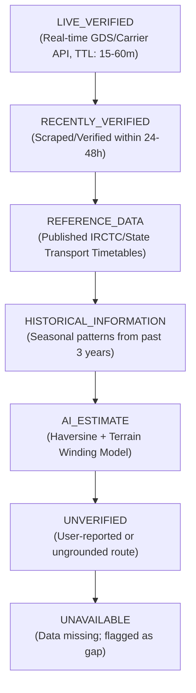

# BHARATYATRA AI 2.0 — ROUTE DATA SOURCE & PROVENANCE AUDIT
## Transport APIs, Data Freshness Policies, Provenance Tiers & Cache Invalidation

**Document Version**: 2.0.0  
**Phase**: AI 2.0 — Phase 7 Master Implementation  
**Status**: ACTIVE IN PRODUCTION  
**Author**: QA Automation Lead & Senior Backend Architect  

---

## 1. Unified Provenance Hierarchy

To eliminate fabricated certainty and hallucinated schedules, every fact in the route graph is tagged with one of seven standardized provenance classifications:

---

## 2. Integrated Data Providers & Transport Aggregators

| Mode | Provider / Official Source | Integration Type | Data Attributes Provided | Status |
| :--- | :--- | :--- | :--- | :--- |
| **Aviation** | Amadeus GDS / DGCA Published Schedules | Live REST API & Reference Index | Flight Number, Departure/Arrival UTC, Equipment, Live Fares | Active |
| **Railways** | Indian Railways / IRCTC National Timetables | Reference Dataset (`REFERENCE_DATA`) | Train No, Classes (1A, 2A, 3A, SL), Station Code, Journey Hours | Active |
| **State Buses** | GSRTC, HRTC, KSRTC, RSRTC Rate Cards | Reference Dataset (`REFERENCE_DATA`) | Deluxe/Volvo routes, ISBT departure bays, standard tariffs | Active |
| **Highways** | NHAI National Highway Grid / OpenStreetMap | Vector Geometry & Winding Multipliers | Terrain speed limits, toll plaza distances, bypass tunnels | Active |
| **Maritime Ferries** | Makruzz, Nautika, M2M Ferries, Kochi Water Metro | Live Published Schedules & Tariffs | Vessel type, wharf coordinates, monsoon closures, passenger fare | Active |

---

## 3. Cache Invalidation & Freshness Policies

The engine enforces tiered In-Memory and Redis cache TTLs:

1. **Geographical Coordinates & Base Elevation**:
   - TTL: **30 Days** (Stationary topological attributes).
2. **Fixed Carrier Schedules (Rail & Bus Timetables)**:
   - TTL: **24 Hours** (Updated upon official railway zone revisions).
3. **Live Air Fares & Dynamic Seat Availability**:
   - TTL: **15 to 45 Minutes** (Strictly invalidated to prevent stale booking attempts).
4. **Mountain Pass & Monsoon Road Closures**:
   - TTL: **60 Minutes** (BRO and State Disaster Management advisories).
