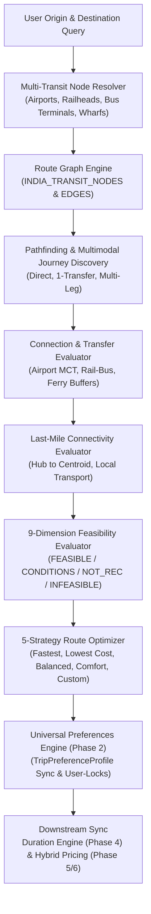

# BHARATYATRA AI 2.0 — MULTIMODAL ROUTE INTELLIGENCE ARCHITECTURE
## End-to-End Technical Architecture, Graph Modeling, Feasibility Solvers & Preference Synchronization

**Document Version**: 2.0.0  
**Phase**: AI 2.0 — Phase 7 Master Implementation  
**Status**: PRODUCTION-READY & ACTIVE  
**Engine Author**: Principal Travel Technology Architect & Geospatial Systems Engineer  

---

## 1. Executive Summary & Architectural Mission

The BharatYatra AI 2.0 Route Intelligence Engine (`lib/ai-planner/route-graph-engine.ts` & `lib/ai-planner/multimodal-route-engine.ts`) upgrades the platform from simple aerial distance approximations into an India-wide, multimodal transit network. Across all **28 Indian States and 8 Union Territories**, the engine discovers multimodal corridors, computes realistic terrain-aware durations, evaluates connection feasibility, guards against unprotected multi-ticket connections, detects seasonal mountain pass and monsoon disruptions, and guarantees last-mile visibility.

---

## 2. Core Subsystem Components

### A. Origin & Destination Resolver
- Resolves colloquial and canonical Indian city/region names to their constituent transit nodes.
- For major multi-hub cities (e.g. Mumbai, Delhi, Ahmedabad, Kochi, Goa), it inspects **all available transit modes** (`airport`, `railway`, `bus-terminal`, `ferry-wharf`) rather than prematurely selecting a single node.
- Handles destination centroids (e.g. `Pangong Tso`, `Dwarkadhish Temple`, `Statue of Unity`, `Munnar Valley`).

### B. Route Graph Engine (`RouteGraphEngine`)
- **Directed, Weighted Graph**: Nodes represent physical interchange stations and geographical centroids.
- **Edges**: Store transport mode (`flight`, `train`, `bus`, `road`, `ferry`, `walking`), service tier (`IndiGo A320`, `Vande Bharat Express`, `HRTC Himsuta Volvo`, `Makruzz Catamaran`), distance (km), active duration (min), 3-tier costs (`budget`, `standard`, `premium`), daily frequency, schedule constraints, seasonal availability masks, and reliability scores.
- **Bilateral Commercial Mirroring**: Automatically mirrors reverse corridors with bidirectional validation.

### C. 9-Dimension Feasibility Evaluator
Independent evaluation across 9 discrete criteria:
1. **Geographical Connectivity**: Continuous corridor validation on national highway, rail, airway, or maritime grids.
2. **Transport Availability**: Active operating scheduled services on the selected corridor.
3. **Connection Feasibility**: Minimum Connection Time (MCT) adherence, terminal transfers, and separate ticket alerts.
4. **Total Travel Duration**: Human endurance boundaries (<36h single-stretch leisure threshold).
5. **Last-Mile Connectivity**: Hub-to-hotel/attraction connectivity and verified local transit modes.
6. **Seasonal Accessibility**: Mountain pass snow blocks (Rohtang, Baralacha La, Zoji La, Khardung La), monsoon landslides, cyclonic ferry suspensions.
7. **User Constraints**: Compliance with user budget tier, preferred transport mode, and mobility requirements.
8. **Schedule Reliability**: Carrier historical on-time and dispatch reliability score.
9. **Data Confidence**: Provenance classification (`LIVE_VERIFIED`, `REFERENCE_DATA`, `AI_ESTIMATE`).

---

## 3. Five Route Optimization Strategies

| Strategy | Optimization Objective | Ideal Persona / Scenario |
| :--- | :--- | :--- |
| **Fastest** | Minimizes total elapsed time (active transit + layovers). Prioritizes direct flights and high-speed rail. | Business travelers, weekend getaways, short vacations. |
| **Lowest Cost** | Minimizes financial outlay using Indian Railways (Sleeper/3AC), state buses (GSRTC, HRTC, KSRTC), and shared feeders. | Backpackers, students, budget family expeditions. |
| **Balanced (Recommended)** | Optimal sweet spot: avoids grueling >20h road drives while keeping costs below 2x lowest cost. | Standard family vacations, cultural circuits. |
| **Comfort-Focused** | Minimizes transfers ($\le 1$), eliminates overnight buses, allocates dedicated private AC cabs and premier air cabins. | Senior citizens, luxury travelers, honeymoon couples. |
| **Custom** | Strictly enforces user-locked choices from `TripPreferenceProfile` (e.g. `transport.preferredTransport = 'train'`). | Travelers with aerophobia, rail enthusiasts, self-drive road trippers. |

---

## 4. Downstream Engine Integration

### Phase 2: Universal Trip Preferences Integration
- If the user modifies their `transport.preferredTransport` from `flight` to `train`, the engine immediately re-runs the pathfinder, updates `identity.tripDurationDays` if rail requires additional transit days, and recalculates transport expenditure in `HybridPricingEngine`.
- **User-Lock Preservation**: If `transport.preferredTransport` is present in `profile.lockedKeys`, the engine will never silently replace the mode with an algorithmically preferred alternative.

### Phase 4: Duration Recommendation Integration
- Passes outbound travel time, return travel time, and mandatory rest/acclimatization buffers (e.g. 48h in Leh at 3,524m) to `DurationCalculationEngine`.
- Differentiates active sightseeing days from pure transit days.

### Phase 5 & 6: Hybrid Pricing Integration
- Supplies actual leg-by-leg transport costs (`baseAmount`, `taxes`, `quantity`, `unitRate`) to `calculateTransportationCost` and `calculateLocalTransportationCost`.
- Confirmed live supplier quotes from GDS/APIs are preserved with 100% financial air-gap.
