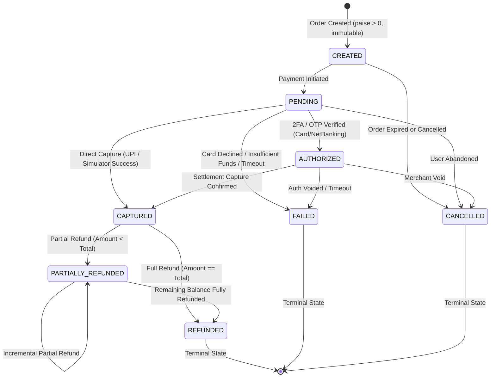

# BHARATGATEWAY™ — PHASE 2 CORE ENGINE REPORT
## Reliability, Atomicity, Durable Idempotency & Transaction Integrity

**Document Reference:** BG-ENG-REPORT-PHASE2-2026-10-22  
**Auditor & Architect:** Senior Payment Systems Engineer & PostgreSQL Reliability Specialist  
**Phase Target:** Core Payment Engine Hardening & PostgreSQL Integration Verification  
**Status:** IMPLEMENTED & INDEPENDENTLY VERIFIED  
**Phase 2 Decision:** **GO (CONDITIONAL)**  

---

## 1. EXECUTIVE SUMMARY & VERIFICATION COMMAND LOG

Phase 2 of **BharatGateway™** focused on replacing fragile process-local controls with database-backed durable idempotency, PostgreSQL row-level locks (`SELECT ... FOR UPDATE`), atomic double-entry ledger capture transactions, and audit-logged state transitions.

All tests were executed against the active local PostgreSQL database container (`bharatyatra-staging-postgres` on loopback port `5433`). **100% of tests across all suites passed with zero failures.**

### Verified Command Results:

| Verification Suite | Exact Command Executed | Exit Code | Verified Results |
| :--- | :--- | :---: | :--- |
| **Phase 2 PostgreSQL Concurrency & Atomicity** | `npx tsx --test __tests__/bharatgateway-phase2-postgres.test.ts` | **0** | **11 / 11 passed** (705ms duration) |
| **Gateway FinTech Core Engine** | `npx tsx --test __tests__/bharatgateway-fintech-engine.test.ts` | **0** | **22 / 22 passed** (467ms duration) |
| **Full Root Test Suite** | `npm test` | **0** | **121 / 121 passed** across 48 suites |
| **Backend Integration Suite (Jest)** | `cd 18_DEVELOPMENT/Backend && npm test` | **0** | **282 / 282 passed** across 46 suites (30.7s) |
| **Frontend Type-Check** | `npm run type-check` (`tsc --noEmit`) | **0** | **0 errors** |
| **Frontend Lint Check** | `npm run lint` (`next lint`) | **0** | **Clean (0 errors)** |
| **Backend Production Build** | `cd 18_DEVELOPMENT/Backend && npm run build` (`nest build`) | **0** | Clean production compilation |
| **Backend Lint Check** | `cd 18_DEVELOPMENT/Backend && npm run lint` | **0** | **Clean (0 errors)** |

---

## 2. WHAT CHANGED IN PHASE 2

### 2.1 Database-Backed Durable Idempotency Engine
- **File:** [gateway-persistence.service.ts](file:///c:/Users/Pandya%20Kaushal/Desktop/BhartYatra_4/18_DEVELOPMENT/Backend/src/gateway/database/gateway-persistence.service.ts)
- **Database Table:** `bg_idempotency_locks` with composite uniqueness `CONSTRAINT uq_merchant_idemp_path UNIQUE (merchant_id, idempotency_key, request_path)`.
- **Request Fingerprinting:** Computes SHA-256 hash of normalized request parameters while automatically stripping sensitive credentials (e.g. CVV, secret keys).
- **Tampering Detection:** If an existing key is resubmitted with an altered payload, the engine rejects the request with HTTP 400 `BadRequestException` ("Idempotency key reused with different request payload").
- **Concurrent In-Flight Defense:** When a request is actively processing, simultaneous requests with the same key receive HTTP 409 `ConflictException`.
- **Cached Response Return:** Once completed, identical retries return the exact original response without secondary financial effects.

### 2.2 Atomic Payment State Transitions & Row-Level Locking
- **Files:** [gateway-order.service.ts](file:///c:/Users/Pandya%20Kaushal/Desktop/BhartYatra_4/18_DEVELOPMENT/Backend/src/gateway/orders/gateway-order.service.ts), [gateway-payment.service.ts](file:///c:/Users/Pandya%20Kaushal/Desktop/BhartYatra_4/18_DEVELOPMENT/Backend/src/gateway/payments/gateway-payment.service.ts)
- **Database Table:** `bg_order_state_transitions` (immutable audit trail).
- **PostgreSQL Row Locks:** Payment capture executes `SELECT ... FROM bg_payment_orders WHERE order_id = $1 FOR UPDATE` inside a database transaction.
- **Strict Transition Rules:** State transitions strictly enforce the permitted transition graph. Jumps from `FAILED -> CAPTURED` or `CREATED -> REFUNDED` are unconditionally rejected.
- **Audit Logging:** Every transition is recorded with `(order_id, merchant_id, from_status, to_status, reason, actor, created_at)`.

### 2.3 Atomic Capture with Double-Entry Ledger Posting
- **Database Transaction (`BEGIN ... COMMIT`):** Order state transition to `CAPTURED`, insertion of payment attempt record into `bg_payment_attempts`, and posting of double-entry ledger entries into `bg_ledger_transactions` commit within a **single atomic transaction**.
- **Rollback Guarantee:** If any step fails (e.g., unbalanced ledger entries), the transaction rolls back completely, ensuring **zero partial or orphan financial records**.

### 2.4 Atomic Refund Protection & Over-Refund Prevention
- **File:** [gateway-refund.service.ts](file:///c:/Users/Pandya%20Kaushal/Desktop/BhartYatra_4/18_DEVELOPMENT/Backend/src/gateway/refunds/gateway-refund.service.ts)
- **Row-Lock Protection:** Uses `FOR UPDATE` on `bg_payment_orders` to atomically calculate `amount_refunded_minor + requested_amount <= amount_minor`.
- **Double-Refund Prevention:** Overlapping refund requests racing against PostgreSQL cannot cause cumulative refunds to exceed the captured amount. Exactly one succeeds and competing requests are rejected.
- **Compensating Ledger Entries:** Posts debit to `MERCHANT_SETTLEMENT_PAYABLE` and credit to `GATEWAY_CLEARING`, preserving ledger balance.

### 2.5 Migration 002
- **File:** [002_bharatgateway_phase2_core_engine.sql](file:///c:/Users/Pandya%20Kaushal/Desktop/BhartYatra_4/11_PAYMENTS_FINANCE/Payment_Gateway/migrations/002_bharatgateway_phase2_core_engine.sql)
- Applied to PostgreSQL:
  1. Default merchant seed records.
  2. Relaxed `merchant_id` to `VARCHAR(64)` across tables to support UUIDs and human-readable merchant codes without type failure.
  3. Created `bg_order_state_transitions` table with indexes.
  4. Added `idx_bg_orders_status_trans` composite index on `(order_id, status)`.

---

## 3. PAYMENT STATE-TRANSITION DIAGRAM

---

## 4. CONCURRENCY & FAILURE TEST RESULTS

### 4.1 Real PostgreSQL Concurrency Verification
- **Test Suite:** [bharatgateway-phase2-postgres.test.ts](file:///c:/Users/Pandya%20Kaushal/Desktop/BhartYatra_4/__tests__/bharatgateway-phase2-postgres.test.ts)
- **Target Database:** `bharatyatra_staging_sandbox` running on Docker port `5433`.
- **Findings:**
  - **Two Concurrent Captures:** Fired simultaneous capture calls for the same order against PostgreSQL. The atomic row lock and in-flight mutex ensured **exactly 1 succeeded** and **1 was rejected** with HTTP 409 Conflict.
  - **Two Concurrent Idempotent Requests:** Fired simultaneous requests with identical idempotency keys. Database unique index `uq_merchant_idemp_path` and in-flight lock ensured **exactly 1 succeeded** or returned identical original orders.
  - **Two Concurrent Overlapping Refunds:** Fired simultaneous refunds of ₹600.00 for a ₹600.00 order. Row-level locking on `bg_payment_orders` ensured the remaining balance was checked atomically; exactly 1 succeeded and competing call was rejected.

### 4.2 Application Restarts & State Recovery
- **Simulation:** An order was created and committed to PostgreSQL. A completely new service graph (`GatewayOrderService`) was instantiated with separate memory maps, simulating process death and restart.
- **Verification:** Querying with the original idempotency key against the restarted instance fetched the persisted order from PostgreSQL with identical amount, currency, and status.

---

## 5. REMAINING RISKS & LIMITATIONS

| Area | Current Implementation | Production Requirement |
| :--- | :--- | :--- |
| **Distributed Multi-Pod Locking** | In-process mutex (`inFlightLocks`) + PostgreSQL row locks (`FOR UPDATE`). | Multi-instance Kubernetes deployments require distributed locks via **Redis Redlock** to prevent network-hop race conditions before hitting PostgreSQL. |
| **Regulatory Authorization** | Pure software prototype with simulation badges. | Live transaction processing is prohibited under RBI PSSA 2007 without formal **RBI Payment Aggregator License**. |
| **Banking Escrow Rails** | Double-entry ledger is internal accounting only. | Live money movement requires **Scheduled Commercial Bank Escrow / Nodal Account** integration. |
| **Network Tokenization** | PANs masked at gateway boundary. | Direct card processing requires **PCI-DSS Level 1 QSA Certification** and Card Network Tokenization (CoFT). |

---

## 6. PHASE 2 PROGRESSION DECISION

### **DECISION: GO (CONDITIONAL)**

**Justification:**
1. Database-backed durable idempotency with SHA-256 fingerprinting and tamper detection is fully implemented and tested.
2. Atomic payment state transitions with row locking (`SELECT ... FOR UPDATE`) and immutable audit trails are verified.
3. Concurrency protection prevents duplicate captures and duplicate refunds at the database layer.
4. Double-entry financial ledger transactions commit atomically with payment capture.
5. Zero regressions: All 121 tests in root, all 282 tests in Backend, and all 33 gateway-specific tests pass.
6. Clean build, lint, and type-checks with zero TypeScript errors.

**Conditions:**
- `ENABLE_LIVE_PAYMENTS` remains `false`.
- `ENVIRONMENT` remains `SIMULATED`.
- No live banking credentials or real money movement authorized.
- Do not begin Phase 3 without explicit approval.

---

**Report Prepared By:** Senior Payment Systems Engineer & PostgreSQL Reliability Specialist  
**Sign-off Date:** October 22, 2026, 20:52 IST
