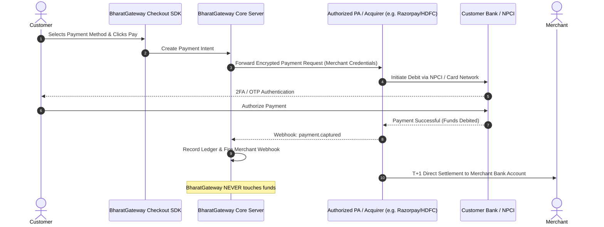
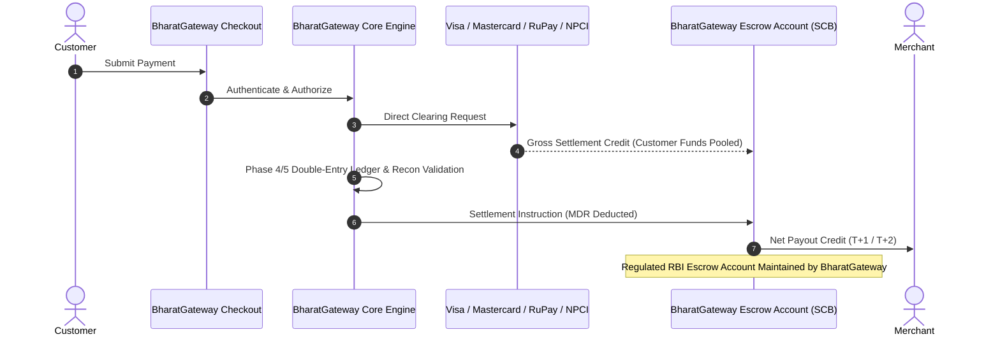
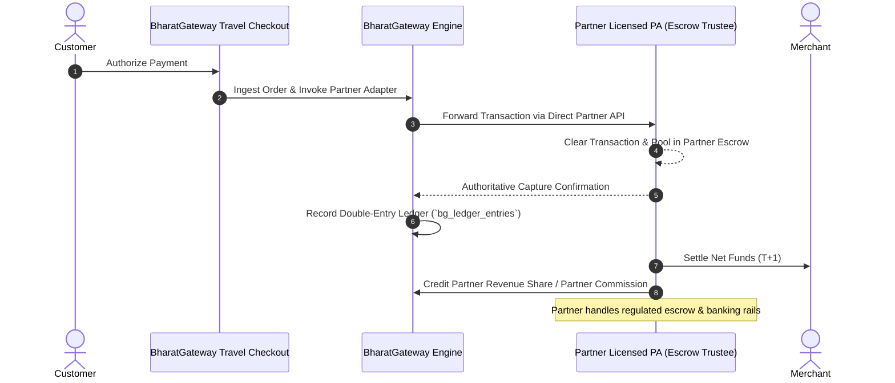

# BHARATGATEWAY™ — PHASE 7 BUSINESS & COMMERCIAL OPERATING MODEL
## Strategic Comparison of Operating Models, Fund Flows, Liability Frameworks & Commercial Unit Economics

- **Document ID:** `BG-PHASE7-BIZ-002`
- **Classification:** Business Strategy, Fund Flow Architecture & Commercial Financial Modeling
- **Environment Status:** `ENVIRONMENT=SIMULATED` | `ENABLE_LIVE_PAYMENTS=false`
- **Target Jurisdiction:** Republic of India (Domestic INR & Cross-Border Travel Invoicing)
- **Status:** Phase 7 Final — Executive Business Architecture

---

## 1. Executive Summary

This document evaluates the commercial, financial, and operational architecture of **BharatGateway™**.

A common fallacy in fintech software engineering is the belief that developing a payment gateway software stack automatically grants the owner the right to earn Merchant Discount Rate (MDR) spreads or process payments independently. In reality:
- **Direct payment aggregation** requires an RBI PA license, ₹15 Cr to ₹25 Cr in net worth, and a dedicated bank escrow account.
- **Card and payment network access** (Visa, Mastercard, RuPay, UPI via NPCI) requires direct sponsorship from a member acquiring bank or an authorized payment aggregator.
- **Interchange, network assessment fees, and banking gateway charges** exist across all models and cannot be eliminated by writing software.

To determine the most viable commercial path for BharatGateway, this report analyzes three distinct operating models:
1. **Model A: Technology Service Provider (TSP) / Pure SaaS Payment Gateway**
2. **Model B: Licensed Direct Online Payment Aggregator (PA-O)**
3. **Model C: Hybrid / White-Label Merchant Facilitator with Licensed Partner**

This analysis concludes that **Model C (Hybrid / Co-Branded Merchant Facilitator)** represents the most strategic and profitable commercial entry point for BharatGateway, enabling immediate market entry in the travel vertical without violating RBI capital mandates, while establishing the transaction volume history required for a future Model B license application.

---

## 2. Comparative Analysis of Operating Models

```
+---------------------------------------------------------------------------------------------------------+
|                                    OPERATING MODEL COMPARISON MATRIX                                    |
+--------------------------+-----------------------+-----------------------+------------------------------+
| Dimension                | Model A: TSP / SaaS   | Model B: Direct PA-O  | Model C: Hybrid Facilitator  |
+--------------------------+-----------------------+-----------------------+------------------------------+
| Legal Classification     | Technology Vendor     | Regulated PA (RBI)    | Aggregator Technology Partner|
| RBI License Required     | No (No handling funds)| Yes (Section 4 PSS)   | No (Partner holds license)   |
| Minimum Net Worth        | None (Standard Co.)   | ₹15 Cr -> ₹25 Cr      | None (Standard Co.)          |
| Custody of Funds         | Never touches money   | BharatGateway Escrow  | Licensed Partner Escrow      |
| Merchant Contract Entity | Merchant <-> Acquirer | Merchant <-> BG       | Tripartite (BG/Partner/Merch)|
| Underwriting / KYC       | Done by Bank/PA       | Done by BG (PMLA/RBI) | Shared / Delegated to Partner|
| Settlement Execution     | Done by Bank/PA       | Done by BG Escrow     | Done by Partner Escrow       |
| Chargeback Financial Loss| Borne by Merchant/PA  | Borne by BG           | Borne by Merchant / Split    |
| Primary Revenue Stream   | Software / API SaaS   | MDR Spread (20-50 bps)| Revenue Share + SaaS Platform|
| Time-to-Market           | Immediate (Weeks)     | 18 - 24 Months        | 1 - 3 Months                 |
+--------------------------+-----------------------+-----------------------+------------------------------+
```

---

## 3. Deep-Dive: Architecture, Fund Flow & Responsibilities by Model

### 3.1. Model A: Technology Service Provider (Pure SaaS Payment Gateway)

In Model A, BharatGateway provides the checkout UI, merchant dashboard, developer APIs, routing engine, and analytics. The merchant brings their own payment processing accounts (e.g., their own Razorpay, Cashfree, Pine Labs, or HDFC Bank merchant account).



#### Responsibility Matrix for Model A:
- **Fund Custody:** Customer funds flow directly from Customer Bank to the Acquirer/PA's Escrow account, and settle directly into the Merchant's current account. BharatGateway never holds or routes money.
- **Merchant Relationship:** Dual relationship. Merchant contracts with BharatGateway for software/analytics, and separately contracts with the acquiring bank/PA for payment clearing.
- **KYC & Due Diligence:** 100% conducted by the licensed acquiring bank or PA. BharatGateway performs standard SaaS account verification only.
- **Refunds & Settlements:** Controlled and executed directly by the licensed acquirer upon API instruction.
- **Disputes & Chargebacks:** Borne entirely between the Merchant and the acquiring bank/PA. Zero financial chargeback exposure for BharatGateway.
- **Records & Consumer Grievances:** The acquiring bank/PA handles Level 1 payment inquiries and RBI Ombudsman escalations. BharatGateway handles software uptime support.
- **Regulatory Implications:** Completely exempt from RBI PSS Act Section 4 licensing. Must comply only with Annex 2 baseline security standards (PCI DSS SAQ A, encryption, ISO 27001).

---

### 3.2. Model B: Licensed Direct Online Payment Aggregator (PA-O)

In Model B, BharatGateway operates as a full-fledged, RBI-licensed Payment Aggregator under the PSS Act, 2007.



#### Responsibility Matrix for Model B:
- **Fund Custody:** BharatGateway opens and controls an official Escrow Account with a Scheduled Commercial Bank. Customer funds are pooled directly inside BharatGateway's escrow.
- **Merchant Relationship:** Owned 100% by BharatGateway. BharatGateway signs the Master Merchant Agreement.
- **KYC & Due Diligence:** BharatGateway must perform statutory Video KYC, PAN verification, GST validation, site inspection, and OFAC/PEP sanctions screening under RBI KYC Master Directions.
- **Refunds & Settlements:** BharatGateway's core engine initiates debits from its escrow account to settle merchants and execute customer refunds.
- **Disputes & Chargebacks:** BharatGateway bears primary financial liability to the card networks and acquiring banks if an insolvent merchant defaults on chargebacks.
- **Records & Consumer Grievances:** BharatGateway must appoint a Principal Nodal Officer, integrate with the RBI Integrated Ombudsman Scheme (CMS portal), and comply with T+1 TAT auto-compensation rules.
- **Regulatory Implications:** Requires full RBI authorization under PSS Act Section 4, ₹15 Cr -> ₹25 Cr net worth, comprehensive annual System Audit Reports (SAR) by CERT-In empanelled auditors, and full PCI DSS SAQ D-SP certification.

---

### 3.3. Model C: Hybrid / White-Label Merchant Facilitator Partner

In Model C, BharatGateway enters into a Strategic Payment Aggregator Partnership Agreement with an existing authorized PA (e.g., Razorpay, Cashfree, BillDesk, or an acquiring bank like HDFC/Axis). 

BharatGateway provides the customized travel-commerce checkout experience, proprietary merchant portal, automated reconciliation, and multi-channel API. The partner PA acts as the regulated settlement and escrow clearinghouse.



#### Responsibility Matrix for Model C:
- **Fund Custody:** Funds reside exclusively in the Partner PA's licensed escrow account. BharatGateway never holds customer balances.
- **Merchant Relationship:** Co-branded relationship. BharatGateway manages the customer interface, travel ecosystem integration, and frontend analytics; the partner PA provides the legal payment clearing agreement.
- **KYC & Due Diligence:** Delegated workflow. BharatGateway collects documentation through its merchant onboarding UI and forwards it via API to the partner PA for authoritative KYC underwriting and verification.
- **Refunds & Settlements:** Triggered by BharatGateway's APIs (`gateway-refund.service.ts`), but settled from the partner PA's escrow.
- **Disputes & Chargebacks:** Chargebacks are deducted by the partner PA from the merchant's rolling reserve or pending settlements. BharatGateway provides dispute submission tools in the dashboard.
- **Records & Consumer Grievances:** Tier 1 support handled by BharatGateway; formal statutory escalations handled by the partner PA.
- **Regulatory Implications:** Highly viable. Operates under the licensed partner's regulatory umbrella. Requires robust data privacy (DPDP Act) and baseline security (PCI DSS SAQ A-EP).

---

## 4. Realistic Commercial & Unit Economics Model

### 4.1. Revenue Streams & Cost Structure

```
+---------------------------------------------------------------------------------------------------------+
|                                    COMMERCIAL REVENUE & COST ANATOMY                                    |
+------------------------------------+--------------------------------------------------------------------+
| Revenue Component                  | Description & Industry Pricing Benchmarks                          |
+------------------------------------+--------------------------------------------------------------------+
| 1. Platform SaaS Subscription      | Monthly subscription for dashboard, API access, and reconciliation |
|                                    | (Tier 1: ₹2,499/mo, Tier 2: ₹9,999/mo, Tier 3: ₹24,999/mo).        |
| 2. Transaction Fee / MDR Spread    | Gross MDR charged to merchant: 1.80% - 2.00% (Cards/NetBanking).   |
|                                    | Partner/Acquirer cost: 1.40% - 1.65%.                              |
|                                    | BharatGateway Net Spread: 0.15% - 0.40% (15 to 40 bps).            |
| 3. Value-Added Service (VAS) Fees  | Charge for instant settlement (0.15%), international card routing  |
|                                    | (3.00% MDR), custom invoicing, and advanced fraud filtering.       |
| 4. Setup & Integration Fees        | Enterprise onboarding fee (₹15,000 - ₹50,000 per large merchant).  |
+------------------------------------+--------------------------------------------------------------------+
| Direct Operational Costs           | Mandatory Expenses (Cannot Be Eliminated By Software)              |
+------------------------------------+--------------------------------------------------------------------+
| 1. Interchange & Network Fees      | Visa/Mastercard interchange (0.80% - 1.15%) + RuPay/NPCI switch fees|
| 2. Acquirer Processing Margin      | Acquiring bank/PA markup (0.30% - 0.50%).                          |
| 3. Chargeback & Dispute Losses     | Unrecovered chargebacks and arbitration fees (approx 0.05% of GTV).|
| 4. Cloud & Database Infrastructure | AWS Mumbai (PostgreSQL RDS Multi-AZ, ECS, Redis, CloudWatch, WAF). |
| 5. Security Audits & Compliance    | Annual VAPT (₹3-5 Lakh), PCI DSS audit (₹6-10 Lakh), CERT-In SAR.  |
| 6. Merchant Support & Operations   | Tier 1/2 customer support, reconciliation specialists, compliance. |
+------------------------------------+--------------------------------------------------------------------+
```

---

## 5. Illustrative Financial Volume Scenarios (Model C: Hybrid Partner)

The following financial models calculate revenue, direct costs, overhead, and net profitability across three realistic operating milestones. 

**Core Baseline Assumptions:**
- Blended Payment Method Mix: 60% UPI (zero interchange / 0.00% MDR to merchant, ₹0.15 flat platform fee), 25% Domestic Debit/Credit Cards (1.85% MDR), 10% Net Banking (1.50% MDR), 5% International Cards (3.20% MDR).
- Blended Gross MDR on Card/NB volume: 1.95%.
- Partner Acquirer Base Cost on Card/NB volume: 1.60%.
- Blended Net Spread on Non-UPI GTV: **0.35% (35 bps)**.
- Average Transaction Ticket Size: ₹4,000 (Travel booking / tour package average).
- Merchant Base: Low (50 merchants), Medium (250 merchants), High (1,000 merchants).

---

### Scenario 1: Low Volume — Initial Pilot Launch (₹5 Crore GTV / Month)

- **Monthly Gross Transaction Value (GTV):** ₹5,00,00,000 (~12,500 transactions)
- **Active Merchants:** 50
- **Volume Breakdown:**
  - UPI (60%): ₹3,00,00,000 (7,500 transactions)
  - Cards & Net Banking (40%): ₹2,00,00,000 (5,000 transactions)

```
+-----------------------------------------------------------------------------------------+
| SCENARIO 1: MONTHLY P&L STATEMENT (LOW VOLUME - ₹5 CRORE GTV)                           |
+-----------------------------------------------------------------------------------------+
| Gross Transaction Value (GTV)                                        |    ₹5,00,00,000  |
+-----------------------------------------------------------------------------------------+
| OPERATING REVENUE:                                                                      |
| - Merchant MDR Spread (0.35% on ₹2.00 Cr Cards/NB)                   |         ₹70,000  |
| - UPI Flat Convenience/SaaS Fee (7,500 txn @ ₹1.50)                  |         ₹11,250  |
| - Merchant Software Subscriptions (50 merchants @ avg ₹2,000/mo)     |       ₹1,00,000  |
| - Value-Added Services & Setup Fees                                  |         ₹20,000  |
+-----------------------------------------------------------------------------------------+
| TOTAL GROSS REVENUE                                                  |       ₹2,01,250  |
+-----------------------------------------------------------------------------------------+
| OPERATING EXPENSES (OPEX):                                                              |
| - Cloud Infrastructure (AWS Mumbai RDS, ECS, Load Balancers)         |         ₹45,000  |
| - SMS OTP & Transactional Email Gateway                              |          ₹8,000  |
| - Security & Logging Tools (WAF, SIEM, Error Monitoring)             |         ₹15,000  |
| - Customer Support & Operations (1 Ops Specialist)                   |         ₹40,000  |
| - Compliance & Audit Amortization (PCI DSS / Legal Retainer)         |         ₹35,000  |
| - Unrecovered Chargeback / Dispute Reserve (0.05% of non-UPI)        |         ₹10,000  |
+-----------------------------------------------------------------------------------------+
| TOTAL OPERATING EXPENSES                                             |       ₹1,53,000  |
+-----------------------------------------------------------------------------------------+
| NET MONTHLY OPERATING PROFIT (EBITDA)                                |        +₹48,250  |
| Net Margin on Gross Revenue                                          |           23.9%  |
+-----------------------------------------------------------------------------------------+
```

---

### Scenario 2: Medium Volume — Scaling Travel Vertical (₹25 Crore GTV / Month)

- **Monthly Gross Transaction Value (GTV):** ₹25,00,00,000 (~62,500 transactions)
- **Active Merchants:** 250
- **Volume Breakdown:**
  - UPI (60%): ₹15,00,00,000 (37,500 transactions)
  - Cards & Net Banking (40%): ₹10,00,00,000 (25,000 transactions)

```
+-----------------------------------------------------------------------------------------+
| SCENARIO 2: MONTHLY P&L STATEMENT (MEDIUM VOLUME - ₹25 CRORE GTV)                       |
+-----------------------------------------------------------------------------------------+
| Gross Transaction Value (GTV)                                        |   ₹25,00,00,000  |
+-----------------------------------------------------------------------------------------+
| OPERATING REVENUE:                                                                      |
| - Merchant MDR Spread (0.35% on ₹10.00 Cr Cards/NB)                  |       ₹3,50,000  |
| - UPI Flat Convenience/SaaS Fee (37,500 txn @ ₹1.50)                 |         ₹56,250  |
| - Merchant Software Subscriptions (250 merchants @ avg ₹2,500/mo)    |       ₹6,25,000  |
| - Value-Added Services (Instant Settlement, International Routing)   |       ₹1,20,000  |
+-----------------------------------------------------------------------------------------+
| TOTAL GROSS REVENUE                                                  |      ₹11,51,250  |
+-----------------------------------------------------------------------------------------+
| OPERATING EXPENSES (OPEX):                                                              |
| - Cloud Infrastructure (High-Availability RDS Multi-AZ, Autoscaling) |       ₹1,20,000  |
| - SMS OTP & Transactional Email Gateway                              |         ₹35,000  |
| - Security & Logging Tools (Cloudflare Enterprise WAF, SIEM)         |         ₹45,000  |
| - Operations & Engineering Team (2 Ops, 1 Support, 1 Onboarding)    |       ₹2,20,000  |
| - Compliance, Legal Retainer & Annual Audit Reserve                  |         ₹65,000  |
| - Chargeback & Fraud Provision Reserve (0.05% of non-UPI)            |         ₹50,000  |
+-----------------------------------------------------------------------------------------+
| TOTAL OPERATING EXPENSES                                             |       ₹5,35,000  |
+-----------------------------------------------------------------------------------------+
| NET MONTHLY OPERATING PROFIT (EBITDA)                                |       +₹6,16,250 |
| Net Margin on Gross Revenue                                          |           53.5%  |
+-----------------------------------------------------------------------------------------+
```

---

### Scenario 3: High Volume — Enterprise Travel Platform (₹100 Crore GTV / Month)

- **Monthly Gross Transaction Value (GTV):** ₹100,00,00,000 (~250,000 transactions)
- **Active Merchants:** 1,000
- **Volume Breakdown:**
  - UPI (60%): ₹60,00,00,000 (150,000 transactions)
  - Cards & Net Banking (40%): ₹40,00,00,000 (100,000 transactions)

```
+-----------------------------------------------------------------------------------------+
| SCENARIO 3: MONTHLY P&L STATEMENT (HIGH VOLUME - ₹100 CRORE GTV)                        |
+-----------------------------------------------------------------------------------------+
| Gross Transaction Value (GTV)                                        |  ₹100,00,00,000  |
+-----------------------------------------------------------------------------------------+
| OPERATING REVENUE:                                                                      |
| - Merchant MDR Spread (0.35% on ₹40.00 Cr Cards/NB)                  |      ₹14,00,000  |
| - UPI Flat Convenience/SaaS Fee (150,000 txn @ ₹1.25)                |       ₹1,87,500  |
| - Merchant Software Subscriptions (1,000 merchants @ avg ₹2,800/mo)  |      ₹28,00,000  |
| - Value-Added Services (Dynamic Currency Conversion, Fraud ML, VAS)  |       ₹5,50,000  |
+-----------------------------------------------------------------------------------------+
| TOTAL GROSS REVENUE                                                  |      ₹49,37,500  |
+-----------------------------------------------------------------------------------------+
| OPERATING EXPENSES (OPEX):                                                              |
| - Cloud Infrastructure (Dedicated AWS DB Clusters, Elasticache)      |       ₹3,50,000  |
| - SMS OTP, WhatsApp Business API & Invoicing Services                |       ₹1,25,000  |
| - 24/7 Security Operations Center (SOC), DDoS Mitigation, SIEM       |       ₹1,80,000  |
| - Operations & Risk Management Staff (Risk, AML, Reconciliation)     |       ₹7,50,000  |
| - Legal, Tax, Regulatory Filings & Enterprise PCI QSA Retainer       |       ₹1,50,000  |
| - Chargeback, Dispute & Fraud Reserve (0.05% of non-UPI)             |       ₹2,00,000  |
+-----------------------------------------------------------------------------------------+
| TOTAL OPERATING EXPENSES                                             |      ₹17,55,000  |
+-----------------------------------------------------------------------------------------+
| NET MONTHLY OPERATING PROFIT (EBITDA)                                |      +₹31,82,500 |
| Net Margin on Gross Revenue                                          |           64.4%  |
+-----------------------------------------------------------------------------------------+
```

---

## 6. Strategic Business Model Recommendations

1. **Do Not Attempt Independent Model B (Direct PA-O) Initially:**
   - The ₹15 Crore net worth requirement, mandatory 18–24 month regulatory review cycle at RBI, and operational overhead of maintaining an independent banking escrow make Model B commercially unviable for an early-stage venture.
2. **Execute Model C (Hybrid Facilitator) with a Tier-1 Licensed PA or Acquirer:**
   - Partnering with an authorized PA (e.g., Razorpay Partner Program, Cashfree Co-branded Aggregation, or Axis/HDFC Bank Merchant Services) allows BharatGateway to immediately monetize its travel checkout engine, merchant dashboard, and automated reconciliation suite.
   - BharatGateway captures high-margin software SaaS revenue (₹2,500/month/merchant) plus 15–35 bps in partner revenue share.
3. **Protect Against Merchant Fraud & Negative Balances:**
   - In travel commerce, flight cancellations and hotel disputes carry elevated chargeback risks. BharatGateway must enforce a **5% to 10% rolling reserve** on merchant payouts and require partner PAs to enforce contractual indemnities.
4. **Target High-Ticket Travel Invoicing:**
   - BharatGateway’s native integration with the BharatYatra travel ecosystem enables high average ticket sizes (₹4,000 to ₹50,000), significantly improving unit economics per API call compared to micro-transaction e-commerce.

*Report Prepared By: Senior Fintech Commercial Strategist & Payment Systems Architect*  
*Approved For: Phase 7 Executive Strategic Deliverables*
