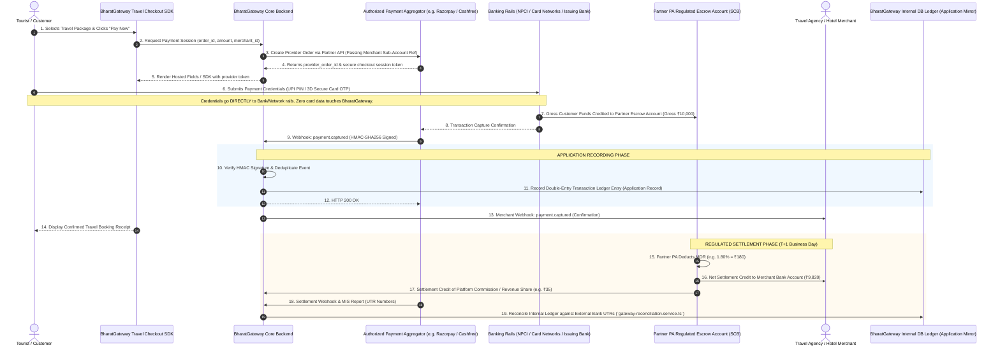

# BHARATGATEWAY™ — PHASE 8 HYBRID FUND FLOW & RESPONSIBILITY ARCHITECTURE
## Regulatory Boundaries, Fund Custody Separation, Operational Responsibilities & Ledger Governance

- **Document ID:** `BG-PHASE8-FLOW-002`
- **Classification:** Fund Flow Architecture, Regulatory Responsibility Matrix & Financial Governance
- **Environment Status:** `ENVIRONMENT=SIMULATED` | `ENABLE_LIVE_PAYMENTS=false`
- **Regulatory Framework:** Reserve Bank of India (Regulation of Payment Aggregators) Directions, 2025 (dated 15 September 2025) & PSS Act 2007
- **Official Starting Point:** [https://www.rbi.org.in/](https://www.rbi.org.in/)
- **Status:** Phase 8 Final — Technical & Legal Fund Flow Blueprint

---

## 1. Executive Summary & Core Architectural Principle

The cornerstone of the **BharatGateway™ Hybrid Operating Model (Model C)** is the **absolute separation of software orchestration from the custody and settlement of monetary funds**.

Under Indian law, specifically the **Payment and Settlement Systems Act, 2007 (PSS Act)** and the **Reserve Bank of India (Regulation of Payment Aggregators) Directions, 2025 (dated 15 September 2025)**, any entity that receives, holds, pools, or executes payouts of customer funds is classified as a Payment Aggregator and must hold a direct Certificate of Authorization from the Reserve Bank of India (RBI).

### The Cardinal Guardrails:
1. **Zero Fund Custody:** Customer funds must **never** pass through, sit in, or transit across an ordinary BharatGateway corporate operating bank account.
2. **Regulated Escrow Ring-Fencing:** All customer funds flow exclusively from the customer's issuing bank or payment app (UPI/card) directly into the designated **Escrow Account maintained with a Scheduled Commercial Bank by the authorized partner Payment Aggregator** (e.g., Razorpay, Cashfree, or an acquiring bank).
3. **Application Record Status of Software Ledger:** The internal double-entry ledger implemented in Phase 4 (`bg_ledger_entries`, `gateway-ledger.service.ts`) serves strictly as an **internal application accounting and audit mirror**. It does **not** represent autonomous bank balances or a self-executing custodial wallet. No merchant payouts, split disbursements, or refunds may be executed based purely on internal ledger entries without authoritative confirmation and execution by the regulated partner bank/PA.

---

## 2. Regulatory Deep-Dive: RBI Directions 2025 & Hybrid Platform Boundaries

### 2.1. RBI (Regulation of Payment Aggregators) Directions, 2025 Analysis

- **Official Source:** Reserve Bank of India (DPSS / Central Office)
- **Primary Portal:** [https://www.rbi.org.in/](https://www.rbi.org.in/)
- **Instrument Title:** *Master Direction / Directions on Regulation of Payment Aggregators, 2025* (Consolidating Guidelines of March 17, 2020, Clarifications of March 31, 2021, Draft Directions of April 16, 2024, and Master Updates of 15 September 2025).
- **Statutory Authority:** Section 10(2) read with Section 18 of the Payment and Settlement Systems Act, 2007 (Act 51 of 2007).

#### Critical Statutory Provisions & Delineation of Responsibilities:

| Section / Topic | Regulatory Requirement under 2025 Directions | Application to Authorized Partner PA | Application to BharatGateway (Hybrid Platform / TSP) | Unresolved Legal Question Requiring Counsel Review |
|---|---|---|---|---|
| **Section 4 / Scope & Applicability** | Non-bank entities facilitating pooling of customer funds and settlement to merchants must obtain RBI authorization. | **Mandatory.** Partner PA holds valid Certificate of Authorization. | **Exempt from Direct Licensing**, provided BharatGateway does not handle, control, or intercept funds. | Does facilitating checkout parameters and generating split instructions constitute "operating a payment system"? |
| **Section 6 / Capital Adequacy** | Net worth requirements for PAs. Non-bank entities must demonstrate statutory net worth compliance. | **Mandatory.** Partner PA must maintain statutory net worth perpetually. | **Not directly applicable.** BharatGateway needs standard corporate solvency only. | Prior reports referenced older ₹15 Cr / ₹25 Cr figures; counsel must verify latest capital tier schedules under 2025 directions. |
| **Section 7 / Merchant Due Diligence & KYC** | Mandatory KYC of merchants prior to onboarding under PMLA and RBI KYC Directions. Contact Point Verification (CPV). | **Statutory Owner.** Partner PA is legally accountable to RBI for merchant KYC and AML screening. | **Facilitator.** BharatGateway may collect merchant documentation via its UI, but **cannot** approve KYC autonomously. | Can BharatGateway contractually execute delegated CPV for travel agencies on behalf of the partner PA? |
| **Section 8 / Escrow Account Operations** | All merchant funds must sit in an SCB Escrow Account. Strict permissible debits (merchants, refunds, commissions). | **Statutory Trustee.** Partner PA maintains and operates the Escrow Account with an SCB. | **Zero Escrow Access.** BharatGateway has no signatory or debit access to the escrow account. | Can platform commission be automatically debited from the PA escrow directly into BharatGateway's current account? |
| **Section 9 / Settlement Timelines (T+1 / T+2)** | Settlement to merchants must occur within T+1 / T+2 business days from transaction intimation. | **Mandatory.** Partner PA executes settlement credits to merchant bank accounts. | **Reporting Role.** BharatGateway displays settlement status to merchants via its dashboard. | How are settlement delays handled when a travel booking is disputed or cancelled prior to departure? |
| **Section 10 / Customer Grievances & Disputes** | PAs must have a board-approved dispute policy, appointed Nodal Officer, and integrate with the RBI Ombudsman. | **Mandatory.** Partner PA provides statutory escalation path to RBI Ombudsman. | **Tier-1 Support.** BharatGateway handles product/travel inquiries; escalates banking disputes to PA. | Does BharatGateway's travel branding require it to establish an independent Ombudsman grievance register? |
| **Section 11 / Baseline Security & Cyber Resilience** | Strict information security, data localization, zero raw card storage (COFT), 6-hour incident reporting. | **Mandatory.** Partner PA undergoes annual System Audit Report (SAR). | **Mandatory.** As a technology provider touching payment interfaces, BharatGateway must adhere to baseline IT security. | Exact scoping under PCI DSS v4.0.1 (SAQ A vs SAQ A-EP) for BharatGateway's custom checkout SDK. |

### 2.2. The "Technology Service Provider" Fallacy

> [!WARNING]
> **Regulatory Notice:** Labeling BharatGateway as a "Technology Service Provider (TSP)" or "SaaS Platform" does **not** provide a blanket legal exemption from Indian financial regulations.
> 
> Under the RBI 2025 Directions and judicial precedents, the RBI examines **economic substance over contractual nomenclature**. If BharatGateway exercises effective control over settlement instructions, holds rolling reserves, mediates dispute deductions, or accepts customer funds into an intermediary holding account, the RBI has the statutory power to deem BharatGateway an unauthorized Payment Aggregator under Section 25 of the PSS Act.
>
> Therefore, BharatGateway's technical architecture must enforce strict separation of roles.

---

## 3. End-to-End Hybrid Fund Flow Architecture

The following sequence diagram illustrates the precise movement of funds, cryptographic data, and settlement instructions in the BharatGateway Model C architecture.



---

## 4. Comprehensive Responsibility Allocation Matrix

The table below defines the statutory, operational, and technical boundaries between BharatGateway, the Authorized Payment Aggregator, the Partner Bank, and the Merchant.

```
+--------------------------------------------------------------------------------------------------------------------------------------------------------------------+
|                                                              RESPONSIBILITY ASSIGNMENT MATRIX (RACI)                                                               |
+------------------------------------+--------------------------+-----------------------+--------------------------+-------------------------------------------------+
| Functional Domain                  | BharatGateway (Platform) | Authorized Partner PA | Scheduled Commercial Bank| Travel Agency Merchant                          |
+------------------------------------+--------------------------+-----------------------+--------------------------+-------------------------------------------------+
| 1. Fund Custody & Escrow Account   | NO ROLE (Zero Custody)   | ACCOUNT TRUSTEE (Sole)| ESCROW BANK (Host)       | BENEFICIARY (Settlement Account)                |
| 2. Merchant Underwriting & KYC     | ASSIST (Document Collect)| SOLE STATUTORY OWNER  | ESCROW DUE DILIGENCE     | DISCLOSURE (Submit PAN/GSTIN/KYC)               |
| 3. Customer Authentication (2FA)   | NO ROLE (Offloaded)      | GATEWAY SWITCH        | ISSUING BANK (OTP/PIN)   | NO ROLE                                         |
| 4. Card Data Security (PCI DSS)    | SAQ A / SAQ A-EP (SDK)   | PCI DSS LEVEL 1 CDE   | PCI COMPLIANT NETWORK    | NO ROLE                                         |
| 5. Settlement Execution (Payouts)  | INSTRUCTION MIRROR ONLY  | DIRECT EXECUTION (T+1)| RTGS / NEFT / IMPS SWITCH| RECEIVER                                        |
| 6. Platform Commission Transfer    | RECEIVER (Operating A/c) | DEBIT FROM ESCROW/MDR | INTERBANK TRANSFER       | PAYER (Contractual SaaS/MDR)                    |
| 7. Refund Initiation & Processing  | API INITIATION TRIGGER   | SETTLEMENT & DEBIT    | REVERSAL TO CARD/UPI     | REQUESTER / APPROVER                            |
| 8. Dispute & Chargeback Defense    | EVIDENCE UPLOAD TOOL     | REPRESENTMENT TO BANK | ARBITRATION EXECUTION    | PRIMARY FINANCIAL LOSS BEARER                   |
| 9. Consumer Grievance Escalation   | TIER-1 TRAVEL SUPPORT    | TIER-2 PAYMENT SUPPORT| ESCALATION TO RBI OMBUDS.| MERCHANT PRODUCT/SERVICE RESOLUTION             |
| 10. Audit Logging & Records        | 5-YEAR APP LOG ARCHIVE   | STATUTORY PSS ARCHIVE | BANKING RECORDS          | TAX & INVOICING RECORDS                         |
+------------------------------------+--------------------------+-----------------------+--------------------------+-------------------------------------------------+
```

---

## 5. Ledger Governance: Application Mirror vs. Custodial Reality

> [!IMPORTANT]
> **Codebase Governance Rule:**
> In Phases 4 and 5, BharatGateway implemented a PostgreSQL-backed double-entry ledger (`bg_ledger_entries`, `gateway-ledger.service.ts`). 
> 
> In this Phase 8 Hybrid Model, that ledger **must not be treated as an authoritative custodian of real fiat balances**.
> 
> 1. **Informational Status:** An entry in `bg_ledger_entries` with type `MERCHANT_PAYABLE` does **not** mean BharatGateway owes the merchant money from its own pocket; it records that the partner PA owes the merchant settlement from the escrow account.
> 2. **Dependency on External Reconciliation:** No ledger balance can be deemed finalized until `gateway-reconciliation.service.ts` successfully matches the internal transaction record against the partner PA’s authoritative Settlement MIS report containing valid banking UTR (Unique Transaction Reference) codes.
> 3. **Prohibition of Direct Payout APIs:** The BharatGateway codebase must **not** implement direct banking payout triggers (e.g. initiating direct IMPS/NEFT transfers from corporate bank accounts) unless governed by a specific, contractually reviewed banking partner integration in a future phase.

---

## 6. Strategic Legal Disclaimers

1. **No Legal Authorization Implied:** This fund-flow architecture is designed to comply with RBI guidelines for technology platforms; however, it does not substitute for a formal legal opinion from qualified Indian payments counsel.
2. **Mandatory Bilateral Review:** Prior to signing merchant agreements or launching production systems, the final tripartite agreement (Merchant <-> BharatGateway <-> Authorized PA) must be reviewed to ensure indemnity clauses and sub-merchant risk allocations reflect this architecture.

*Report Prepared By: Senior Fintech Architect, Payments Systems Engineer & Compliance Specialist*  
*Approved For: BharatGateway Phase 8 Governance Documentation*
