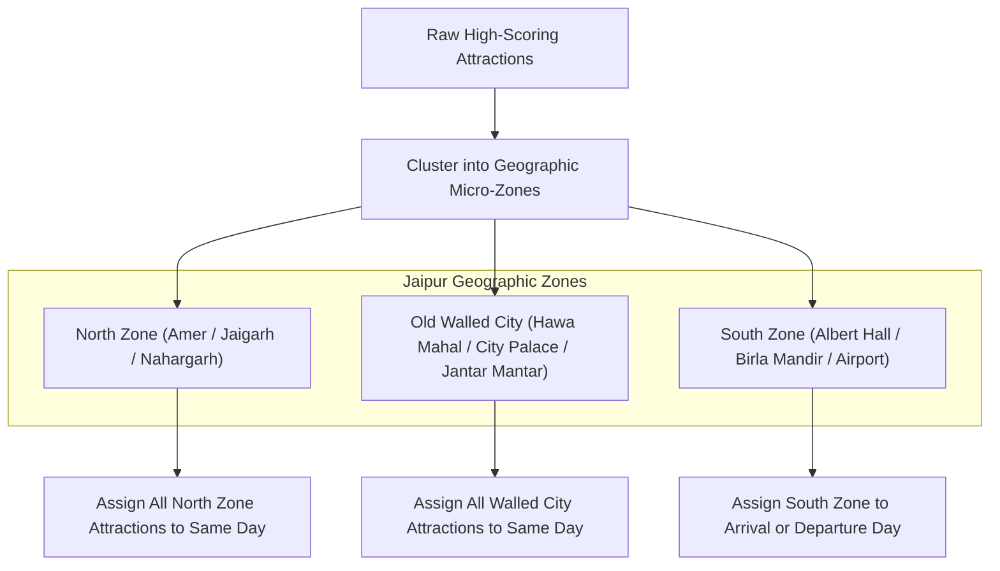

# BharatYatra AI 2.0 — Activity Selection, Scoring & Geographic Clustering Model

## 1. Verified Attraction Data Model

Every attraction scheduled by BharatYatra must exist in the verified registry or be synthesized with deterministic ground truth from the Destination Master dataset. Unverified, hallucinated, or closed tourist spots are mathematically barred.

```typescript
export interface VerifiedAttractionMetadata {
  id: string;                   // Unique identifier, e.g. "DWR_TEMPLE"
  name: string;                 // Canonical attraction name
  displayName: string;          // Human-readable title with subtitle
  city: string;                 // Destination city
  state: string;                // Indian State or UT
  latitude: number;             // Exact WGS84 coordinate
  longitude: number;            // Exact WGS84 coordinate
  category: string;             // Heritage, Religious, Nature, Adventure, etc.
  visitDurationMinutes: number; // Realistic time required on site
  openingTime: string;          // e.g. "06:30"
  closingTime: string;          // e.g. "21:30"
  closedDays: string[];         // e.g. ["Friday"] (Taj Mahal) or ["Monday"] (Akshardham)
  entryFeeInr: number;          // Official ASI / trust entry fee for Indian adults
  entryFeeStatus: 'free' | 'verified_fee' | 'estimated_fee';
  bookingRequired: boolean;     // Advance ASI/Trust registration needed
  seniorFriendly: boolean;      // Ramp access, minimal climbing
  wheelchairAccessible: boolean;// Paved paths, ramp availability
  interestTags: string[];       // Tag alignments for scoring boost
}
```

---

## 2. Multi-Factor Attraction Scoring Function

When selecting attractions for a destination, candidates are scored using a weighted multi-factor scoring function:

$$\text{Score}(A) = S_{\text{base}} + S_{\text{must\_visit}} + S_{\text{interest}} + S_{\text{senior}} + S_{\text{pace}} - P_{\text{penalty}}$$

Where:
- $S_{\text{base}} = 50$: Base baseline score.
- $S_{\text{must\_visit}} = +100$: Awarded if the attraction matches user-specified `preferredAttractions` in preference profile.
- $S_{\text{interest}} = +15 \times M_{\text{matched\_tags}}$: Awarded for each user interest tag matching the attraction's `interestTags` (e.g. Heritage, Culture, Nature).
- $S_{\text{senior}} = +20$ (if party has seniors $\ge 60\text{y}$ and `seniorFriendly === true`), or $-40$ (if party has seniors and `seniorFriendly === false` with heavy stairs).
- $S_{\text{pace}}$:
  - For `relaxed` pace: $+20$ for attractions with duration $\le 90\text{ min}$, $-30$ for duration $\ge 180\text{ min}$.
  - For `active` pace: $+20$ for major full-experience attractions.
- $P_{\text{penalty}} = \infty$: If user marked attraction in `excludedAttractions`, it is filtered out completely with score $-\infty$.

---

## 3. Geographic Clustering & Anti-Backtracking Model

Generative AI planners frequently suffer from "ping-pong routing"—sending travelers from the south of Jaipur to Amber Fort in the extreme north, then back south to the airport, then north again to Nahargarh.

BharatYatra solves this using a **Nearest-Neighbor Spatial Clustering Model**:



### Algorithmic Formulation:
Given set of attractions $A$ assigned to Day $d$:
1. Select anchor attraction $A_1$ (e.g. Amber Fort).
2. For subsequent slot $s$, select attraction $A_{k}$ that minimizes Haversine distance:
   $$D(A_{k-1}, A_{k}) = 2R \arcsin\left(\sqrt{\sin^2\left(\frac{\Delta \phi}{2}\right) + \cos\phi_1\cos\phi_2\sin^2\left(\frac{\Delta \lambda}{2}\right)}\right)$$
3. If $D(A_{k-1}, A_{k}) > 15\text{ km}$ within the same urban area, the attraction is rejected for that day and deferred to another day with closer spatial proximity.

---

## 4. Opening Hours & Closed Day Conflict Avoidance

Many Indian monuments and museums have strict statutory closure days:
- **Taj Mahal, Agra**: Closed every **Friday** for prayers.
- **Akshardham, Delhi**: Closed every **Monday**.
- **Red Fort, Delhi**: Closed every **Monday**.
- **Salar Jung Museum, Hyderabad**: Closed every **Friday**.

### The `pickNextOpenAttraction` Selector:
The scheduling engine maintains an unassigned attraction queue and queries `pickNextOpenAttraction(dayOfWeek)`:
```typescript
const pickNextOpenAttraction = (slot: string): VerifiedAttractionMetadata | undefined => {
  const cityIdx = availableAttractions.findIndex((a) => {
    const cityMatch = destList.length > 1 ? a.city.toLowerCase() === currentCity.toLowerCase() : true;
    return cityMatch && !a.closedDays.includes(dayOfWeek);
  });
  if (cityIdx !== -1) {
    return availableAttractions.splice(cityIdx, 1)[0];
  }
  return undefined;
};
```
If an attraction is closed on the current day of the week, it is **never scheduled on that day**; it is held in the queue and scheduled on an alternate day when open.

