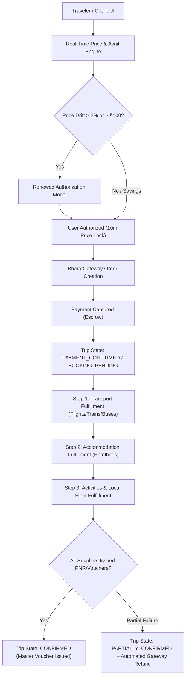

# BHARATYATRA AI 2.0 — PHASE 10
# Booking Orchestration Architecture Specification

**System:** BharatYatra Unified Travel Orchestration Platform  
**Component:** `lib/booking/unified-booking-orchestrator.ts`  
**API Endpoints:** `/api/v1/booking/orchestrate`, `/api/v1/booking/availability`, `/api/v1/booking/cancel`  

---

## 1. Architectural Overview

The BharatYatra Booking Orchestrator is the central coordinator for multi-supplier, multimodal travel packages and itineraries across India. It bridges the gap between AI-driven dynamic trip planning (Phases 1–9) and commercial travel execution.



---

## 2. Booking Lifecycle State Machine

The platform implements a formal finite-state machine (FSM) guaranteeing that no intermediate state is bypassed and all transitions are audit-logged.

### 2.1 State Definitions

| State | Description | Invariant Rules |
| :--- | :--- | :--- |
| **`DRAFT`** | Initial itinerary components drafted by user or AI planner. | Quoted price may drift; unverified inventory. |
| **`SEARCHED`** | System has queried supplier catalogs. | Inventory search results returned. |
| **`AVAILABILITY_VERIFIED`** | All components checked against live supplier adapters. | Cached with category-specific TTLs. |
| **`PRICE_VERIFIED`** | Supplier rates re-checked against original estimates. | Within allowable tolerance ($\le 2\%$ or $\le ₹100$). |
| **`PRICE_CHANGED`** | Rate drift exceeds tolerance ($> 2\%$ and $> ₹100$). | **Payment blocked.** User renewed authorization required. |
| **`USER_AUTHORIZED`** | Traveler explicitly approves verified price. | Activates strict 10-minute price lock window. |
| **`PAYMENT_PENDING`** | Payment order created on BharatGateway. | Order active; waiting for user completion. |
| **`PAYMENT_CONFIRMED`** | Customer payment successfully captured. | **Decoupled from booking confirmation.** |
| **`BOOKING_PENDING`** | Supplier reservation requests in transit. | Sequential execution priority active. |
| **`CONFIRMED`** | All constituent suppliers returned valid PNRs/vouchers. | Master booking reference generated. |
| **`PARTIALLY_CONFIRMED`** | One or more components succeeded; one failed. | Auto-refund initiated for failed component. |
| **`FAILED`** | Critical failure (payment declined or core transit unavailable). | Full refund triggered back to customer. |
| **`CANCELLATION_PENDING`** | Cancellation initiated by customer or operator. | Penalty calculations in progress. |
| **`CANCELLED`** | Reservations released with suppliers. | Booking marked inactive. |
| **`REFUND_PENDING`** | Gateway refund payload dispatched. | Awaiting banking clearing (T+1 to T+3). |
| **`REFUNDED`** | Gateway refund successfully completed. | Ledger balances reconciled. |

---

## 3. Multi-Component Trip Booking Coordination

A single trip often consists of multiple heterogeneous products:
1. Intercity Transport (Flight or Bus or Train)
2. Stays & Lodging (Hotelbeds / Heritage Resorts)
3. Guided Tours & Attraction Passes (Gir Lion Safari, SOU Gallery)
4. Local Cabs & Airport Transfers

### 3.1 Data Model Relationship
```
TripBookingRecord (Master Container)
 ├── tripBookingId: "BY-TRIP-2026-XXXXXX"
 ├── totalQuotedPrice / totalVerifiedPrice
 ├── paymentOrderId & paymentStatus
 └── components: ComponentBookingRecord[]
      ├── [0] Component: Flight / Bus (Transport priority)
      ├── [1] Component: Hotel Stays (Stay priority)
      └── [2] Component: Forest Permit (Activity priority)
```

### 3.2 Sequential Execution Strategy
To avoid stranded hotel rooms when intercity transport is unavailable, suppliers are invoked in strict dependency order:
1. **Priority 1: Long-Haul Transport** (Flight / Train / Intercity Bus)  
   If transport cannot be secured, the stay and activity are never booked.
2. **Priority 2: Accommodations** (Hotelbeds APItude)  
   Secures confirmed room rateKey and issues GIATA voucher.
3. **Priority 3: Experiences & Safaris**  
   Secures specific time slot permits.
4. **Priority 4: Local Cabs & Airport Transfers**  
   Dispatches vehicle to matching arrival schedule.

---

## 4. Partial Failure & Compensation Rollback

In distributed travel systems, network timeouts or sudden seat sell-outs during peak seasons can cause a constituent component to fail even after payment is captured.

BharatYatra solves this through an automated **Compensation Workflow**:
1. When Component $k$ fails during confirmation:
   - Component $k$ state $\to$ `FAILED`.
   - Remaining successful components $\to$ `CONFIRMED`.
   - Master trip state $\to$ `PARTIALLY_CONFIRMED`.
2. The orchestrator immediately calculates:
   $$\text{RefundAmount} = \text{VerifiedPrice}(\text{Component } k)$$
3. Calls `GatewayClient.createRefund(paymentOrderId, RefundAmount, Reason)`.
4. The traveler is notified via SMS/email and shown the confirmed vouchers alongside the instant refund confirmation.
5. An operations discrepancy is flagged on the Admin Operations Dashboard for lead review.

