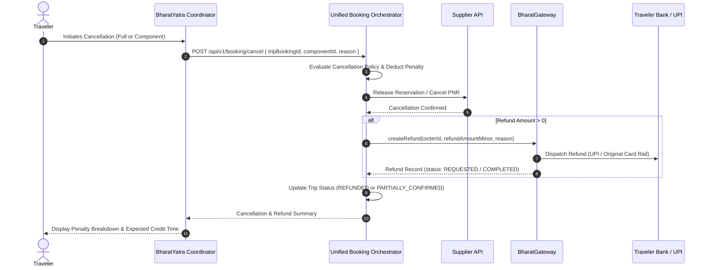

# BHARATYATRA AI 2.0 — PHASE 10
# Cancellation & Tiered Refund Workflow Specification

**System:** Customer Self-Service & Automated Refund Pipeline  
**Module:** `lib/booking/unified-booking-orchestrator.ts` (`cancelBooking`)  
**API Endpoint:** `POST /api/v1/booking/cancel`  

---

## 1. Overview & Policy Governance

Cancellations in multimodal travel require precise category-specific rules. Cancelling an intercity cab has fundamentally different penalty structures than cancelling a non-refundable forest safari pass issued by a state department.

BharatYatra supports:
1. **Full Trip Cancellation:** Releasing all components simultaneously and issuing an aggregated refund.
2. **Partial / Component Cancellation:** Cancelling a single component (e.g. dropping a train berth or hotel room) while preserving all other confirmed itinerary reservations.

---

## 2. Category-Specific Cancellation Policies

| Category | Typical Supplier Policy | Penalty Structure | Refund Processing |
| :--- | :--- | :--- | :--- |
| **Hotels (Hotelbeds)** | Free cancellation up to 48h prior to check-in. | $\le 48\text{h}$: 0% penalty. $< 48\text{h}$: 1 night or 100% room rate. | Instant release with Hotelbeds; refund via BharatGateway. |
| **Buses (GSRTC/Private)** | Tiered scale based on hours prior to departure. | $> 24\text{h}$: 10–15% fee. $12\text{h}–24\text{h}$: 25% fee. $< 12\text{h}$: 50–100% fee. | Direct PNR cancellation; net refund processed. |
| **Flights (Domestic)** | Standard airline sector cancellation fees. | Airline penalty (₹3,000–₹3,500/pax) deducted. $< 2\text{h}$: 100% penalty. | GDS segment cancel; statutory taxes refunded. |
| **Trains (IRCTC)** | Indian Railways PRS clerkage cancellation rules. | $> 48\text{h}$: Flat ₹60–₹240 fee/class. $48\text{h}–12\text{h}$: 25% fee. $12\text{h}–4\text{h}$: 50% fee. $< 4\text{h}$: Nil refund. | PRS electronic cancellation message; IRCTC gateway refund. |
| **Activities & Safaris** | Municipal / Forest Dept non-refundable permits. | Non-refundable ($100\%$ penalty) except on park closure due to weather. | Zero refund unless officially cancelled by authority. |
| **Outstation Cabs** | Flexible cancellation up to 6 hours prior. | $> 6\text{h}$: 0% penalty (Full refund). $< 6\text{h}$: ₹500 driver mobilization fee. | Chauffeur dispatch cancelled; instant gateway refund. |

---

## 3. End-to-End Refund Execution Pipeline

---

## 4. Financial Clearing & Speed Slabs

When `GatewayClient.createRefund()` is executed:
1. **UPI Transactions:** Cleared within **15 minutes to 2 hours** via direct NPCI UPI refund rail.
2. **NetBanking:** Cleared within **T+1 business day** via IMPS / NEFT.
3. **Credit / Debit Cards:** Cleared within **T+2 to T+5 business days** depending on the acquiring bank.

Every refund is recorded in the BharatGateway double-entry ledger with an immutable `refundId` (e.g. `ref_bg_1793342202605`).

