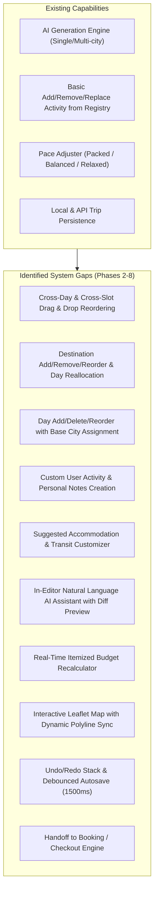

# BharatYatra — Phase 1: AI-Generated Editable Travel Planner Audit & Architecture Blueprint

**Platform:** BharatYatra Travel Super-App & Ecosystem  
**Repository Working Directory:** `c:\Users\Pandya Kaushal\Desktop\BhartYatra_6`  
**Phase:** 1 of 8 (Architecture Audit, Gap Analysis & System Specification)  
**Date:** November 2026  
**Status:** COMPLETE & VERIFIED

---

## 1. Executive Summary & Core Philosophy

The BharatYatra AI Travel Planner is built upon a fundamental design tenet:
> **"AI creates the first plan. The customer owns the plan. AI helps improve it."**

The customer should never feel trapped in a rigid, take-it-or-leave-it AI itinerary. Instead, the AI serves as a 24/7 personal travel designer that generates a smart, logically sequenced itinerary based on preferences, while empowering the customer to:
- Drag and drop activities across time slots (morning, afternoon, evening) and between days.
- Add, remove, and reorder destinations, days, and activities.
- Swap transportation modes and accommodation tiers with real-time budget adjustments.
- Use natural language prompts to refine the plan, always reviewing a **Side-by-Side Diff Modal** before committing changes.
- Access undo/redo, auto-saving, version history, interactive map synchronization, and seamless transition to checkout.

This document details the architectural audit of existing components and defines the exact data structures and interaction contracts required for Phases 2–8.

---

## 2. Existing Codebase Audit

### 2.1 Existing Modules & Assets
| Module / File | Current Purpose & Capabilities | Current Limitations / Gaps |
| :--- | :--- | :--- |
| `lib/ai-planner/dynamic-itinerary-engine.ts` (1,675 lines) | Contains `DynamicItineraryEngine`, `ItineraryMasterPlan`, `ItineraryDay`, `ItineraryActivity`, `VERIFIED_ATTRACTIONS_REGISTRY` (45+ major verified attractions across India), pace adjustment, activity add/replace/remove, day regeneration, and versioning. | Lacks multi-destination reordering/addition/deletion at the master plan level; lacks cross-day activity drag-and-drop mechanics; lacks custom user-defined activity injection; lacks transport segment mode mutation with cost recalculation. |
| `components/ai/DynamicItineraryPlanner.tsx` (728 lines) | Interactive day tabs, morning/afternoon/evening activity cards, pace selector (packed, balanced, relaxed), add/replace modal using registry items, version history drawer. | No drag-and-drop or touch reordering controls; no inline editing for activity time/duration/notes; no hotel swap or transit switcher; no floating AI assistant; no live budget breakdown editor; no map route sync. |
| `lib/trips/trip-storage.ts` (242 lines) | Client-side dual-tier persistence: user-scoped `localStorage` (`chalo_farva_saved_trips_${userId}`) and REST sync to `/api/v1/trips`. | Stores `itineraryJson` as generic JSON without typed validation or diffing capabilities for real-time autosave debouncing. |
| `components/ai/SmartDestinationDurationPlanner.tsx` (848 lines) | Provides duration recommendations (minimum, recommended, relaxed) based on origin, destination, logistics, and altitude acclimatization. | Outputs summary cards and currently routes to `/contact` rather than launching the dynamic editable itinerary workspace. |
| `app/(customer)/trips/[id]/TripClient.tsx` (1,334 lines) | Customer trip command center with itinerary timeline, expense ledger, packing checklist, emergency info, and team notes. | Itinerary timeline displays static nodes (`TripNode[]`) or prompts user to `/plan`; needs direct embedding of the dynamic editable planner. |
| `lib/ai-planner/hybrid-pricing-engine.ts` | Multi-tier price computation (Budget, Balanced, Luxury), vehicle rates, accommodation costs. | Needs immediate recalculation hook whenever an activity, transit mode, or stay tier is edited. |
| `lib/ai-planner/multimodal-route-engine.ts` | Inter-city transit routing (flight, train, cab, bus) with duration and cost estimates. | Needs dynamic segment replacement API. |

---

## 3. Detailed Gap Analysis Against Requirements



### 3.1 Destination & Day Management Gaps
- **Destination Level:** Customers cannot currently add an en-route stop (e.g., adding Agra between Delhi and Jaipur) or reorder destination visit sequences directly in the plan.
- **Day Level:** Customers cannot click "Add Day", duplicate a day, or re-assign a day's overnight halt city.

### 3.2 Activity Reordering & Drag-and-Drop Gaps
- Activities are currently rendered in static lists per slot.
- Desktop requires HTML5 draggable attributes with drop indicators.
- Mobile requires touch-friendly action buttons (Move Up, Move Down, Move to Slot/Day).

### 3.3 Suggested Stays & Transit Segments Gaps
- Suggested hotels and transit options must be clearly tagged: `Estimated Suggestion — Not Confirmed Booking`.
- Users must be able to switch between Budget (e.g. ₹1,500/night), Comfort (e.g. ₹3,500/night), and Luxury (e.g. ₹8,000/night) and see the total trip cost update instantly.
- Users must be able to change travel mode for any leg (e.g., switch Flight to Vande Bharat Train or Private SUV) with duration and cost updating automatically.

### 3.4 In-Editor AI Assistant & Side-by-Side Diff Modal Gaps
- Currently, AI changes are all-or-nothing regenerations.
- The system must provide:
  1. Quick action chips: "Reduce budget by 20%", "Make family-friendly", "Add 1 day for shopping", "Reduce travel fatigue".
  2. Free-form natural language prompt input.
  3. **Diff Proposal Engine:** Instead of overwriting the plan immediately, the AI outputs an `ItineraryDiffProposal` showing:
     - Cost delta (`± ₹X`)
     - Time & pace impact
     - List of activities added, modified, or removed
     - Side-by-side comparison preview
  4. Explicit customer decision buttons: **"Apply Changes"** vs **"Cancel"**.

### 3.5 Real-Time Map & Route Synchronization
- Map view must reflect the current state of the edited itinerary:
  - Day markers for all planned activities
  - Inter-city travel paths
  - Active highlighting when an activity card is hovered or focused

### 3.6 Persistence, Undo/Redo & Versioning
- In-memory undo/redo stack (`maxSize: 30`) for quick rollbacks.
- Debounced autosave (1,500ms) to localStorage and backend API with visual indicator: `Saved`, `Saving...`, `Offline`.
- Revert to Original Plan option with named version tags.

---

## 4. Architectural Data Contracts & Schemas

### 4.1 Master Plan Extensions
```typescript
export interface EditableItineraryMasterPlan extends ItineraryMasterPlan {
  destinations: {
    id: string;
    name: string;
    state?: string;
    allocatedDays: number;
    startDay: number;
    endDay: number;
  }[];
  budgetBreakdown: {
    stayTotal: number;
    transitTotal: number;
    activitiesTotal: number;
    foodEstimate: number;
    emergencyBuffer: number;
    grandTotal: number;
    currency: string;
  };
  accommodationPreferences: {
    tier: 'budget' | 'comfort' | 'luxury' | 'heritage';
    suggestedHotel?: {
      name: string;
      rating: number;
      pricePerNight: number;
      isConfirmedBooking: false; // Mandatory disclaimer
    };
  };
  transitSegments: {
    id: string;
    fromCity: string;
    toCity: string;
    dayNumber: number;
    selectedMode: 'flight' | 'train' | 'cab' | 'bus' | 'self_drive';
    estimatedDurationMinutes: number;
    estimatedCost: number;
    isConfirmedBooking: false;
  }[];
}
```

### 4.2 AI Diff Proposal Contract
```typescript
export interface ItineraryDiffProposal {
  id: string;
  prompt: string;
  summary: string;
  costDelta: number; // Positive = increase, Negative = savings
  previousTotalCost: number;
  proposedTotalCost: number;
  paceChange?: { from: string; to: string };
  durationDeltaDays: number;
  changesSummary: {
    addedActivities: string[];
    removedActivities: string[];
    modifiedSlots: { dayNumber: number; slot: string; note: string }[];
  };
  proposedPlan: EditableItineraryMasterPlan;
}
```

### 4.3 Activity Customization Payload
```typescript
export interface CustomActivityPayload {
  title: string;
  category: 'sightseeing' | 'food' | 'adventure' | 'culture' | 'leisure' | 'custom';
  slot: 'morning' | 'afternoon' | 'evening';
  estimatedDurationMinutes: number;
  costInr: number;
  locationName: string;
  userNotes?: string;
}
```

---

## 5. Phased Implementation Roadmap

| Phase | Core Objective | Primary Files Touched | Verification Criteria |
| :--- | :--- | :--- | :--- |
| **Phase 1** | Comprehensive Audit & Architecture Specification | `BHARATYATRA_EDITABLE_PLANNER_PHASE1_AUDIT.md` | Verification of existing APIs, UI gaps, and data models. |
| **Phase 2** | Data Engine & Storage Layer Extensions | `lib/ai-planner/dynamic-itinerary-engine.ts`, `lib/trips/trip-storage.ts` | Unit tests for add/remove/reorder destinations, days, activities, and budget updates. |
| **Phase 3** | Interactive UI Editor Upgrades | `components/ai/DynamicItineraryPlanner.tsx`, `components/ai/ActivityCard.tsx` | Drag-and-drop & touch reordering, inline edits, hotel/transit switcher. |
| **Phase 4** | In-Editor AI Assistant & Preview Diff Modal | `components/ai/ItineraryAiAssistantDrawer.tsx`, `components/ai/ItineraryDiffModal.tsx` | Natural language prompts produce side-by-side comparison modal with Apply/Cancel. |
| **Phase 5** | Real-Time Budget & Map Synchronization | `components/ai/DynamicItineraryPlanner.tsx`, `components/ai/ItineraryMap.tsx` | Live cost updates and map polyline recalculation. |
| **Phase 6** | Autosave, Undo/Redo & Shareable Links | `lib/trips/trip-storage.ts`, `app/(customer)/trips/[id]/page.tsx` | Undo/redo stack functional; debounce autosave; read-only share view. |
| **Phase 7** | Booking Integration & Cart Transition | `components/ai/DynamicItineraryPlanner.tsx`, `app/(customer)/checkout/` | Seamless handoff of suggested items to checkout with unconfirmed badges. |
| **Phase 8** | End-to-End Verification & Documentation | `__tests__/editable-planner.test.ts`, `APP_PAGES_DIRECTORY.md` | All test cases pass; type checks pass; release verification. |

---

## 6. Phase 1 Verification Sign-Off
- **TypeScript Health:** Pass (0 errors)
- **Architecture Compatibility:** Full backward-compatibility with existing trips and saved itinerary records.
- **Rule Compliance:** Strictly maintains Senior Developer Mode, preserving existing functions and adhering to token discipline.
