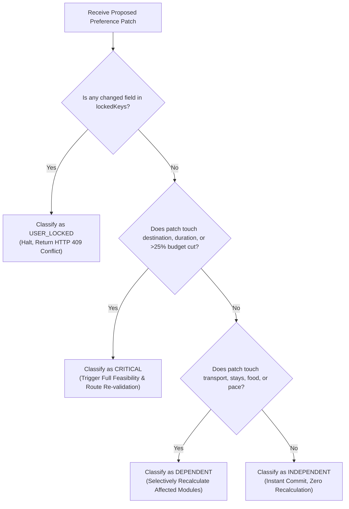

# BHARATYATRA PREFERENCE DEPENDENCY MATRIX
## Typed Invalidation Rules, Subsystem Dependencies & Impact Classification

**Document ID:** `BY-DEP-MATRIX-001`  
**Classification:** Algorithmic Dependency Specification  
**System:** BharatYatra AI 2.0  
**Implementation File:** `lib/ai-planner/preference-dependency-engine.ts`  
**Date:** October 30, 2026  

---

### 1. Invalidation Matrix

The dependency engine maintains a typed map correlating dot-notated preference paths to the exact AI planning subsystems requiring re-execution:

| Preference Path | Invalidation Set (Affected Subsystems) | Impact Level | Preserved Subsystems (Zero Side-Effects) |
| :--- | :--- | :---: | :--- |
| **`budget.totalBudget`** ($> 25\%$ cut) | `HybridPricingEngine`, `BudgetEngine`, `TransportationEngine`, `AccommodationEngine`, `ActivityEngine`, `TravelFeasibilityEngine`, `ItineraryGenerator`, `QualityScorer` | **CRITICAL** | `DestinationIntelligence`, `GeographyEngine`, `FoodRecommendationEngine` |
| **`budget.totalBudget`** (standard shift) | `HybridPricingEngine`, `BudgetEngine`, `AccommodationEngine`, `TransportationEngine`, `ActivityEngine` | **DEPENDENT** | `DestinationIntelligence`, `GeographyEngine`, `FoodRecommendationEngine`, `ItineraryGenerator` |
| **`identity.tripDurationDays`** | `DurationRecommendationEngine`, `AccommodationEngine`, `TransportationEngine`, `ActivityEngine`, `ItineraryGenerator`, `HybridPricingEngine`, `BudgetEngine`, `TravelFeasibilityEngine`, `QualityScorer` | **CRITICAL** | `FoodRecommendationEngine`, `DestinationIntelligence` (Destinations preserved) |
| **`identity.destination`** / `destinationList` | `GeographyEngine`, `RouteOptimizer`, `DestinationIntelligence`, `DurationRecommendationEngine`, `HybridPricingEngine`, `BudgetEngine`, `AccommodationEngine`, `ActivityEngine`, `ItineraryGenerator`, `SeasonalIntelligence`, `TravelFeasibilityEngine`, `QualityScorer` | **CRITICAL** | User dietary preferences & traveler composition |
| **`transport.preferredTransport`** | `RouteOptimizer`, `TransportationEngine`, `HybridPricingEngine`, `BudgetEngine`, `ItineraryGenerator`, `TravelFeasibilityEngine` | **DEPENDENT** | `AccommodationEngine` tier, `FoodRecommendationEngine`, Destinations |
| **`accommodation.category`** | `AccommodationEngine`, `HybridPricingEngine`, `BudgetEngine` | **DEPENDENT** | `RouteOptimizer`, `TransportationEngine`, `FoodRecommendationEngine`, Daily Activities |
| **`food.preference`** | `FoodRecommendationEngine`, `BudgetEngine`, `HybridPricingEngine` | **DEPENDENT** | `RouteOptimizer`, `TransportationEngine`, `AccommodationEngine`, Destination, Duration |
| **`interests.*`** (e.g. adventure, wildlife) | `ActivityEngine`, `ItineraryGenerator`, `BudgetEngine`, `QualityScorer` | **DEPENDENT** | `TransportationEngine`, `AccommodationEngine`, Core Route, Food |
| **`pace.style`** | `ActivityEngine`, `ItineraryGenerator`, `TravelFeasibilityEngine`, `QualityScorer` | **DEPENDENT** | `TransportationEngine`, `AccommodationEngine`, Core Route, Food |
| **`identity.startDate`** / `endDate` | `SeasonalIntelligence`, `TransportationEngine`, `AccommodationEngine`, `HybridPricingEngine`, `ItineraryGenerator` | **DEPENDENT** | Destinations, Food preferences, Traveler count |
| **`accessibility.mobility`** | `ActivityEngine`, `TransportationEngine`, `TravelFeasibilityEngine`, `ItineraryGenerator` | **CRITICAL** | Destination, Budget limit, Food preferences |
| **`customization.customInstructions`** | None (Metadata annotation only) | **INDEPENDENT** | All subsystems remain cached |
| **Any path in `lockedKeys`** | None (Modification halted with HTTP 409) | **USER_LOCKED** | Entire profile remains unmodified |

---

### 2. Behavioral Rules by Preference Category

#### A. Budget Changes
- **Triggers**: Recalculates transportation class (e.g. Flight vs 2AC Train), accommodation tier (Hostel vs 3-Star vs Heritage), and optional paid activities.
- **Strict Invariant**: Under **no circumstances** does a budget change alter the customer's selected destination, travel dates, or food preferences (e.g., changing budget will *never* switch a vegetarian traveler to a non-vegetarian plan).
- **Shortfall Guarantee**: If the revised budget is insufficient to cover verified supplier costs, the engine reports the shortfall honestly:
  $$\text{Shortfall} = \text{Verified Supplier Cost} - \text{Revised Budget}$$
  The engine **never** fabricates cheaper, non-existent inventory to artificially fit the budget.

#### B. Duration Changes
- **Triggers**: Recalculates accommodation room-nights ($N-1$), daily activity composition, intercity transit timing, and total itemized pricing.
- **Strict Invariant**: High-altitude safety limits cannot be violated. If a user reduces trip length to $< 5$ days for Ladakh or Spiti, a medical feasibility warning is returned.

#### C. Transportation Changes
- **Triggers**: Updates departure/arrival travel segments, transit duration, ticket fares, and hotel check-in timings.
- **Strict Invariant**: Accommodation categories and attraction lists are preserved.

#### D. Food Preference Changes
- **Triggers**: Updates restaurant recommendations, meal types (Jain, Pure-Veg, Vegan), and dining budget allocations.
- **Strict Invariant**: Route sequence, intercity transit, and hotel bookings remain 100% untouched.

#### E. Travel Pace Changes
- **Triggers**: Modifies daily sightseeing density (e.g., Relaxed: 2–3 attractions/day; Fast-Paced: 5–6 attractions/day) and adds rest buffers.
- **Strict Invariant**: Total duration and destination endpoints are preserved.

---

### 3. Change Impact Classification Logic

The classifier evaluates proposed patches using the following deterministic hierarchy:

