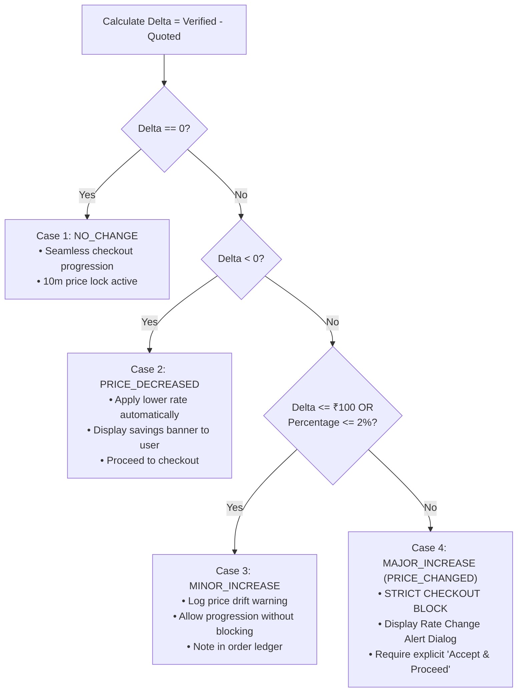

# BHARATYATRA AI 2.0 — PHASE 10
# Price Revalidation Rules & Drift Governance Specification

**System:** Commercial Pricing Calibration & Recheck Subsystem  
**Engine Module:** `lib/booking/unified-booking-orchestrator.ts` (`revalidateTripPrices`)  
**Consumer Interface:** `components/booking/EndToEndBookingCoordinator.tsx`  

---

## 1. Regulatory Context & Consumer Protection

In online travel agencies (OTAs), dynamic pricing fluctuations between initial search and final payment are a primary driver of customer distrust and regulatory sanctions (CCPA/DOT guidelines).

BharatYatra AI 2.0 establishes a strict **Fair Price Guarantee**:
- **Zero Silent Upcharges:** No traveler will ever be charged more than the exact amount displayed at final review without renewed confirmation.
- **Immediate Downward Rate Pass-Through:** If a supplier lowers their rate, the full savings must be credited to the customer.
- **Deterministic Tolerance Bands:** Clearly defined thresholds determine whether checkout can proceed or must halt for re-authorization.

---

## 2. Mathematical Rate Drift Formulations

For any component $i$ with previously quoted price $Q_i$ and verified supplier price $V_i$:

$$\Delta_i = V_i - Q_i$$
$$\text{Percentage Drift } P_i = \left( \frac{\Delta_i}{Q_i} \right) \times 100$$

For a multi-component trip booking with $N$ items:
$$\Delta_{\text{total}} = \sum_{i=1}^N V_i - \sum_{i=1}^N Q_i$$
$$\text{Total Percentage Drift } P_{\text{total}} = \left( \frac{\Delta_{\text{total}}}{\sum_{i=1}^N Q_i} \right) \times 100$$

---

## 3. Four Governance Action Slabs



### 3.1 Detailed Slabs Specification

| Slab | Condition | Status Flag | System Action | User Experience |
| :--- | :--- | :--- | :--- | :--- |
| **Case 1: Exact Match** | $\Delta_{\text{total}} = 0$ | `NO_CHANGE` | Lock prices for 10 minutes. State remains `PRICE_VERIFIED`. | Uninterrupted checkout. |
| **Case 2: Price Drop** | $\Delta_{\text{total}} < 0$ | `PRICE_DECREASED` | Automatically update payable total to lower verified rate. Compute savings: $\text{Savings} = \|\Delta_{\text{total}}\|$. | Prominent green banner: *"Great news! Prices dropped by ₹X. Lower rate locked."* |
| **Case 3: Minor Increase** | $\Delta_{\text{total}} \le ₹100$ or $P_{\text{total}} \le 2.0\%$ | `MINOR_INCREASE` | Update verified price. Mark as allowable variance. Allow progression. | Subtle notice in order summary. |
| **Case 4: Major Increase** | $\Delta_{\text{total}} > ₹100$ and $P_{\text{total}} > 2.0\%$ | `MAJOR_INCREASE` (`PRICE_CHANGED`) | **HARD STOP.** Payment order creation is rejected by API until `AUTHORIZE_PRICE` action is submitted. | High-contrast dialog with before/after component breakdown and *"Accept Updated Price & Lock"* button. |

---

## 4. Price Lock Window (10-Minute Lock)

When a traveler reviews verified prices or explicitly authorizes an updated quote:
1. The orchestrator stamps `priceLockedUntil = Date.now() + 600,000` (10 minutes).
2. If payment is not initiated within this 10-minute window, the lock expires.
3. Any attempt to call `createBharatGatewayOrder` after expiration throws:
   ```json
   {
     "success": false,
     "error": "Price lock expired. Please revalidate prices before proceeding to payment."
   }
   ```
4. The frontend displays a real-time countdown timer (`MM:SS`) to keep the traveler informed.

