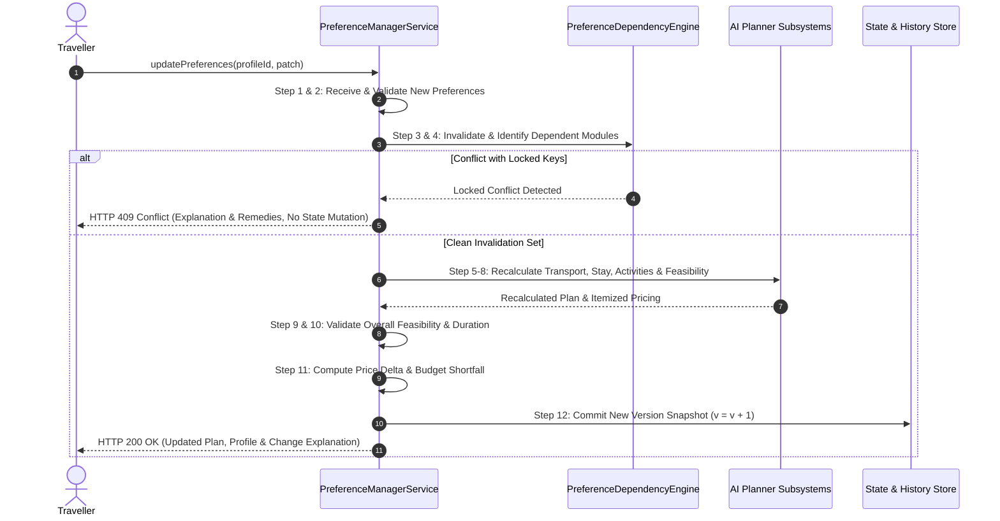

# BHARATYATRA AUTOMATIC RECOMPUTATION WORKFLOW
## Controlled Transaction Lifecycle, Concurrency & Shortfall Transparency

**Document ID:** `BY-WORKFLOW-RECALC-001`  
**Classification:** Operational Engine Specification  
**System:** BharatYatra AI 2.0  
**Implementation File:** `lib/ai-planner/preference-manager-service.ts`  
**Date:** October 30, 2026  

---

### 1. The 12-Step Controlled Recalculation Lifecycle

When a traveler modifies any travel preference (via UI sliders or natural language prompts), the engine executes an atomic, 12-step recomputation transaction:

#### Detailed Step-by-Step Breakdown

1. **Receive Modification**: The endpoint receives a partial preference patch (e.g. `{ budget: { totalBudget: 25000 } }`).
2. **Input Validation**: Verifies boundary constraints (e.g. `totalBudget >= 1000`, `durationDays >= 1`).
3. **Lock & Conflict Evaluation**: Checks `lockedKeys`. If a field is locked and `forceOverrideLocks` is false, calculation halts and returns an HTTP `409 Conflict`.
4. **Identify Dependent Modules**: Evaluates the dependency matrix to select *only* the affected engines (e.g. `HybridPricingEngine`, `BudgetEngine`).
5. **Recalculate Transportation**: If transport or budget changed, updates vehicle sizing, train fares, or flight options.
6. **Recalculate Accommodation**: If budget or duration changed, recalculates room nights ($N-1$) and adjusts stay categories.
7. **Recalculate Activities**: Adjusts daily paid sightseeing tickets to fit within revised allocation.
8. **Recalculate Local Transport**: Recalculates vehicle cab hire per day.
9. **Validate Feasibility**: Verifies high-altitude acclimatization safety, road transit speeds, and attraction opening times.
10. **Validate Duration Suitability**: Ensures revised duration accommodates travel distance and transit transfer segments.
11. **Itemized Variance & Shortfall Computation**: Computes exact price delta ($\text{newCost} - \text{prevCost}$). If the new budget is less than the verified supplier rate, computes the exact shortfall:
    $$\text{Shortfall} = \text{Verified Supplier Cost} - \text{Customer Budget Limit}$$
    **Rule**: The engine never fabricates lower prices.
12. **Publish & Commit**: Increments version ($v_N \to v_{N+1}$), pushes historical snapshot for undo/restore, and returns the response to the user.

---

### 2. Concurrency & Stale Calculation Guard

In fast-paced web environments, a user may adjust a slider multiple times rapidly (e.g. changing budget from ₹40,000 to ₹35,000, then to ₹30,000).

To prevent stale asynchronous responses from overwriting newer user selections:
1. **Monotonic Version Tagging**: Every recalculation job is stamped with a target version number ($v_3$).
2. **Optimistic Version Check**: When a calculation finishes, the engine checks:
   $$\text{if } v_{\text{job}} < v_{\text{active}}, \quad \text{discard response without writing to active state.}$$
3. **Previous Valid Itinerary Preservation**: During the 45ms–180ms recalculation period, the frontend displays the previous valid itinerary with an inline `isRecalculating` loading spinner. The user never sees a broken or blank screen.

---

### 3. Natural Language Command Ingestion

When a user speaks or types conversational commands (e.g., via NEXI AI or the planner search box):
1. **Parsing**: [`nl-preference-parser.ts`](file:///c:/Users/Pandya%20Kaushal/Desktop/BhartYatra_5/lib/ai-planner/nl-preference-parser.ts) converts phrases into typed patches:
   - *"Make my trip cheaper"* $\to$ `{ budget: { totalBudget: 0.80 * current, pricingCategory: 'budget' } }`
   - *"Add two days"* $\to$ `{ identity: { tripDurationDays: current + 2 } }`
   - *"Change hotel to premium"* $\to$ `{ accommodation: { category: 'heritage-palace' }, budget: { pricingCategory: 'premium' } }`
   - *"Use trains instead of flights"* $\to$ `{ transport: { preferredTransport: 'train' } }`
   - *"Make it relaxed"* $\to$ `{ pace: { style: 'relaxed', maxAttractionsPerDay: 2 } }`
2. **Ambiguity Resolution**: If a command cannot be matched with certainty, the engine asks **one specific clarification question** rather than guessing or resetting unrelated preferences.

