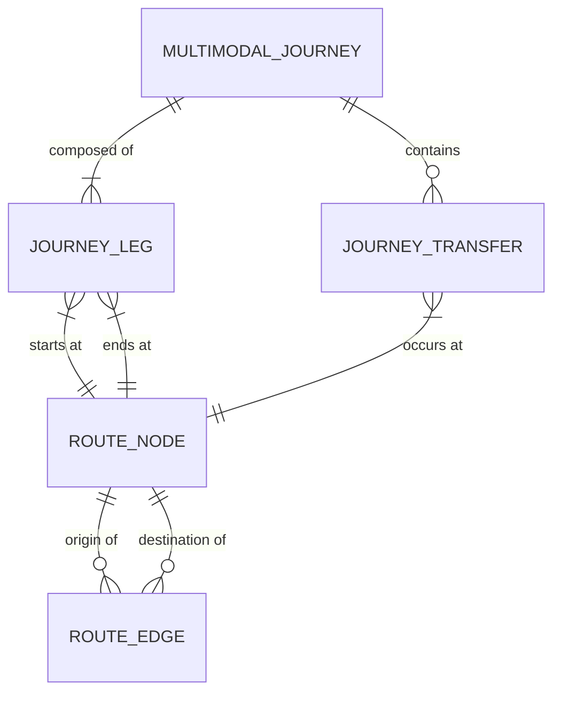

# BHARATYATRA AI 2.0 — ROUTE GRAPH & TRANSIT NETWORK SCHEMA
## Node, Edge, Multimodal Journey & Transfer Data Model Specifications

**Document Version**: 2.0.0  
**Phase**: AI 2.0 — Phase 7 Master Implementation  
**Status**: VERIFIED & BENCHMARKED  
**Author**: Principal Geospatial AI Architect & Travel Data Engineer  

---

## 1. Graph Entity Relationship Diagram



---

## 2. Interface Definitions

### A. RouteNode Interface
```typescript
export interface RouteNode {
  id: string;                    // Unique identifier, e.g. 'AMD_AIR', 'DEL_AIR', 'DWK_RAIL'
  code: string;                  // Standard IATA, IRCTC, or Regional code ('AMD', 'NDLS', 'DWK')
  name: string;                  // Official name: 'Sardar Vallabhbhai Patel International Airport'
  city: string;                  // City or district centroid ('Ahmedabad')
  stateOrUt: string;             // Indian State or Union Territory ('Gujarat')
  type: TransitNodeType;         // 'airport' | 'railway' | 'bus-terminal' | 'ferry-wharf' | 'city-center' | 'attraction'
  lat: number;                   // Geographic WGS84 latitude
  lng: number;                   // Geographic WGS84 longitude
  altitudeMeters: number;        // Elevation above sea level (e.g. 3,256m for Leh IXL)
  isHighAltitude: boolean;       // True if >= 2,800m
  operatingHours?: string;       // e.g. '24/7' or '05:00 - 23:00'
  hasBaggageTransfer?: boolean;  // Interline baggage agreement capability
  facilities: string[];          // ['metro', 'prepaid-taxi', 'ev-charging', 'lounge']
}
```

### B. RouteEdge Interface
```typescript
export interface RouteEdge {
  id: string;                         // Unique corridor ID: 'EDGE_FLT_AMD_DEL'
  sourceNodeId: string;               // Origin node ID ('AMD_AIR')
  targetNodeId: string;               // Target node ID ('DEL_AIR')
  mode: TransportMode;                // 'flight' | 'train' | 'bus' | 'road' | 'ferry' | 'walking'
  serviceType: string;                // 'IndiGo A320 Direct', 'Vande Bharat Express', 'HRTC Volvo'
  distanceKm: number;                 // Measured route distance in kilometers
  durationMinutes: number;            // Active travel duration (excluding layover buffers)
  baseCostInr: {
    budget: number;                   // Economy/Sleeper/State bus class tariff
    standard: number;                 // Standard AC 3-Tier/AC Volvo/Sedan share tariff
    premium: number;                  // Business Class/Executive Chair Car/Private SUV tariff
  };
  frequencyDaily: number;             // Number of scheduled departures per day
  scheduleNotes?: string;             // Operational hints: 'Morning flights only due to crosswinds'
  seasonalMonthsAvailable: number[];  // Array of active months [1..12]
  requiresPermit?: boolean;           // True for restricted zones (ILP/PAP)
  permitName?: string;                // e.g. 'Ladakh Inner Line Permit (LAHDDC)'
  provenance: DataProvenance;         // 'LIVE_VERIFIED' | 'REFERENCE_DATA' | 'HISTORICAL_INFORMATION'
  lastVerifiedTimestamp: string;      // ISO 8601 string
  reliabilityScore: number;           // 0.0 - 1.0 carrier reliability metric
}
```

### C. JourneyTransfer Interface
```typescript
export interface JourneyTransfer {
  transferIndex: number;              // 0-indexed position within journey
  atNode: RouteNode;                  // Transit hub where transfer takes place
  incomingLegIndex: number;           // Index of arriving leg
  outgoingLegIndex: number;           // Index of departing leg
  incomingMode: TransportMode;        // Mode arriving ('flight')
  outgoingMode: TransportMode;        // Mode departing ('road')
  terminalChangeRequired: boolean;    // Flag for terminal shifts (e.g. DEL T1 -> T3)
  recommendedBufferMinutes: number;   // Required connection buffer time
  feasibilityRating: 'Comfortable' | 'Tight' | 'High-risk' | 'Not feasible' | 'Unknown';
  feasibilityExplanation: string;     // Contextual human explanation
  unprotectedTicketWarning: boolean;  // True if legs are booked on independent separate PNRs
}
```

### D. MultimodalJourney Interface
```typescript
export interface MultimodalJourney {
  journeyId: string;
  originQuery: string;
  destinationQuery: string;
  originNode: RouteNode;
  destinationNode: RouteNode;
  legs: JourneyLeg[];
  transfers: JourneyTransfer[];
  totalDistanceKm: number;
  totalTransitMinutes: number;
  totalBufferMinutes: number;
  totalJourneyMinutes: number;
  totalCostInr: {
    budget: number;
    standard: number;
    premium: number;
  };
  primaryMode: TransportMode | 'multimodal';
  modeSummary: string;
  isDirect: boolean;
  transfersCount: number;
  seasonalAdvisories: string[];
  permitsRequired: string[];
  lastMileResolved: boolean;
  lastMileDetails?: {
    hubToCentroidKm: number;
    estimatedLocalDurationMinutes: number;
    availableLocalModes: string[];
    isUnverified: boolean;
  };
  overallProvenance: DataProvenance;
  overallReliabilityScore: number;
}
```

---

## 3. Supported Multi-Modal Combinations

1. **Flight + Scenic Road**: e.g., Flight from Mumbai to Kochi (COK) + Private AC Cab to Munnar Hill Station (110 km).
2. **Train + EV Feeder**: e.g., Vande Bharat Express from Ahmedabad (ADI) to Ekta Nagar (EKNR) + EV Shuttle to Statue of Unity (6 km).
3. **Flight + Connecting Flight**: e.g., AMD to DEL (90 min) + 120 min Transfer Buffer + DEL to Leh IXL (80 min).
4. **Flight + High-Speed Ferry**: e.g., Flight to Port Blair (IXZ) + Makruzz Luxury Catamaran from Phoenix Bay Jetty to Havelock Island (54 km).
5. **Urban Water Metro**: e.g., High Court Water Metro Jetty to Fort Kochi / Vypin electric water metro network.

