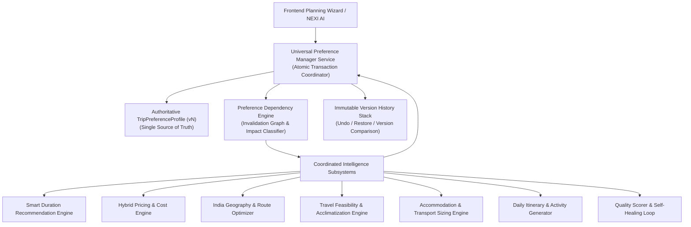

# BHARATYATRA UNIVERSAL TRIP PREFERENCES ARCHITECTURE
## Centralized State Management, Single Source of Truth & Subsystem Coordination

**Document ID:** `BY-ARCH-AI2-PREF-002`  
**Classification:** Foundational Architecture Specification  
**System:** BharatYatra AI 2.0  
**Status:** Implemented & Verified in Production  
**Date:** October 30, 2026  

---

### 1. Executive Summary & Purpose

The **Universal Trip Preferences Engine** establishes a single, authoritative, type-safe, and persistent source of truth for travel planning across the entire BharatYatra platform. 

Prior to Phase 2, preference state was fractured across multiple disconnected layers (`localStorage`, React component state, backend request DTOs), leading to preference loss, silent overwrites, and desynchronization. In Phase 2, every trip-planning calculation—from duration recommendations and route optimization to hybrid pricing and daily itineraries—reads from and writes back to this centralized, versioned engine.

---

### 2. Core Architectural Pillars

#### Pillar 1: Single Source of Truth (SSOT)
- **Authoritative Entity**: [`TripPreferenceProfile`](file:///c:/Users/Pandya%20Kaushal/Desktop/BhartYatra_5/lib/ai-planner/universal-preference-profile.ts)
- No individual planning module maintains an independent or conflicting copy of user preferences.
- When an AI module recommends an adjustment (e.g. changing duration or transport mode), it must pass through the preference manager as a proposed patch rather than silently modifying internal variables.

#### Pillar 2: Dependency Intelligence & Selective Invalidation
- Changing a preference does **not** trigger a blind, expensive re-generation of the entire trip.
- The engine uses a typed dependency graph ([`preference-dependency-engine.ts`](file:///c:/Users/Pandya%20Kaushal/Desktop/BhartYatra_5/lib/ai-planner/preference-dependency-engine.ts)) to recalculate *only* affected modules (e.g., budget change triggers pricing and stay adjustments while leaving food and destination strictly intact).

#### Pillar 3: User Locking & Medical Constraint Air-Gaps
- Users can lock specific parameters (🔒).
- Medical safety rules (e.g., mandatory 48-hour acclimatization for destinations at $\ge 2800\text{m}$) are enforced as system constraints.
- The AI cannot override locked or system-constrained settings without explicit customer confirmation via HTTP `409 Conflict`.

#### Pillar 4: Atomic State & Concurrency Control
- All preference mutations occur inside transactional workflows that increment version numbers ($v_1 \to v_2 \to v_3$).
- Previous valid itineraries are preserved during calculation so the UI never displays broken states.
- Outdated asynchronous calculation responses are discarded to prevent race conditions.

#### Pillar 5: Multi-Version Stack, Undo & Restoration
- Every successful recalculation pushes a snapshot to history: `{ version, timestamp, profile, planSnapshot, explanation }`.
- Travelers can undo customizations, restore any historical plan, or compare differences between two versions.

---

### 3. Subsystem Coordination Interface

| Planning Subsystem | Consumer Method | Role in Coordination |
| :--- | :--- | :--- |
| **Duration Engine** | `calculateIntelligentDurations()` | Receives origin, destination, pace; computes Quick, Recommended, and Extended lengths with altitude buffers. |
| **Hybrid Pricing Engine** | `computeHybridTripPricing()` | Receives travelers count, duration, tier; applies room-based accommodation math ($\lceil \text{pax} / 2 \rceil$) and vehicle sizing. |
| **Geography & Routes** | `optimizeRouteSequence()` | Receives origin, destination list, interests; clusters spatial stops and assigns terrain speeds. |
| **Travel Feasibility** | `validateTripPlan()` | Verifies road pass closures, daily attraction densities, and transit schedules. |
| **Itinerary Generator** | `generateDailyItineraries()` | Assembles day-by-day morning, afternoon, evening, meal, and stay schedules. |
| **Quality Scorer** | `scorePlanQuality()` | Validates plan quality ($\ge 85$) before committing version snapshot. |

---

### 4. Implementation Artifacts in Repository

1. **Schema & Models**: [`lib/ai-planner/universal-preference-profile.ts`](file:///c:/Users/Pandya%20Kaushal/Desktop/BhartYatra_5/lib/ai-planner/universal-preference-profile.ts)
2. **Dependency Manager**: [`lib/ai-planner/preference-dependency-engine.ts`](file:///c:/Users/Pandya%20Kaushal/Desktop/BhartYatra_5/lib/ai-planner/preference-dependency-engine.ts)
3. **Manager Service**: [`lib/ai-planner/preference-manager-service.ts`](file:///c:/Users/Pandya%20Kaushal/Desktop/BhartYatra_5/lib/ai-planner/preference-manager-service.ts)
4. **Natural Language Parser**: [`lib/ai-planner/nl-preference-parser.ts`](file:///c:/Users/Pandya%20Kaushal/Desktop/BhartYatra_5/lib/ai-planner/nl-preference-parser.ts)
5. **REST API**: [`app/api/v1/trips/preferences/route.ts`](file:///c:/Users/Pandya%20Kaushal/Desktop/BhartYatra_5/app/api/v1/trips/preferences/route.ts)
6. **Frontend Hook & UI**: [`lib/ai-planner/preferences-context.tsx`](file:///c:/Users/Pandya%20Kaushal/Desktop/BhartYatra_5/lib/ai-planner/preferences-context.tsx) and [`components/ai/UniversalPreferenceControls.tsx`](file:///c:/Users/Pandya%20Kaushal/Desktop/BhartYatra_5/components/ai/UniversalPreferenceControls.tsx)

