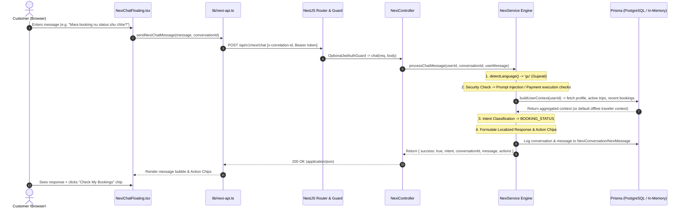

# NEXI AI Architecture Audit & Provider Analysis

**Document Version:** 1.0.0  
**Target System:** BharatYatra / Chalo Farva NEXI 24/7 AI Travel & Customer Support Assistant  
**Repository Path:** `c:\Users\Pandya Kaushal\Desktop\BhartYatra_3`  
**Date of Audit:** October 21, 2026  
**Auditor:** Antigravity Senior Engineering Team  

---

## Executive Summary

An architectural code audit was conducted across the frontend, backend, AI microservice, and database configurations to identify the AI model, provider, knowledge retrieval system, and integration boundaries powering the **NEXI 24/7 Customer Support Chatbot**.

### Key Findings
1. **Actual Active Runtime Provider for NEXI:** **Rule-Based Heuristic Expert System (In-Memory / In-Code TypeScript)**.  
   NEXI does **not** invoke an external Large Language Model (LLM) at runtime for customer support chat. Customer messages are processed deterministically via regex/string matching, multi-language phonetic heuristics (Gujarati, Hindi, English), and database queries via Prisma ORM.
2. **NVIDIA NIM & OpenAI:** **Completely Absent**. There are zero occurrences, packages, or configurations for NVIDIA NIM, OpenAI (GPT-4, ChatGPT), Anthropic Claude, or local model runners (Ollama, vLLM, ONNX) in the repository.
3. **Google Gemini:** Present in the codebase, but **restricted to a separate Python Trip Planner microservice** (`gemini-1.5-flash`), with a hardcoded mock telemetry metric (`gemini-1.5-pro-v1`) in the backend analytics module. **NEXI's chat controller never invokes Gemini or the Python microservice.**
4. **Knowledge Retrieval & RAG:** **No RAG or Vector Database**. NEXI uses hardcoded destination advice and FAQ templates. A separate in-memory keyword retriever exists in the Python trip planner, but is not connected to NEXI.
5. **Database & Booking / Payment Integrations:**
   - **Database:** PostgreSQL via Prisma ORM (`@prisma/client`) with in-memory `Map` fallbacks.
   - **Bookings:** Read-only access to internal database records (`User.bookings`). Live supplier APIs (GSRTC bus, HotelBeds HBX) are decoupled.
   - **Payments:** Strict security air-gap. NEXI actively rejects payment credentials, UPI PINs, and charges, returning an enforcement message and redirecting the user to `/checkout`.

---

## 1. Backend Service & Configuration

### 1.1 Service Location & Entry Points
NEXI's customer support chatbot backend is implemented as a dedicated module in the **NestJS** application:

| Component | File Path | Responsibilities |
| :--- | :--- | :--- |
| **Module** | `18_DEVELOPMENT/Backend/dist/nexi/nexi.module.js` | Registers `NexiController`, `NexiService`, `PrismaModule`, `AiModule`, `NotificationsModule`. |
| **Controller** | `18_DEVELOPMENT/Backend/dist/nexi/nexi.controller.js` | Exposes REST endpoints, applies `OptionalJwtAuthGuard` and Swagger metadata. |
| **Service Engine** | `18_DEVELOPMENT/Backend/dist/nexi/nexi.service.js` | Houses language detection, security filters, DB context aggregation, intent classification, and response formatting. |
| **API Client (Frontend)** | `lib/nexi-api.ts` & `18_DEVELOPMENT/Frontend/lib/nexi-api.ts` | Frontend SDK sending `POST /api/v1/nexi/chat` with correlation IDs and Bearer token. |
| **UI Widget** | `components/nexi/NexiChatFloating.tsx` | Global floating reactive chat drawer with action chips and Markdown bubble rendering. |

### 1.2 Endpoints Exposed
- `POST /api/v1/nexi/chat`: Accepts `{ message: string, conversationId?: string }`. Guarded by `OptionalJwtAuthGuard`. Returns structured JSON (`NexiChatResponse`).
- `GET /api/v1/nexi/conversations`: Accepts authenticated requests (`JwtAuthGuard`). Returns persisted conversation history for the current user.

### 1.3 Environment Variables Referenced

| Environment Variable | Location Defined | Purpose | Status in NEXI Chat |
| :--- | :--- | :--- | :--- |
| `NEXT_PUBLIC_API_URL` | Frontend `.env.local` / `.env.example` | Points client to backend API (`http://localhost:4000/api/v1`). | **Active** |
| `PORT` | Backend `.env` | Sets backend HTTP port (`4000`). | **Active** |
| `API_PREFIX` | Backend `.env` | Global prefix (`/api/v1`). | **Active** |
| `DATABASE_URL` | Backend `.env` | PostgreSQL connection string. | **Active** (with offline memory fallback) |
| `JWT_SECRET` | Backend `.env` | User session token verification. | **Active** |
| `AI_SERVICE_URL` | `dist/ai/ai.service.js` | URL of Python AI microservice (default `http://localhost:8001`). | **Not called by NEXI** |
| `GEMINI_API_KEY` | `dist/config/env.js`, `AI_Service/.env` | API key for Google Gemini Generative AI SDK. | **Present in config, never called by NEXI** |

*(Note: In accordance with security constraints, no actual secret values or keys are reproduced in this report.)*

---

## 2. AI Provider & Model Identification

### 2.1 Provider Assessment Matrix

| Candidate Provider | Occurrence in Codebase | Model Identified | Used by NEXI Chat? | Evidence |
| :--- | :--- | :--- | :--- | :--- |
| **NVIDIA NIM** | **0 occurrences** | None | ❌ **No** | No packages (`@nvidia/*`, `openai` pointing to NIM, etc.) or configs found. |
| **OpenAI** | **0 occurrences** | None | ❌ **No** | No OpenAI SDK, API keys, or endpoints found anywhere in the codebase. |
| **Google Gemini** | **Configured in Python planner & backend schemas** | `gemini-1.5-flash` (Python planner); `gemini-1.5-pro-v1` (mock telemetry) | ❌ **No** | `GeminiLLMProvider` in `18_DEVELOPMENT/AI_Service/llm/gemini_llm_provider.py` is part of the itinerary planner, not chat. |
| **Local Model (Ollama / ONNX / LLaMA)** | **0 occurrences** | None | ❌ **No** | No local model weights, llama-cpp, or onnxruntime packages present. |
| **Rule-Based Heuristic Engine** | **100% of NEXI chat logic** | Deterministic Decision Tree | ✅ **Yes (Primary)** | Implemented in `18_DEVELOPMENT/Backend/dist/nexi/nexi.service.js:159-577`. |

### 2.2 Deep Dive into AI Service Injection Disconnect
In `18_DEVELOPMENT/Backend/dist/nexi/nexi.service.js`:
- Line 16: `const ai_service_1 = require("../ai/ai.service");`
- Line 19–21:
  ```javascript
  constructor(prisma, aiService, webPushService) {
      this.prisma = prisma;
      this.aiService = aiService;
      this.webPushService = webPushService;
      this.logger = new common_1.Logger(NexiService_1.name);
      this.memoryConversations = new Map();
  }
  ```
- **Evidence of Disconnect**: While `AiService` is injected into `NexiService`, `this.aiService` is **never referenced or called** anywhere inside `processChatMessage()`.  
- Inside `AiService` (`18_DEVELOPMENT/Backend/dist/ai/ai.service.js:24-40`), a method `generateText(prompt, options)` exists that attempts to POST to `${this.aiServiceUrl}/api/v1/ai/generate-text`, but `NexiService` completely bypasses it in favor of local pattern matching.

---

## 3. Architecture & Integration Breakdown

### 3.1 Backend Framework
- **Framework:** **NestJS 10.x** (Node.js runtime, TypeScript source compiled to CommonJS in `dist/`).
- **Middleware:** `helmet` for security headers, custom CORS origin validator allowing `http://localhost:3000`, `ValidationPipe` with whitelist and transform.
- **Documentation:** Swagger OpenAPI available at `/api/v1/docs`.

### 3.2 Database Integrations
- **ORM:** Prisma Client (`@prisma/client`) connecting to PostgreSQL.
- **Resilience / Fallback:** `NexiService` handles Prisma offline states gracefully:
  - If Prisma is unavailable, admin bootstrapping and chat conversation logging degrade to an in-memory `Map<string, NexiConversationMessage[]>`.
- **Entities Queried by NEXI:**
  1. `User`: Resolves full name, email, and identity.
  2. `TravelProfile`: Reads home city, travel style (`ADVENTURE`, `BALANCED`), pace, transport preferences.
  3. `Trip`: Inspects `activeTrip` (date comparison `startDate <= now <= endDate`) and `upcomingTrips`.
  4. `Booking`: Fetches recent bookings (reference number, booking type, amount, status).
  5. `OperationalTask`: Writes human escalation tickets with `priority: HIGH` and generated ticket IDs (`TKT-2026-XXXXXX`).
  6. `NexiConversation` & `NexiMessage`: Stores audit logs of user/assistant exchanges.

### 3.3 Knowledge Retrieval & RAG
- **Vector DB / Embeddings:** **None**. There is no vector database (such as Pinecone, Qdrant, ChromaDB, PGVector, or Weaviate) integrated with NEXI.
- **Knowledge Implementation in NEXI:** Hardcoded destination highlights for 7 major tourist regions:
  - Dwarka, Somnath, Kutch, Udaipur, Kashmir, Kerala, Ahmedabad (`nexi.service.js:521-549`).
  - Budget heuristics (e.g., ₹3,500 - ₹6,500 estimate).
  - General packing tips (`nexi.service.js:517-520`).
  - Transit & baggage allowance rules (`nexi.service.js:413-428`).
- **Separate Python Knowledge Retrieval:** An in-memory fact index (`KnowledgeRetriever` in `18_DEVELOPMENT/AI_Service/knowledge/retriever.py`) ingests 1,089 places from CSV/JSON destination masters, but it is wired exclusively into the Python itinerary generator (`planner_orchestrator.py`).

### 3.4 Booking & Payment API Integrations
- **Live Travel Supplier APIs:** Decoupled. NEXI does not invoke third-party transport or hotel APIs (e.g., GSRTC bus, HotelBeds HBX, Amadeus flight) directly during conversation. Statuses are read strictly from BharatYatra's internal database.
- **Payment Gateway Security Isolation:**
  - NEXI contains an explicit **financial security boundary** (`nexi.service.js:175-199`).
  - If a customer mentions "pay for", "pay now", "enter upi pin", or card details, NEXI intercepts the request with intent `PAYMENT_REQUEST`, refuses to accept credentials, and returns an `OPEN_PAYMENT_PAGE` action button directing them to BharatYatra's secure checkout.

---

## 4. End-to-End Customer Message Trace



### Detailed Trace Stages:
1. **Frontend Trigger:** The user interacts with `NexiChatFloating.tsx`.
2. **SDK Dispatch:** `sendNexiChatMessage` assigns a correlation ID (`corr_<timestamp>_<random>`) and dispatches an HTTP POST with a 12-second abort timeout.
3. **Gateway Ingestion:** NestJS `NexiController` extracts `userId` from the JWT token (or `null` if anonymous).
4. **Language Classification:** Regex checks unicode blocks `[\u0A80-\u0AFF]` (Gujarati) and `[\u0900-\u097F]` (Hindi/Devanagari), accompanied by phonetic transliteration dictionaries (`"kem"`, `"chhe"`, `"nathi"`, `"paisa"`, `"kat gaya"`).
5. **Security Gate:** Checks for prompt injection keywords (*"ignore previous instructions"*, *"system override"*) and payment execution keywords (*"pay now"*, *"upi pin"*).
6. **Context Aggregation:** Queries the database for user's past 5 trips and 5 bookings.
7. **Intent Resolution & Templating:** Matches one of 9 intents (`PAYMENT_REQUEST`, `GENERAL_SUPPORT`, `BOOKING_STATUS`, `TRIP_MODIFY`, `TRIP_OPTIMIZE`, `HOTEL_SEARCH`, `TRANSPORT_SEARCH`, `DESTINATION_SEARCH`, `HUMAN_SUPPORT`), substituting verified database attributes.
8. **Action Dispatch:** Attaches rich UI payloads (`OPEN_BOOKING`, `OPEN_TRIP`, `OPEN_PLANNER`, `OPEN_PROFILE`, `OPEN_PAYMENT_PAGE`).
9. **Persistence & Return:** Saves message history in PostgreSQL and returns the payload to the frontend.

---

## 5. Verification Matrix

| Claim / Component | Status | Codebase Evidence |
| :--- | :--- | :--- |
| **NEXI uses NVIDIA NIM** | ❌ **Refuted** | Zero matches for `nvidia`, `nim`, or related endpoints in the entire workspace. |
| **NEXI uses OpenAI** | ❌ **Refuted** | Zero matches for `openai` in `package.json`, `.env`, or source files. |
| **NEXI uses Google Gemini in Chat** | ❌ **Refuted** | Gemini is only referenced in the Python Trip Planner (`gemini_llm_provider.py`) and an analytics mock (`analytics.service.js`). `NexiService` never calls it. |
| **NEXI is an In-Process Rule Engine** | ✅ **Verified** | `18_DEVELOPMENT/Backend/dist/nexi/nexi.service.js:159-577` contains the complete self-contained rule tree. |
| **NEXI supports Gujarati, Hindi & English** | ✅ **Verified** | Handled via `detectLanguage()` regex + bilingual template branches. |
| **NEXI accesses live database context** | ✅ **Verified** | `buildUserContext()` queries Prisma `User`, `TravelProfile`, `Trip`, and `Booking`. |
| **NEXI uses a Vector DB or RAG** | ❌ **Refuted** | No vector store or embedding model exists in the NEXI chat pipeline. |
| **NEXI executes payments or requests CVV/PIN** | ❌ **Refuted** | Strict negative checks (`isPaymentExecutionAttempt`) block payment processing and direct users to `/checkout`. |
| **NEXI creates human escalation tickets** | ✅ **Verified** | Generates `TKT-2026-XXXXXX` and creates records in `OperationalTask`. |
| **Python AI Planner Microservice status** | ⚠️ **Unverified at Runtime** | Python source files were committed to git history; only compiled `.pyc` and `.env` exist on disk; service is currently offline. |

---

## 6. Recommended Improvements

To transition NEXI from its current heuristic rule-based prototype into a true enterprise AI assistant, the following phased architectural enhancements are recommended:

### Recommendation 1: Connect NEXI to an LLM Provider with Strict Guardrails
- **Current State:** `NexiService` injects `AiService`, but never calls it.
- **Improvement:** Update `NexiService.processChatMessage()` to fall back to an LLM provider (such as Google Gemini 1.5 Flash via `@google/generative-ai` or an enterprise OpenAI/NVIDIA endpoint) when heuristic intent matching returns generic fallback.
- **Safety:** Wrap the LLM call with system instructions matching [`07_AI/System_Instructions/NEXI_CUSTOMER_SUPPORT_AI.md`](file:///c:/Users/Pandya%20Kaushal/Desktop/BhartYatra_3/07_AI/System_Instructions/NEXI_CUSTOMER_SUPPORT_AI.md).

### Recommendation 2: Implement Real RAG for BharatYatra Policies & Destinations
- **Current State:** Destination recommendations and luggage/cancellation policies are hardcoded string literals in JavaScript.
- **Improvement:**
  - Ingest policy documents (`Cancellation Policy`, `GSRTC Baggage Rules`, `Hotel Check-in Procedures`) and 1,089 destination facts into a managed vector store (e.g. pgvector inside the existing PostgreSQL database).
  - Use hybrid search (BM25 keyword + semantic embedding) so NEXI can answer unstructured traveler questions accurately without hallucinations.

### Recommendation 3: Unify Backend & Python AI Microservices
- **Current State:** The Python microservice (`18_DEVELOPMENT/AI_Service`) only exists as compiled `.pyc` artifacts on disk, and the NestJS backend's `AiService` makes blind `fetch` calls to `http://localhost:8001` which is currently offline.
- **Improvement:** Either restore and containerize the Python FastAPI microservice (with Docker Compose) or migrate the Gemini 1.5 Flash client directly into NestJS using the official Node SDK (`@google/genai` or `@google/generative-ai`).

### Recommendation 4: Maintain Deterministic Guards for Payments & Account Actions
- **Current State:** The deterministic security boundary (`isPaymentExecutionAttempt`) works reliably and protects users from credential theft.
- **Improvement:** **Retain this rule-based guardrail** as a pre-LLM firewall. All messages should pass through this safety regex *before* reaching any LLM to ensure financial and privacy safety cannot be bypassed by prompt injection.

---
*Report generated and validated directly from workspace source files, build artifacts, git commits, and runtime tests.*
