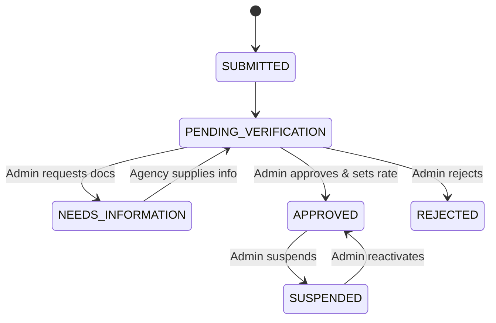
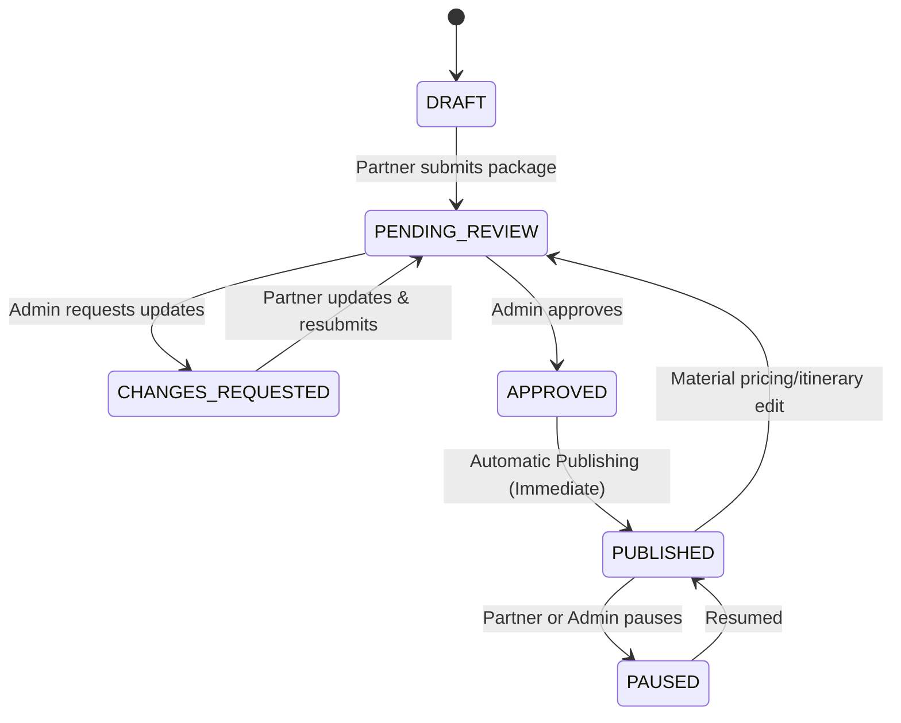

# BHARATYATRA TRAVEL PARTNER & PACKAGE MANAGEMENT ECOSYSTEM

## 1. Overview & Architecture
The BharatYatra Travel Partner Ecosystem enables local travel agencies, destination management companies (DMCs), and tour operators across India (Gujarat, Rajasthan, Uttarakhand, Kerala, Assam, Kashmir, etc.) to register, get verified, manage tour packages, and receive customer bookings.

### Business Model: Option A — Commission-Based Marketplace
- Agencies supply and fulfill their own tour packages.
- BharatYatra provides discovery, package presentation, customer quotation coordination, and transparent contractual commission tracking (standard 10.00% on eligible completed bookings).
- Onboarding Model: **Option 3 — Public registration form + Private partner dashboard**.

---

## 2. Implemented Route Directory

### A. Public Website Routes
| Route | Description |
|---|---|
| `/partners/register` | Mobile-first 4-step public travel agency registration wizard |
| `/partners/application-status` | Secure application status tracker (Lookup by Reference `BY-AGY-XXXXXX` and email) |
| `/packages` | Public curated packages directory (dynamically merging published partner packages) |
| `/packages/[slug]` | Dedicated package detail page with quotation customizer and booking request |

### B. Private Partner Portal (`/partner/...`)
| Route | Description |
|---|---|
| `/partner/dashboard` | Telemetry overview: agency status, packages, bookings, gross booking value, commission ledger |
| `/partner/packages` | Package catalog table with publication status badges and quick actions |
| `/partner/packages/new` | 7-step Package Creation Wizard (Basic details, Itinerary, Pricing, Inclusions, Availability, Media, Preview) |
| `/partner/packages/[id]/edit`| Package editor with draft saving and review submission |
| `/partner/bookings` | Manage customer booking requests and upcoming departures |
| `/partner/commissions` | Reconciled financial ledger: booking ref, gross amount, commission rate, net payout |
| `/partner/profile` | Manage business contacts and service regions (sensitive fields locked) |
| `/partner/notifications` | Real-time in-app operational notification center |
| `/partner/settings` | Executed partner agreement, commission schedule, and compliance terms |

### C. Operations Admin Portal (`/admin/...`)
| Route | Description |
|---|---|
| `/admin/travel-partners` | Search and filter partner applications (SUBMITTED, APPROVED, SUSPENDED, etc.) |
| `/admin/travel-partners/[id]` | Agency dossier, document inspection, approve/reject/request info/suspend modal |
| `/admin/travel-packages` | Moderation queue for partner-submitted packages |
| `/admin/travel-packages/[id]/review` | Side-by-side package reviewer with instant automatic publication |
| `/admin/travel-commissions` | Platform-wide commission ledger and payout settlement manager |
| `/admin/travel-partner-audit` | Immutable audit trail tracking all partner and admin events |

---

## 3. REST API Contracts (`/api/v1/...`)

### Public Endpoints
- `POST /api/v1/travel-partners/applications`: Submit new agency application.
- `GET /api/v1/travel-partners/application-status?ref=BY-AGY-XXXXXX&email=...`: Check status.
- `GET /api/v1/travel-packages`: Retrieve public approved and published packages.
- `GET /api/v1/travel-packages/:slug`: Retrieve published package details.
- `POST /api/v1/packages/booking`: Customer booking request + commission ledger accrual.

### Partner Endpoints
- `GET /api/v1/partner/dashboard`: Telemetry metrics.
- `GET & PATCH /api/v1/partner/profile`: Agency profile management.
- `GET & POST /api/v1/partner/packages`: Package list and draft creation.
- `GET & PATCH /api/v1/partner/packages/:id`: Specific package details & updates.
- `POST /api/v1/partner/packages/:id/submit`: Submit draft package for review.
- `POST /api/v1/partner/packages/:id/pause`: Pause or resume live package.
- `GET /api/v1/partner/commissions`: Financial ledger entries.
- `GET /api/v1/partner/notifications`: Partner notification alerts.

### Admin Endpoints
- `GET /api/v1/admin/travel-partners`: List and search applications.
- `GET /api/v1/admin/travel-partners/:id`: Get full agency dossier.
- `POST /api/v1/admin/travel-partners/:id/approve`: Approve agency and set commission rate.
- `POST /api/v1/admin/travel-partners/:id/reject`: Reject application with reason.
- `POST /api/v1/admin/travel-partners/:id/request-information`: Request document corrections.
- `POST /api/v1/admin/travel-partners/:id/suspend`: Suspend agency and auto-suppress packages.
- `GET /api/v1/admin/travel-packages`: Moderation queue.
- `POST /api/v1/admin/travel-packages/:id/approve`: Approve package (Automatic Publishing).
- `POST /api/v1/admin/travel-packages/:id/request-changes`: Request itinerary/price corrections.
- `POST /api/v1/admin/travel-packages/:id/reject`: Reject package.
- `POST /api/v1/admin/travel-packages/:id/pause`: Pause package listing.
- `GET /api/v1/admin/travel-commissions`: Platform financial ledger.
- `POST /api/v1/admin/travel-commissions/settle`: Settle partner payout with banking reference.
- `GET /api/v1/admin/travel-partner-audit`: View immutable audit log history.

---

## 4. Lifecycle State Machines

### Agency Lifecycle


### Package Lifecycle & Automatic Publishing Rule


**Automatic Publishing Rule:**
When an administrator approves a package, the system automatically checks:
1. Owning agency is `APPROVED` and active.
2. Package mandatory information is complete.
3. Base price is valid (`base_price > 0`).
If verified, the status instantly transitions to `PUBLISHED` and appears in public queries without manual database intervention.

**Suspension Cascade:**
When an agency is marked as `SUSPENDED`, all of its published packages are immediately suppressed (`publicationStatus = 'PAUSED'`) and excluded from public search queries.

---

## 5. PostgreSQL Database Schema
Migration file: `data/migrations/20261012_travel_partner_ecosystem.sql`

Includes:
- `travel_agencies`
- `agency_verification_documents`
- `travel_partner_agreements`
- `travel_packages`
- `travel_package_itinerary`
- `travel_package_departures`
- `travel_package_reviews`
- `travel_commission_ledger`
- `travel_partner_audit_logs`
- `travel_partner_notifications`

---

## 6. Verification & Automated Test Results
To execute the automated test suite:
```bash
npx tsx --test __tests__/travel-partner-ecosystem.test.ts
```

All 12 core test suites pass:
- Public Agency Registration
- Anti-Abuse duplicate prevention
- Application status lookup security
- Authorization guards on unapproved agencies
- Admin verification & agreement creation
- Package lifecycle & draft saving
- Cross-agency ownership guards
- Administrative review & automatic publishing
- Contractual commission calculation & idempotency
- Payout settlement workflow
- Agency suspension cascade suppression
