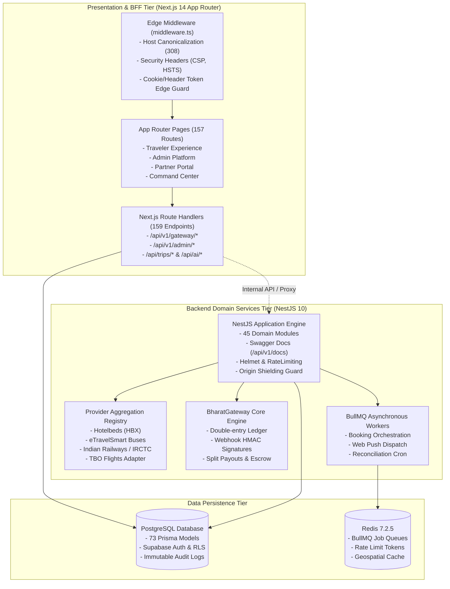
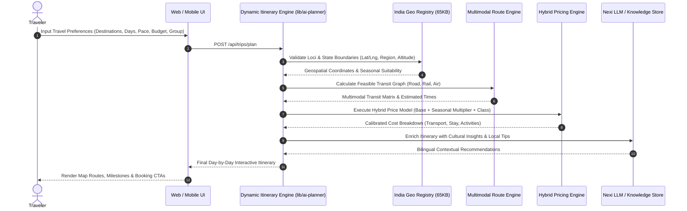
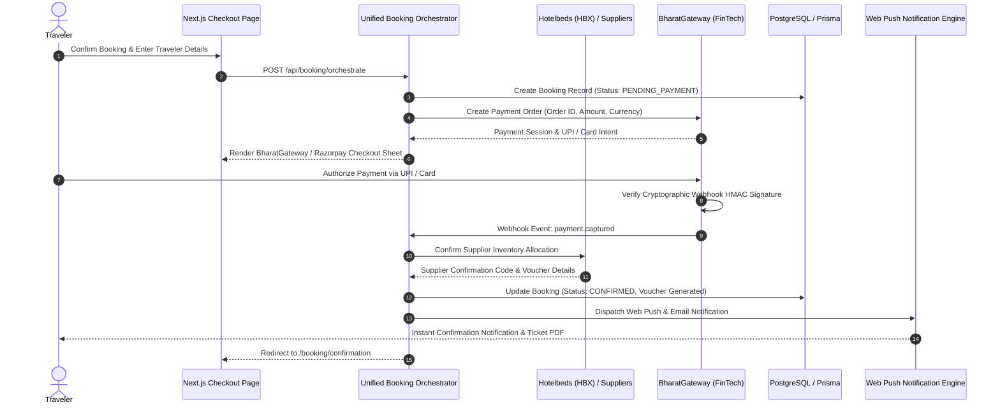

# BharatYatra — Complete System Architecture Specification

> **Audit Phase:** Phase 1 Technical Architecture Audit  
> **Status:** Production Verified Architecture  
> **Target Audience:** Independent Technical Auditors, System Architects, Mobile Transformation Engineers  

---

## 1. System Architecture Overview

BharatYatra is engineered as an enterprise-grade multi-tier architecture consisting of:
1. **Frontend Presentation & BFF (Backend-for-Frontend) Layer:** A Next.js 14 App Router application deployed on edge infrastructure (Vercel / Node.js container), containing 157 user-facing pages, an edge security middleware (`middleware.ts`), and 159 serverless API route handlers.
2. **Backend Domain Services Layer:** A standalone modular NestJS 10 application (`18_DEVELOPMENT/Backend`) structured into 45 domain modules, providing business logic, third-party supplier abstraction, cryptographic payment reconciliation, BullMQ background queues, and Swagger API documentation.
3. **AI Planning & Intelligence Engine:** A hybrid intelligence architecture composed of:
   - 34 specialized TypeScript intelligence modules in `lib/ai-planner/` (graph-based routing, Indian geographic registries, duration calibration, and hybrid cost modeling).
   - The **Nexi AI** contextual customer support and itinerary copilot (`components/nexi/`, `lib/nexi-api.ts`, NestJS `src/nexi/`).
4. **Data Persistence & Isolation Tier:**
   - **Supabase Cloud PostgreSQL:** High-availability database managing user authentication, row-level security (RLS), partner applications, and direct relational queries.
   - **Prisma PostgreSQL Engine:** 73 relational data models defining the core transaction engine, ledger, inventory, packages, and bookings.
   - **Redis 7.2 Cache & BullMQ:** Distributed in-memory storage for asynchronous queues, rate limiting, and cache invalidation.

---

## 2. Frontend Architecture (Next.js 14 App Router)

### 2.1 App Router Paradigm
The application utilizes Next.js 14 App Router with React Server Components (RSC) and explicit `'use client'` boundaries:
- **Server Components (Default):** Utilized for initial HTML streaming, SEO metadata generation, canonical URL injection, and initial database/catalog lookups.
- **Client Components (`'use client'`):** Utilized where browser APIs, Leaflet interactive maps, interactive modals, local storage access, or reactive state machines are required.

### 2.2 Route Hierarchy & Grouping
The 157 registered pages under `app/` are divided into core domains:
- `app/(customer)/*`: Traveler customer journey including `/activities`, `/ai-planner`, `/buses`, `/trains`, `/destinations`, `/packages`, `/checkout`, and `/booking`.
- `app/admin/*`: 35 super-admin operational pages covering booking matrices, inventory management, financial audit logs, CMS controls, refund workflows, and partner oversight.
- `app/supplier/*` & `app/partner/*`: 12 vendor and supplier portal pages for onboarding, inventory upload, tour package drafting, and commission tracking.
- `app/bharatyatra-ops/*`: 11 operational control center pages for flight tracking, live ground telemetry, and driver dispatch.
- `app/trips/*`: Trip command center with group expense splitting, ticket downloads, and live ground radar.
- `app/bharatgateway/*`: 6 merchant-facing and sandbox FinTech payment testbed pages.

### 2.3 Edge Security Middleware (`middleware.ts`)
The edge middleware intercepts every incoming request before routing:
1. **Canonical Host Enforcement:** Permanently redirects apex domains (`bharatyatra.in`, `bharatyatra.com`, `www.bharatyatra.com`) to `https://www.bharatyatra.in` with HTTP 308.
2. **Defensive Security Headers:** Emits `X-Content-Type-Options: nosniff`, `X-Frame-Options: DENY`, `Referrer-Policy: strict-origin-when-cross-origin`, and `X-DNS-Prefetch-Control: on`.
3. **Multi-Source Authentication Edge Inspection:** Extracts authentication tokens from:
   - `Authorization: Bearer <token>`
   - Dedicated cookies: `sb_auth_token`, `sb-access-token`, `auth_token`, `sb_refresh_token`, `admin_token`, and wildcard Supabase auth cookies (`sb-*-auth-token`).
4. **Admin Edge Guard:** Restricts `/admin/*` routes to requests presenting an authenticated admin session, redirecting unauthorized traffic to `/admin/login?returnTo=...`.
5. **Protected Customer Edge Guard:** Guards customer routes (`/my-trips`, `/bookings`, `/profile`, `/saved`, `/checkout`), cleanly redirecting document requests to `/login?returnTo=...`.

---

## 3. Backend Architecture (NestJS 10 Enterprise Microservice)

The backend in `18_DEVELOPMENT/Backend` is constructed using NestJS 10 with TypeScript:

### 3.1 Modular Organization
The system follows strict separation of concerns into 45 specialized modules in `src/app.module.ts`:
- **Core Infrastructure Modules:** `ConfigModule`, `PrismaModule`, `RedisModule`, `SecurityModule`, `QueueModule`, `AuditModule`, `HealthModule`.
- **Domain Entity Modules:** `UsersModule`, `DestinationsModule`, `TripsModule`, `ItinerariesModule`, `HotelsModule`, `BusesModule`, `TrainsModule`, `FlightsModule`, `PackagesModule`, `ActivitiesModule`, `RestaurantsModule`.
- **FinTech & Booking Modules:** `BookingsModule`, `PaymentsModule`, `RefundsModule`, `FinancialModule`, `GatewayModule`, `CartModule`, `CheckoutModule`, `OrdersModule`, `CancellationsModule`.
- **Supplier & Operations Modules:** `SuppliersModule`, `AdminModule`, `ProviderAdminModule`, `LaunchModule`, `AnalyticsModule`.
- **AI & Intelligence Modules:** `AiModule`, `AdaptiveAiModule`, `NexiModule`.

### 3.2 Defensive Network Architecture (`main.ts`)
- **Reverse Proxy Derivation:** Express `trust proxy` configured via `TRUST_PROXY` env var for accurate client IP identification behind Cloudflare/AWS.
- **Resource Exhaustion Defense:** Global JSON and URL-encoded body size cap (`MAX_REQUEST_BODY_SIZE`, default `1mb`).
- **Raw Webhook Verification Buffer:** Raw request body retained in `req.rawBody` for cryptographic HMAC signature verification on Razorpay / bank webhooks.
- **Helmet Security Middleware:** Pre-configured with Cross-Origin Resource Policy, XSS filter, frameguard, and sniffing prevention.
- **Origin Shielding Guard:** When `ORIGIN_VERIFY_SECRET` is set, blocks direct origin bypassing, requiring `x-origin-verify` or `cf-origin-token`.
- **Slowloris & Connection Starvation Timeouts:** Strict bounded timeouts on HTTP headers (`20,000ms`), request execution (`30,000ms`), and keep-alive (`5,000ms`).
- **Swagger Documentation:** Auto-generated OpenAPI / Swagger documentation mounted at `/api/v1/docs`.

---

## 4. AI Trip Planner & Nexi Intelligence Architecture

The AI engine in BharatYatra is constructed without brittle single-prompt dependencies, using a robust multi-stage constraint solving pipeline:

### Key AI Planner Components (`lib/ai-planner/`):
1. `india-geo-registry.ts` (65 KB): Exhaustive geographical registry of Indian states, districts, union territories, high-altitude passes, and monsoon risk zones.
2. `dynamic-itinerary-engine.ts` (59 KB): Deterministic constraint solver ensuring sensible travel pace, rest intervals, and geographic sequencing.
3. `hybrid-pricing-engine.ts` (49 KB) & `pricing-calibration-engine.ts` (48 KB): High-precision financial estimator incorporating fuel indexing, seasonal demand surges, and hotel rate tiers.
4. `route-graph-engine.ts` (46 KB): Topological graph connecting Indian tourist hubs via national highways, expressways, and rail junctions.
5. `travel-recommendation-engine.ts` (43 KB): Content-based and preference-matching recommendation algorithm for attractions and dining.

---

## 5. Database Architecture & Multi-Tenancy

### 5.1 Dual Database Design Pattern
BharatYatra maintains a high-assurance dual database design:
- **Client-Accessible Layer (Supabase PostgreSQL):** Accessed directly by client apps via authenticated Supabase tokens. Secured strictly via **Row-Level Security (RLS)** policies defined in `supabase/migrations/20261028000000_user_data_isolation.sql`.
- **System-of-Record Layer (Backend Prisma Engine):** 73 relational models defined in `18_DEVELOPMENT/Backend/prisma/schema.prisma` maintaining the full business ledger, double-entry financial accounts, supplier contracts, and immutable audit logs.

### 5.2 RLS & User Isolation Enforcement
The production migration `20261028000000_user_data_isolation.sql` enforces strict tenant isolation:
- Table `profiles`, `user_preferences`, `user_travel_profiles`, `saved_destinations`: RLS policy `USING (auth.uid() = user_id)`.
- Table `bookings`: RLS policy ensuring customers can only query bookings matching their authenticated identity `auth.uid() = customer_id`.
- Table `group_expenses`: Group travel expenses isolated by `trip_id` with verified membership validation.
- Administrative Tables: Protected with service-role check `auth.jwt() ->> 'role' = 'service_role'` or explicit admin token validation.

---

## 6. Data Flow & Booking Orchestration

---

## 7. Architecture Assessment & Auditor Notes

1. **Clean Decoupling:** The frontend (`app/`) is architected with clear boundaries. It can function as an independent Next.js web application while leveraging the NestJS backend for high-volume enterprise operations.
2. **Resilience & Fallbacks:** Every third-party supplier integration (HBX, eTravelSmart, Razorpay, LLMs) includes graceful degradation and deterministic fallback data fixtures (`mock-hbx-data.ts`, `mock-bus.provider.ts`, `mock_llm_provider.pyc`).
3. **Audit Trail Completeness:** High-risk actions (role elevation, refund processing, package price modifications) automatically record immutable records into `admin_audit_logs` and `operational_tasks`.

