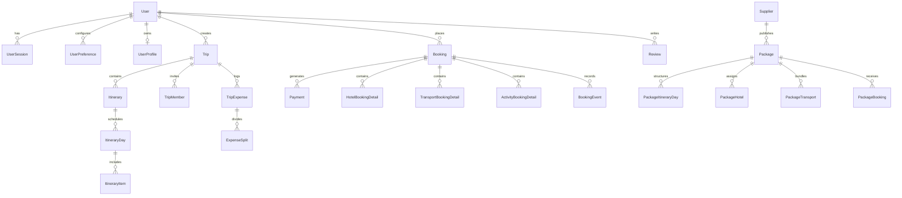

# BharatYatra — Complete Database Architecture & Schema Specification

> **Audit Phase:** Phase 1 Technical Architecture Audit  
> **Primary Relational Engine:** PostgreSQL 15+ (Dual Supabase & Prisma Engine)  
> **Total Prisma Models:** **73 Models** (`18_DEVELOPMENT/Backend/prisma/schema.prisma`)  
> **Production Migrations:** 6 Production Migration Suites (`supabase/migrations/`)  
> **Verification Status:** 100% Extracted from Active Database Definitions  

---

## 1. Database Architecture & Multi-Tenancy Design

BharatYatra operates on an enterprise **dual-layer database design pattern**:
1. **Client-Facing & Authentication Layer (Supabase PostgreSQL):** Handles identity management, user sessions, profile isolation, and partner portal onboarding. Strictly guarded by PostgreSQL **Row-Level Security (RLS)** policies.
2. **System-of-Record & Transaction Engine (Prisma ORM Engine):** 73 relational models in `18_DEVELOPMENT/Backend/prisma/schema.prisma` managing the double-entry accounting ledger, inventory reservations, multi-modal travel bookings, fraud prevention, and admin audit logs.

---

## 2. Core Relational Entity Domains (73 Prisma Models)

The 73 database models are grouped into 10 logical domain clusters:

### 2.1 Identity, Users & Preferences
- `User`: Primary identity record (id, email, passwordHash, phone, role, status, createdAt).
- `UserSession`: Active device session tokens with user-agent, IP hash, and expiration.
- `UserPreference`: User configuration for accessibility, language, dietary requirements, and pace.
- `UserProfile`: Personal travel KYC, emergency contact, passport/Aadhaar status.
- `UserTravelProfile`: AI preference embeddings, preferred travel style, budget ceilings.
- `Traveler`: Co-travelers and passenger directory saved under a primary user account.
- `SavedDestination`: Traveler bookmarks and wishlist loci.

### 2.2 Geography, Catalog & Attractions
- `State`: 28 Indian States & 8 Union Territories with official state tourism metadata.
- `District`: Administrative subdivisions with geographic bounding boxes.
- `City`: Indian urban and rural transit centers.
- `Destination`: Curated tourist loci with geo-coordinates, elevation, best season, and UNESCO tags.
- `DestinationImage`: High-resolution imagery with copyright, CDN URLs, and alt tags.
- `Attraction`: Key monuments, temples, parks, and viewpoints within destinations.
- `Restaurant`: Regional dining establishments with cuisine tags, hygiene ratings, and halal/veg flags.

### 2.3 Curated Tour Packages & Suppliers
- `Supplier`: Verified travel partners, DMCs (Destination Management Companies), and operators.
- `Package`: Multi-day curated tour circuits with pricing, tier, minimum group size.
- `PackageHighlight`: Key experiences included in the tour.
- `PackageItineraryDay`: Day-by-day sequence of tour events.
- `PackageInclusion` & `PackageHotel`: Accommodation and meal plan specifications.
- `PackageTransport`: Dedicated vehicle and transport segments provided.
- `PackageActivity`: Guided tours and excursions included.
- `PackageBooking`: Customer reservations against supplier packages.
- `PackageWishlist`: User bookmarks for tour packages.
- `PackageQuote`: Custom quote negotiations between travelers and suppliers.
- `SupplierBookingRecord`: Supplier-side fulfillment status and PNR confirmation.

### 2.4 AI Trips, Custom Itineraries & Group Expenses
- `Trip`: Custom user-planned journeys generated via AI or custom builder.
- `Itinerary`: Master itinerary schedule linked to a trip.
- `ItineraryDay`: Day-level schedule with date, overnight stay city, and driving distance.
- `ItineraryItem`: Granular activity, attraction visit, or transfer with time slot.
- `TripMember`: Co-travelers collaborating on a shared trip.
- `TripExpense`: Monetary expenditures incurred during group travel.
- `ExpenseSplit`: Multi-currency expense allocation across trip members.
- `GroupExpenseSettlement`: Final peer-to-peer settlement ledger with UPI payment status.

### 2.5 Multi-Modal Transport & Stays
- `Hotel`: Accommodation properties with star rating, amenities, and room inventories.
- `HotelSearchRecord`: Cached search queries and rate availability caches.
- `HotelBookingDetail`: Hotelbeds (HBX) voucher numbers, check-in/out timestamps, room types.
- `HotelBookingGuest`: Passenger and room occupant manifest.
- `BusRoute`: Inter-city bus routes with origin, destination, operator, and amenities.
- `TransportBookingDetail`: PNR records, seat allocations, coach types, boarding points.
- `TransportSegment`: Multi-leg journeys combining road, rail, and air transfers.
- `TransportPassenger`: Ticketed passenger details with berth/seat preferences.
- `TransportSearch`: Cached timetable queries and seat availability logs.
- `Activity`: Bookable local tours, river rafting, safaris, and heritage walks.
- `ActivityBookingDetail`: Slot timings, voucher verification codes, guide contacts.
- `ActivitySearchRecord`: Activity inventory and pricing lookup cache.

### 2.6 Cart, Checkout & Orders
- `Cart`: Active shopping cart holding stay, transport, and package selections.
- `CartItem`: Line items with expiration locks on supplier inventory.
- `CheckoutSession`: Transient checkout state with price locks and applied discount codes.
- `Order`: Master consolidated order binding multi-supplier items under one reference.
- `OrderItem`: Individual supplier line items belonging to an order.

### 2.7 BharatGateway FinTech, Payments & Ledger
- `Payment`: Master payment transaction (Razorpay order ID, payment ID, status, amount, currency).
- `PaymentAllocation`: Split fund disbursement across suppliers, platform commission, and GST.
- `CommissionRecord`: Platform revenue share earned on supplier bookings.
- `SettlementRecord`: Automated batch payouts to supplier bank accounts (T+2 / T+7).
- `Refund`: Reversal ledger with cancellation charges, reason, and bank ARN.

### 2.8 Governance, Audit Logs & Support
- `AuditLog`: General system event log with before/after state diffs.
- `Review`: Verified customer reviews with ratings, photos, and admin moderation flags.
- `BookingEvent`: Immutable state transition timeline for each booking.
- `CancellationRequest`: Formal customer or operator booking cancellation requests.
- `OperationalTask`: Internal team tasks for ground support and manual ticket issuance.
- `AdminUser`: Platform super-admins and operations staff with role definitions.
- `AdminSession`: Dedicated administrative sessions with IP binding.
- `AdminAuditLog`: Immutable audit trail of administrative modifications and overrides.

### 2.9 Communications & Web Push
- `CommunicationEvent`: Dispatch log for transactional SMS, emails, and WhatsApp messages.
- `Notification`: In-app notification messages.
- `NotificationDelivery`: Delivery receipts and bounce tracking.
- `NotificationPreference`: User subscription channels (push, email, SMS, WhatsApp).
- `PushSubscription`: Browser VAPID Web Push endpoints, p256dh keys, and auth secrets.
- `NotificationTemplate`: Localized notification copy and trigger definitions.

### 2.10 Nexi Conversational Intelligence
- `NexiConversation`: AI chat sessions bound to traveler profiles.
- `NexiMessage`: Individual conversational messages, prompts, citations, and intent tokens.

---

## 3. Supabase SQL Migrations Analysis

The production migrations in `supabase/migrations/` enforce database integrity and multi-tenant security:

| Migration File | Size | Security Purpose & Key Operations |
| :--- | :--- | :--- |
| `20261012000000_travel_partner_ecosystem.sql` | 21.2 KB | Creates schemas for travel partners, verification workflows, commission matrices, and package catalogs with partner-level access isolation. |
| `20261022132210_rpc_authorization_remediation.sql` | 10.2 KB | Hardens PostgreSQL Remote Procedure Calls (RPCs), revoking `EXECUTE` privileges from `public` and `anon` roles. |
| `20261022133800_rpc_strict_service_role_guard.sql` | 10.1 KB | Implements internal privilege checks ensuring administrative stored procedures execute only when `auth.jwt() ->> 'role' = 'service_role'`. |
| `20261028000000_rollback_user_data_isolation.sql` | 1.2 KB | Defensive rollback script allowing deterministic restoration of legacy RLS policies if emergency migration rollback is required. |
| `20261028000000_user_data_isolation.sql` | 23.1 KB | **Flagship Security Migration:** Enables RLS across all customer tables (`profiles`, `bookings`, `travelers`, `saved_destinations`), establishing `auth.uid() = user_id` tenant isolation. |
| `20261101_contact_enquiries.sql` | 3.2 KB | Implements encrypted contact enquiries table with rate limiting, audit triggers, and automated notification hooks. |

---

## 4. Connection Pooling & Performance Tuning

The database engine configuration in `18_DEVELOPMENT/Backend/src/config/db.ts` and `docker-compose.staging.yml` includes production-tuned connection pool parameters:
- `DB_POOL_MAX`: 20 connections per node instance.
- `DB_CONNECT_TIMEOUT_MS`: 10,000 ms.
- `DB_IDLE_TIMEOUT_MS`: 30,000 ms.
- `DB_STATEMENT_TIMEOUT_MS`: 15,000 ms (prevents runaway analytical queries from locking tables).
- `PGDATA`: Dedicated named volume (`bharatyatra_staging_pgdata`).

