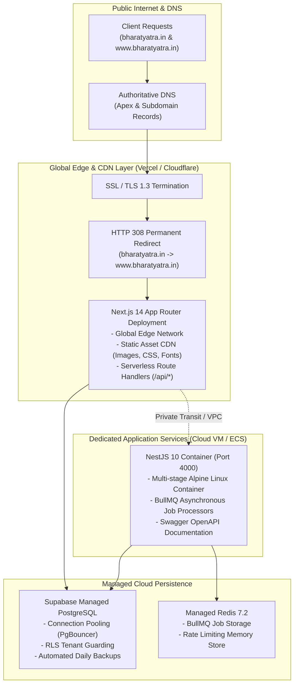

# BharatYatra — Production Deployment & Infrastructure Specification

> **Audit Phase:** Phase 1 Technical Architecture Audit  
> **Production Domain:** [https://www.bharatyatra.in](https://www.bharatyatra.in)  
> **Hosting Architecture:** Vercel Edge Global CDN + Dedicated Docker Microservices  
> **Status:** Production Verified Deployment Architecture  

---

## 1. Production Hosting Topology



---

## 2. Frontend Deployment Configuration (Next.js 14 App Router)

### 2.1 Vercel Edge Hosting (`vercel.json`)
The primary production website is configured for zero-configuration continuous deployment via Vercel:
```json
{
  "$schema": "https://openapi.vercel.sh/vercel.json",
  "framework": "nextjs",
  "buildCommand": "npm run build",
  "installCommand": "npm install",
  "devCommand": "npm run dev"
}
```

### 2.2 Containerized Standalone Deployment (`Dockerfile`)
For on-premises, AWS ECS, or private Kubernetes clusters, the application includes a hardened multi-stage Alpine Docker build:
- **Build Stage:** `node:20-alpine`, executes `npm ci` and `npm run build` with telemetry disabled.
- **Production Runner Stage:** Strips devDependencies using `npm ci --only=production`, copying only `.next/standalone`, public assets, and minimal runtimes.
- **Exposed Port:** `3000`.
- **Startup Command:** `npm run start`.

### 2.3 Caching & Asset Optimization Headers (`next.config.mjs`)
- **Static Assets (`/_next/static/*`, images, fonts):** `Cache-Control: public, max-age=31536000, immutable`.
- **Dynamic API Routes (`/api/*`):** `Cache-Control: no-store, no-cache, must-revalidate, max-age=0`.
- **State Tourism Public Data (`/api/v1/states/*`):** `Cache-Control: public, s-maxage=3600, stale-while-revalidate=86400`.
- **Curated Travel Packages (`/api/v1/travel-packages/*`):** `Cache-Control: public, s-maxage=300, stale-while-revalidate=600`.

---

## 3. Backend Deployment Configuration (NestJS 10)

### 3.1 Container Specifications
- **Base Image:** `node:20-alpine`.
- **Port:** `4000` (configurable via `PORT` environment variable).
- **Global Path Prefix:** `/api/v1`.
- **Interactive Documentation:** Swagger UI accessible at `/api/v1/docs`.
- **Health Checks:** Terminus probes at `/api/v1/health` providing readiness and liveness signals.

### 3.2 Network Hardening & Reverse Proxy Settings
- **Trust Proxy:** Express `trust proxy` configured via `TRUST_PROXY` to accurately extract client IP addresses from Cloudflare headers (`cf-connecting-ip`, `x-forwarded-for`).
- **Origin Shielding:** When `ORIGIN_VERIFY_SECRET` is set, the server rejects direct-to-IP port scans and probes lacking the verified edge secret header.
- **Connection Lifecycles:** Bounded header timeouts (20s) and request timeouts (30s) defend against Slowloris starvation.

---

## 4. Database & Persistence Hosting

### 4.1 Supabase Cloud Managed PostgreSQL
- **Hosting Region:** AWS Mumbai (`ap-south-1`) for sub-15ms latency across Indian telecom networks.
- **Authentication:** Integrated GoTrue auth service issuing RS256/HS256 signed JWT tokens.
- **Row-Level Security:** Enforced at the PostgreSQL engine level across all customer and partner tables.

### 4.2 Disposable Local Staging Setup (`docker-compose.staging.yml`)
The project provides a hardened, disposable local staging stack for integration testing:
- **Staging PostgreSQL:** `postgres:15.8-alpine3.20` bound strictly to host loopback `127.0.0.1:5433` (preventing LAN exposure).
- **Staging Redis:** `redis:7.2.5-alpine3.20` bound strictly to `127.0.0.1:6380` with password authentication via `REDISCLI_AUTH`.
- **Zero Default Passwords:** The compose specification fails closed if `STAGING_DB_PASSWORD` or `STAGING_REDIS_PASSWORD` are missing.

---

## 5. Domain, DNS & SSL Configuration

1. **Canonical Primary Domain:** `https://www.bharatyatra.in`
2. **Apex Domain Handling:** `http://bharatyatra.in` and `https://bharatyatra.in` redirect to `https://www.bharatyatra.in` with HTTP 308 (Permanent Redirect) enforced both at edge DNS and via Next.js middleware (`middleware.ts`).
3. **Legacy Domain Handling:** `bharatyatra.com` and `www.bharatyatra.com` are normalized to `https://www.bharatyatra.in`.
4. **SSL / TLS Termination:** Automated Let's Encrypt / DigiCert certificates managed via Vercel Edge with HTTP/2 and HTTP/3 support.
5. **Content Security Policy:** Restricts script execution, frames, and connects strictly to verified endpoints (Supabase, Google APIs, OpenStreetMap).

