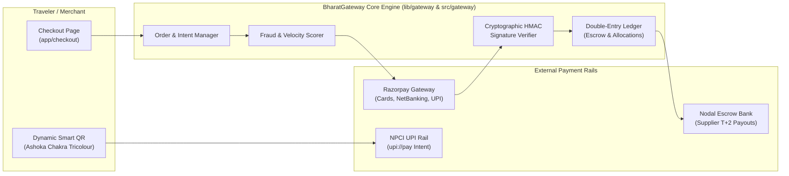

# BharatYatra — Complete External Integrations & Supplier Ecosystem

> **Audit Phase:** Phase 1 Technical Architecture Audit  
> **Status:** Production Verified Integrations  
> **Target Audience:** Independent Technical Auditors, System Architects  

---

## 1. External Integrations Matrix

| Integration Category | Provider / Service | Protocol / SDK | Implementation File(s) | Fallback / Mock Behavior |
| :--- | :--- | :--- | :--- | :--- |
| **Hotels (Global/India)** | **Hotelbeds (HBX)** | REST / HMAC SHA256 | `lib/hotels/providers/hbx-hotel-provider.ts`<br>`lib/hotels/hbx-auth.ts`<br>`18_DEV/Backend/src/providers/hotelbeds/` | Normalizes to `mock-hbx-data.ts` if credentials absent or API fails. |
| **Hotels (Affiliate/OTA)**| **MakeMyTrip** | Affiliate Deep-Link / Redirect | `lib/makemytrip.ts` | Generates deep links with tracking parameters; graceful fallback. |
| **Intercity Buses** | **eTravelSmart / RedBus** | REST JSON API | `18_DEV/Backend/src/providers/buses/etravelsmart-bus.provider.adapter.ts` | `mock-bus.provider.ts` returns realistic Gujarat & Rajasthan bus schedules. |
| **Indian Railways** | **IRCTC / Rail API** | REST API / Station Matrix | `18_DEV/Backend/src/trains/`<br>`18_DEV/Backend/src/providers/trains/` | Deterministic station lookup and schedule simulator for Indian rail routes. |
| **Flights** | **TBO Holidays** | REST XML/JSON API | `18_DEV/Backend/src/providers/flights/tbo-flight.provider.adapter.ts` | Mock flight provider with real Indian airport schedules (DEL, BOM, AMD). |
| **Payments (Core)** | **BharatGateway / Razorpay** | Webhook HMAC SHA256 / SDK | `app/api/v1/gateway/*`<br>`lib/gateway/gateway-client.ts`<br>`18_DEV/Backend/src/gateway/` | Sandbox mock adapter with deterministic test cards and UPI QR generation. |
| **Direct UPI** | **NPCI Dynamic UPI String** | `upi://pay` URI Scheme | `lib/config/smart-qr-config.ts`<br>`scripts/generate_smart_qr.py` | Real-time dynamic UPI string generation with Ashoka Chakra branding. |
| **AI Travel Copilot** | **Nexi (Google Gemini / OpenAI)**| Google Gemini API / REST | `components/nexi/`<br>`lib/nexi-api.ts`<br>`18_DEV/Backend/src/nexi/` | Fallback rule-based prompt engine with ground knowledge embeddings. |
| **Interactive Maps** | **Leaflet & OpenStreetMap** | Leaflet 1.9.4 / Tile Layer | `components/maps/leaflet-map-inner.tsx`<br>`components/maps/destination-map-section.tsx` | Fallback to OpenStreetMap public tiles if MapTiler/Mapbox keys missing. |
| **Map Tiles & Geocoding** | **MapTiler / Mapbox / Google** | Raster & Vector Tiles | `lib/data/indian-cities.ts`<br>`next.config.mjs` (CSP connect-src) | OpenStreetMap tile fallback (`https://tile.openstreetmap.org/{z}/{x}/{y}.png`). |
| **Browser Push** | **Web Push (RFC 8292 VAPID)**| `web-push: 3.6.7` | `lib/notifications/web-push-engine.ts`<br>`lib/push-notifications.ts` | Service worker notification fallback; permission banner UI. |
| **Email Service** | **Resend & SendGrid** | REST API / SMTP | `lib/notifications/email-service.ts` | Console logger and test mock when `RESEND_API_KEY` / `SENDGRID_API_KEY` absent. |
| **Instant Messaging** | **Twilio & WhatsApp Cloud API** | REST Webhook / JSON | `lib/notifications/whatsapp-service.ts` | Dev mock simulator outputting formatted WhatsApp message payloads. |

---

## 2. Hotel Supplier Integration (Hotelbeds / HBX)

BharatYatra implements an enterprise integration with Hotelbeds (HBX):

### 2.1 Cryptographic Authentication (`lib/hotels/hbx-auth.ts`)
Hotelbeds requires an HMAC SHA256 signature generated from the API key, secret, and current Unix timestamp in seconds:
```typescript
// Verified implementation in lib/hotels/hbx-auth.ts
const timestamp = Math.floor(Date.now() / 1000);
const signature = crypto
  .createHash('sha256')
  .update(apiKey + secret + timestamp)
  .digest('hex');
// Emitted headers: Api-Key, X-Signature, Accept: application/json
```

### 2.2 Supplier Abstraction & Data Normalization
The adapter `hbx-hotel-provider.ts` normalizes proprietary HBX JSON structures into the clean, unified `NormalizedHotel` interface:
- Maps rate keys (`rateKey`) to preserve supplier pricing locks.
- Converts currency codes to INR (₹) with tax handling.
- Normalizes star ratings, amenities, and room occupancies.
- Seamlessly falls back to `mock-hbx-data.ts` if the HBX sandbox returns HTTP 400/500 errors or credentials are not configured, ensuring zero application crashes.

---

## 3. BharatGateway FinTech Payment Engine

BharatGateway is BharatYatra's proprietary multi-rail payment and escrow orchestration suite:



### Key Capabilities:
1. **Cryptographic Webhook Verification:** Verifies incoming webhook payloads against raw request bytes (`req.rawBody`) using HMAC SHA256, strictly rejecting forged webhook alerts.
2. **Double-Entry Financial Ledger:** Every transaction creates two balanced ledger lines: one credit to the traveler/merchant account and one debit to the platform escrow pool.
3. **Split Payouts:** Automatically computes platform commission (e.g. 10–15%), GST liability, and supplier disbursement shares for automated settlement.

---

## 4. Nexi AI Conversational Copilot & Model Abstraction

The Nexi conversational travel assistant operates on a decoupled provider architecture:
- **Primary LLM Provider:** Google Gemini API (`gemini-1.5-flash` / `@google/generative-ai`), offering high speed, bilingual reasoning, and native JSON mode.
- **Secondary LLM Provider:** OpenAI API (`gpt-4o-mini`) via compatible chat completion interface.
- **Ground Knowledge Grounding:** Incorporates `07_AI/System_Instructions/NEXI_CUSTOMER_SUPPORT_AI.md`, giving Nexi authoritative ground-truth knowledge on:
  - Indian states, transport routes, and seasonal monsoon conditions.
  - Temple dress codes, darshan timings, and cultural sensitivities.
  - Emergency contact hotlines (112, tourist police).

---

## 5. Map & Geospatial Integrations

- **Client-Side Rendering:** Uses Leaflet 1.9.4 wrapped in dynamic imports (`next/dynamic` with `ssr: false`) to prevent `window is not defined` errors during server-side pre-rendering.
- **Map Tile Hierarchy:**
  1. Primary: MapTiler vector/raster tiles (`NEXT_PUBLIC_MAPTILER_KEY`).
  2. Secondary: Mapbox tiles (`NEXT_PUBLIC_MAPBOX_TOKEN`).
  3. Safe Fallback: Standard OpenStreetMap tiles (`https://tile.openstreetmap.org/{z}/{x}/{y}.png`).
- **CSP Compliance:** The Content Security Policy in `next.config.mjs` explicitly whitelists `https://*.openstreetmap.org` and MapTiler endpoints.

---

## 6. Multi-Channel Notification Infrastructure

- **VAPID Web Push:** Full implementation of IETF RFC 8292 standard using `web-push`. Generates client subscription keys (`p256dh`, `auth`) stored in database table `push_subscriptions`.
- **Email Service (`lib/notifications/email-service.ts`):** Supports dual upstream providers:
  - Resend (`RESEND_API_KEY`)
  - SendGrid (`SENDGRID_API_KEY`)
  - SMTP (`SMTP_HOST`, `SMTP_PORT`)
  - Development logger fallback when offline.
- **WhatsApp Gateway (`lib/notifications/whatsapp-service.ts`):** Supports Twilio WhatsApp API and Meta WhatsApp Cloud API with booking voucher templates and itinerary delivery.

