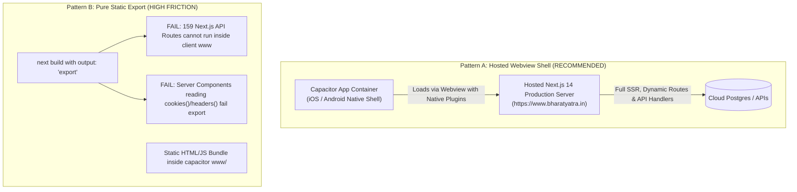
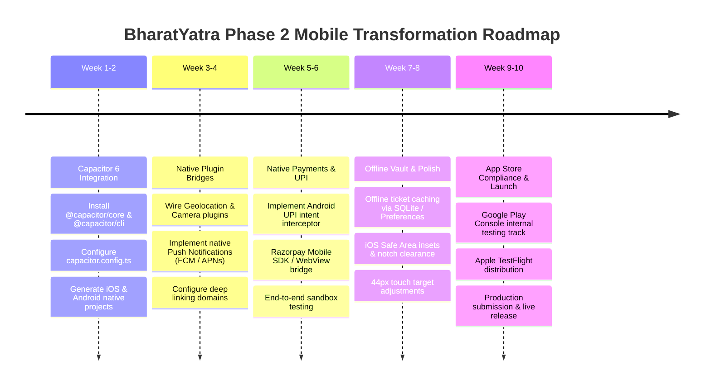

# BharatYatra — Cross-Platform & Mobile Compatibility Audit

> **Audit Phase:** Phase 1 Technical Architecture Audit  
> **Target Platforms:** Android (Phones & Tablets), iOS (iPhones & iPads), Desktop Browsers, Mobile Web  
> **Evaluated Technologies:** Capacitor 6, Next.js Static Export, React Server Components (RSC), Native Plugin Bridges  
> **Status:** Comprehensive Feasibility Assessment  

---

## 1. Executive Summary & Cross-Platform Feasibility Score

| Platform | Feasibility Score | Recommended Strategy | Critical Blockers |
| :--- | :--- | :--- | :--- |
| **Mobile Browsers (iOS/Android)**| **100% (Production Ready)** | Responsive Web App | None. Already optimized with fluid layouts, touch targets, and mobile bottom navigation. |
| **Android (Phones & Tablets)** | **92% (High Feasibility)** | Capacitor 6 Hybrid Container | UPI intent links, back button handling, offline pass caching. |
| **iOS (iPhones & iPads)** | **88% (High Feasibility)** | Capacitor 6 Hybrid Container | Apple App Store Guideline 4.2 compliance, WebKit safe area insets, APNs push. |
| **Desktop Browsers** | **100% (Production Ready)** | Next.js 14 Web Platform | None. Fully functional in Chrome, Safari, Edge, Firefox. |

---

## 2. Capacitor Compatibility Analysis

### 2.1 The Next.js 14 App Router Dilemma: Static Export vs. Hosted SSR
In evaluating Capacitor for BharatYatra, two distinct deployment patterns exist:

### 2.2 Why Pattern A (Hosted Webview Shell) is Strongly Recommended:
1. **Preserves 157 Registered App Router Pages:** No massive refactoring from Server Components to client-side data fetching.
2. **Preserves 159 API Handlers:** All administrative, booking, and payment route handlers continue running securely on the server with full database connection pooling.
3. **Instant Over-The-Air (OTA) Updates:** Critical pricing updates, festival promotions (e.g. Diwali deck), and bugfixes deploy instantaneously to mobile users without waiting for multi-day App Store review cycles.
4. **Capacitor Bridge Access:** Native plugins (`@capacitor/camera`, `@capacitor/geolocation`, `@capacitor/push-notifications`, `@capacitor/app`) remain fully accessible from web code via standard JavaScript bridge injection.

---

## 3. Dependency Compatibility Audit

An inspection of `package.json` identifies several packages requiring special consideration during mobile compilation:

| Dependency | Category | Mobile Compatibility Status | Required Action / Workaround |
| :--- | :--- | :--- | :--- |
| `leaflet` (1.9.4) | Maps | **Compatible with guard** | Leaflet accesses `window` and `document`. Must remain wrapped in `next/dynamic` (`ssr: false`) to avoid crash during mobile bundling. |
| `sharp` (0.35.5) | Image Processing | **Server-Only** | Node.js native binary. Used exclusively in server-side image optimization. Must never be imported into client-side mobile bundles. |
| `pg` (8.23.1) | Database Client | **Server-Only** | Node.js native TCP socket driver. Used only in server API route handlers. |
| `puppeteer-core` (25.16) | PDF Generation | **Server-Only** | Headless Chrome engine used for PDF ticket generation. Exclusively runs on server. |
| `web-push` (3.6.7) | Push Crypto | **Server-Only** | Server-side VAPID message encryption. Native mobile apps will use Firebase Cloud Messaging (FCM) / APNs directly. |
| `@supabase/supabase-js`| Auth & DB | **Fully Compatible** | Universal isomorphic client. Works seamlessly across mobile webviews, Android, and iOS. |
| `lucide-react` (0.417) | Icons | **Fully Compatible** | Pure SVG icon components. Renders crisply across all mobile pixel densities. |

---

## 4. Mobile Hardware & Native Permissions Requirements

### 4.1 Camera & Photo Gallery Access
- **Current State:** File upload forms for partner KYC documents, hotel property images, and traveler review photos use standard HTML `<input type="file">`.
- **Mobile Transformation:** Add `@capacitor/camera` to allow travelers and suppliers to capture photos directly with camera hardware or pick from native gallery with native permission prompts (`NSCameraUsageDescription`, `READ_MEDIA_IMAGES`).

### 4.2 Geolocation & Live Radar Telemetry
- **Current State:** Traveler location relies on HTML5 `navigator.geolocation` (`components/dashboard/live-ground-radar.tsx`).
- **Mobile Transformation:** Implement `@capacitor/geolocation` for high-accuracy background GPS updates, enabling real-time navigation along Indian spiritual circuits and proximity alerts for nearby monuments.

### 4.3 Push Notifications (APNs & FCM)
- **Current State:** Implements browser VAPID Web Push (`web-push: 3.6.7`). Supported on desktop and Android Chrome, but limited on iOS Safari unless added to home screen as PWA.
- **Mobile Transformation:** Implement `@capacitor/push-notifications`. Bridges APNs on iOS and FCM on Android, ensuring 100% reliable push delivery for booking confirmations, gate changes, and payment alerts.

### 4.4 UPI Native Intent Payments (`upi://pay`)
- **Current State:** Renders dynamic QR codes (`AshokaChakraIcon.tsx`) for desktop scanning, and UPI link buttons for mobile browsers.
- **Mobile Transformation:** In Android WebViews, standard `<a>` tags with `href="upi://pay?..."` can fail if not intercepted. Capacitor requires handling via `@capacitor/app` or an in-app browser intent handler to launch installed UPI apps (Google Pay, PhonePe, Paytm, BHIM) seamlessly.

### 4.5 Deep Linking & Universal Links
- **Android:** Configure Digital Asset Links (`assetlinks.json`) hosted at `https://www.bharatyatra.in/.well-known/assetlinks.json`.
- **iOS:** Configure Apple App Site Association (`apple-app-site-association`) hosted at `https://www.bharatyatra.in/.well-known/apple-app-site-association`.
- Enables opening shared trip links (`https://bharatyatra.in/trips/gujarat-heritage-7d`) directly inside the installed mobile app.

---

## 5. Apple App Store Compliance (Guideline 4.2 — Minimum Functionality)

> [!WARNING]
> **CRITICAL APP STORE RISK:** Apple Guideline 4.2 states: *"Your app should include features, content, and UI that elevate it beyond a repackaged website."*

To guarantee effortless Apple App Store approval, the BharatYatra iOS app must activate concrete native capabilities beyond a web wrapper:
1. **Offline Itinerary & Voucher Vault:** Travelers must be able to view their confirmed booking tickets, boarding passes, and daily itinerary offline without an active internet connection (crucial for remote Himalayan / forest circuits).
2. **Native Push Notifications:** Rich transactional alerts with quick actions (View Ticket, Contact Support).
3. **Native Biometrics:** FaceID / TouchID biometric login for swift traveler authentication using `@capacitor/biometrics`.
4. **Haptic Feedback:** Native haptics on booking confirmation and itinerary milestone completions via `@capacitor/haptics`.

---

## 6. Phase 2 Mobile Transformation Technical Roadmap

