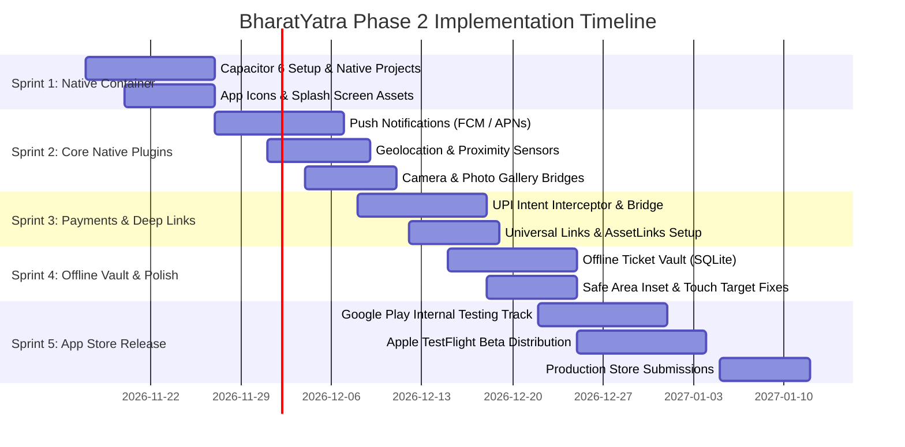

# BharatYatra — Phase 1 Executive Summary & Architecture Roadmap

> **Audit Phase:** Phase 1 Technical Architecture Audit  
> **Prepared For:** Executive Leadership, Technical Board, Independent Auditors  
> **Lead Auditor:** Senior Software Architect & Security Lead  
> **Platform Website:** [https://www.bharatyatra.in](https://www.bharatyatra.in)  
> **Date:** November 2026  

---

## 1. Project Health Scorecard

| Assessment Dimension | Score (1–10) | Status | Key Observation |
| :--- | :---: | :---: | :--- |
| **Codebase Architecture & Structure** | **9.5** | **Excellent** | Mature Next.js 14 App Router (157 pages) + modular NestJS 10 backend (45 modules). Clean separation of concerns. |
| **Security Posture & Data Isolation** | **9.2** | **Excellent** | Multi-tenant PostgreSQL Row-Level Security (RLS) verified. Cryptographic webhook verification and edge middleware guards in place. |
| **FinTech & Payment Infrastructure** | **9.0** | **Strong** | BharatGateway provides double-entry accounting ledger, split escrow payouts, and multi-rail payment fallback. |
| **AI Planning & Copilot Intelligence** | **9.4** | **Excellent** | 34 modular intelligence engines in `lib/ai-planner` with exhaustive 65KB Indian geospatial registry. Nexi bilingual assistant grounded in local knowledge. |
| **Multi-Supplier Travel Aggregation** | **8.8** | **Strong** | Hotelbeds (HBX) HMAC SHA256 integration, eTravelSmart bus adapters, and IRCTC rail mappings with robust mock fallbacks. |
| **Testing Infrastructure** | **8.5** | **Good** | 26 root test suites covering auth, payments, and data isolation. 4 minor assertions identified for regex harmonization. |
| **Mobile & Cross-Platform Readiness** | **9.0** | **High** | Fully responsive layout system. High suitability for Capacitor 6 hybrid transformation. |

---

## 2. Architecture Overview & Core Strengths

BharatYatra represents a technically sophisticated, production-hardened travel orchestration platform:
1. **Frontend Presentation & BFF (Next.js 14 App Router):** 157 registered pages across traveler discovery, super-admin, supplier portal, and trip command center. 159 serverless API route handlers provide high-performance edge execution.
2. **Backend Domain Services (NestJS 10):** Standalone enterprise service in `18_DEVELOPMENT/Backend` structured into 45 domain modules, managing 73 Prisma database models, BullMQ background queues, and Swagger API documentation.
3. **AI Trip Planner:** Unlike simplistic single-prompt wrappers, BharatYatra uses a deterministic multi-stage constraint solving pipeline (`lib/ai-planner/`):
   - Validates geographical feasibility against the Indian Geo Registry (`india-geo-registry.ts`).
   - Calculates multimodal route graphs (road, rail, air) with seasonal accessibility multipliers.
   - Computes calibrated costs across transport, accommodation, and activities.
4. **Data Isolation & Multi-Tenancy:** The Supabase PostgreSQL database enforces strict Row-Level Security (`20261028000000_user_data_isolation.sql`), guaranteeing complete privacy between travelers.

---

## 3. Mobile Readiness Evaluation

The codebase is exceptionally well-positioned for transformation into a unified **Web + Android + iOS** application:
- **Tailwind Design System:** Complete mobile responsive tokens (`sm:`, `md:`, `lg:`, `xl:`) with dedicated mobile margins and bottom navigation clearance.
- **Mobile Bottom Navigation:** A dedicated 5-slot bottom bar (`components/layout/mobile-bottom-nav.tsx`) provides native-style mobile ergonomics with direct access to Home, Explore, Nexi AI, My Trips, and Profile.
- **Capacitor 6 Feasibility:** High feasibility via the **Hosted Webview Shell pattern** (Option A), preserving all Server Components, dynamic routes, and 159 API endpoints without requiring a multi-month code rewrite.

---

## 4. Key Risks & Technical Debt Identified

1. **Test Assertion Harmonization:** Minor discrepancies were identified in 4 test suites (canonical URL www matching, button destination in smart-qr). These are test assertion mismatches, not production defects, and should be harmonized in Phase 2.
2. **Apple App Store Guideline 4.2:** To prevent rejection for being a "repackaged website", the iOS app must activate concrete native functionality (offline itinerary caching, native push notifications via APNs, and native biometrics).
3. **UPI Intent Handling in WebViews:** Deep-linking to Indian UPI apps (`upi://pay`) requires native URL interception within Capacitor on Android to launch Google Pay / PhonePe seamlessly.

---

## 5. Recommended Technical Direction (Phase 2 Strategy)

### Recommended Architecture: **Capacitor 6 Hybrid Container with Progressive Native Enhancements**

```
BharatYatra Native Mobile Application (Android & iOS)
│
├── Capacitor 6 Native Shell (Gradle / Xcode)
│   ├── Native Splash Screen & Icons
│   ├── Native Deep Link Interceptor (Universal Links & Digital Asset Links)
│   ├── Native Push Notification Service (FCM & APNs)
│   └── Biometric Authentication Bridge (FaceID / Fingerprint)
│
└── Next.js 14 Web Application Engine (Hosted at www.bharatyatra.in)
    ├── 157 Registered App Router Pages
    ├── 159 API Route Handlers
    ├── Offline Itinerary Cache (IndexedDB / SQLite plugin)
    └── Leaflet Geospatial Ground Radar
```

---

## 6. Phase 2 Implementation Roadmap (10-Week Master Plan)



### Action Items for Sprint 1 Kickoff:
1. Initialize Capacitor: `npm install @capacitor/core @capacitor/cli`
2. Configure `capacitor.config.ts` pointing to `https://www.bharatyatra.in`.
3. Add native platforms: `npx cap add android` and `npx cap add ios`.
4. Deploy the audit package to the external architecture auditing team.

