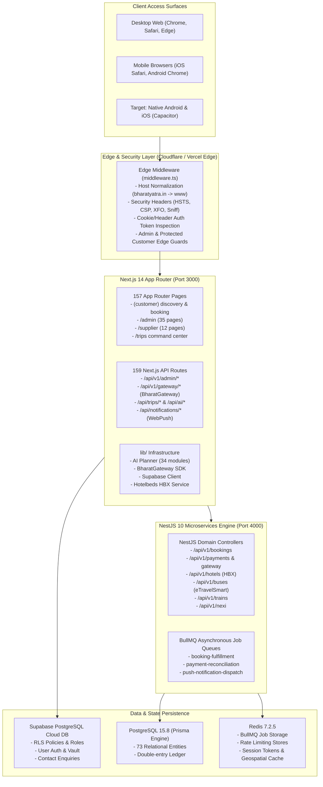

# BharatYatra — Technical Architecture Audit & Project Overview

> **Audit Phase:** Phase 1 — Comprehensive Codebase Discovery & Pre-Transformation Audit  
> **Production Website:** [https://www.bharatyatra.in](https://www.bharatyatra.in)  
> **Repository Name:** `bharatyatra-frontend` / `BhartYatra_6`  
> **Document Version:** 1.0.0 (Production Verified)  
> **Date:** November 2026  
> **Author:** Senior Software Architect & Independent Audit Team  

---

## 1. Executive Overview

**BharatYatra** is India's premier AI-powered experiential tourism and travel orchestration platform, designed specifically to showcase and connect India's diverse cultural heritage, spiritual circuits, wildlife corridors, and tourism destinations. The platform uniquely integrates:
- An intelligent **AI Trip Planner** with dynamic day-by-day itinerary synthesis, duration calibration, and real-time geographic routing.
- **Nexi AI**, a domain-specialized bilingual travel assistance engine with ground knowledge of Indian routes, weather, and local customs.
- **BharatGateway**, a high-assurance multi-rail payment and settlement suite engineered to orchestrate UPI, cards, net banking, and split escrow settlements with suppliers.
- Multi-supplier travel aggregation covering **Hotels** (Hotelbeds / HBX API + MakeMyTrip deep links), **Buses** (eTravelSmart / operator APIs), **Trains** (IRCTC station directory & route mapping), and curated **Tourism Circuits**.
- Dual administrative control panels including a 35-page **Master Platform Admin** and an enterprise **Travel Partner / Supplier Portal**.

This document forms part of the **Phase 1 Technical Architecture Audit Package**, delivered prior to cross-platform transformation across Android, iOS, tablets, and desktop environments.

---

## 2. Core Technology Stack

| Layer | Technologies & Frameworks | Version / Specification | Verification Status |
| :--- | :--- | :--- | :--- |
| **Frontend Framework** | Next.js (App Router) | `14.2.5` | Verified in `package.json` |
| **UI Library & Runtime** | React & React DOM | `18.3.1` | Verified in `package.json` |
| **Styling & CSS** | Tailwind CSS, Autoprefixer, PostCSS | `tailwindcss: 3.4.7` | Verified in `tailwind.config.ts` |
| **Component Icons** | Lucide React | `0.417.0` | Verified |
| **Maps & Geospatial** | Leaflet, React Leaflet Types | `leaflet: 1.9.4` | Verified in `components/maps/` |
| **Image Processing** | Sharp | `0.35.5` | Verified |
| **QR Code Engine** | Node QRCode | `1.5.4` | Verified in `scripts/generate_smart_qr.py` & `qrcode` |
| **Push Notifications** | Web Push (VAPID RFC 8292) | `3.6.7` | Verified in `lib/notifications/web-push-engine.ts` |
| **Database & Auth (Frontend)**| Supabase JS SDK | `2.117.2` | Verified in `lib/supabase/client.ts` |
| **Backend Framework** | NestJS | `10.x` (`@nestjs/core: 10.3.2`) | Verified in `18_DEVELOPMENT/Backend/package.json` |
| **Backend ORM** | Prisma ORM | `5.14.0` (73 Database Models) | Verified in `18_DEVELOPMENT/Backend/prisma/` |
| **Background Queues** | BullMQ & Redis (IoRedis) | `bullmq: 5.8.3`, `ioredis: 5.4.1` | Verified in `18_DEVELOPMENT/Backend/src/queue/` |
| **Language & Compilers** | TypeScript, Node.js, Python | `TypeScript 5.5.4`, `Node 20+`, `Python 3.12` | Verified |
| **Containerization** | Docker & Docker Compose | Docker multi-stage build, Compose v2 | Verified in `Dockerfile`, `docker-compose.staging.yml` |

---

## 3. System Architecture High-Level Layout



---

## 4. Setup & Installation Instructions

### Prerequisites
1. **Node.js**: `v20.14.0` or higher (LTS recommended).
2. **Package Manager**: `npm` v10+ (comes bundled with Node 20).
3. **Database (Optional for local full-stack run)**: Docker & Docker Compose to run staging PostgreSQL 15.8 and Redis 7.2.5.
4. **Python (Optional for tooling)**: Python 3.10+ for documentation generator (`scripts/generate_pages_directory.py`).

### Installation Commands

#### 1. Frontend (Next.js Application)
From the project root:
```bash
# 1. Install dependencies
npm ci
# or if clean install:
npm install

# 2. Configure environment variables
cp .env.example .env.local
# (Edit .env.local with your Supabase and map provider keys)

# 3. Verify TypeScript types
npm run type-check

# 4. Run automated test suite
npm test
```

#### 2. Backend (NestJS Enterprise Service)
From the `18_DEVELOPMENT/Backend` directory:
```bash
cd 18_DEVELOPMENT/Backend

# 1. Install backend dependencies
npm ci

# 2. Configure backend environment
cp .env.example .env

# 3. Generate Prisma client
npm run prisma:generate

# 4. Run database migrations (against local/staging Postgres)
npm run prisma:migrate

# 5. Run backend unit & integration tests
npm test
```

---

## 5. Development & Build Commands

### Frontend Scripts (Root `package.json`)
| Command | Action | Details |
| :--- | :--- | :--- |
| `npm run dev` | Starts Next.js development server | Accessible at `http://localhost:3000` |
| `npm run build` | Produces production build | Compiles SSR, ISR, and static route chunks |
| `npm run start` | Boots production server | Starts Node.js production server on port 3000 |
| `npm run lint` | Next.js ESLint linting | Audits syntax, React Hooks, and formatting |
| `npm run type-check` | TypeScript compiler check | Executes `tsc --noEmit` without writing output |
| `npm test` | Node test runner | Executes `npx tsx --test __tests__/*.test.ts` |
| `npm run docs:pages`| Generates Page Directories | Updates `.pdf`, `.docx`, `.docs`, `.md` page catalogs |

### Staging Infrastructure Commands
To start disposable local staging PostgreSQL (port `5433`) and Redis (port `6380`):
```bash
# Start isolated containers in background
docker compose -f docker-compose.staging.yml up -d

# Check health of database and redis
docker compose -f docker-compose.staging.yml ps

# Tear down disposable staging infrastructure
docker compose -f docker-compose.staging.yml down -v
```

---

## 6. Audit Package Structure & Verification Notice

This audit package has been prepared in accordance with strict security standards:
- **Zero Real Secrets**: All live `.env` files, production credentials, database passwords, and private API keys have been removed and replaced with sanitized `.env.example` templates.
- **Excluded Build Bloat**: Large generated folders (`node_modules`, `.next`, `dist`, `.git`, `.pytest_cache`, and temporary archives) have been excluded to ensure a clean, auditable zip package.
- **Preserved Source Hierarchy**: All original import paths, module boundaries, database migrations, and unit tests have been preserved exactly as engineered in production.

