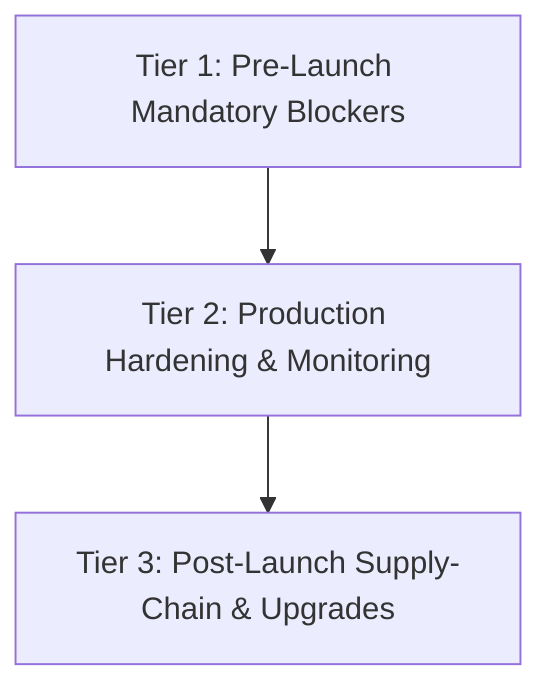

# BharatYatra Prioritized Remediation & Operations Plan
## Document Reference: `BHARATYATRA_SECURITY_PHASE10_REMEDIATION_PLAN.md`
**Phase**: Phase 10 — Final Security Assessment, Remediation Verification & Production Release Decision  
**Target Window**: Production Go-Live Execution  
**Status**: APPROVED ACTION PLAN  
**Timestamp**: 2026-10-22  

---

## 1. Remediation Sequencing & Priority Tiers

The remaining action items are operational and deployment-focused (the codebase itself has zero open critical vulnerabilities). They are categorized into three sequential execution tiers:

---

## 2. Tier 1: Pre-Launch Mandatory Blockers (Day 0)

These 4 items must be executed before opening the platform to public customer or travel partner traffic:

### Action 1.1: Apply Supabase Ecosystem Database Migration
- **Target Item**: `SEC-007` (Pending Remote Database Migration)
- **Responsible Role**: Database Administrator / Lead Backend Engineer
- **Execution**:
  1. Open Supabase Dashboard > SQL Editor for the production project.
  2. Load and run [`data/migrations/20261021_travel_agency_ecosystem.sql`](file:///c:/Users/Pandya%20Kaushal/Desktop/BhartYatra_3/data/migrations/20261021_travel_agency_ecosystem.sql).
  3. Verify tables created: `travel_agencies`, `travel_packages`, `partner_agreements`, `commission_ledger`.
- **Verification Criteria**:
  Execute backend test `travel-partner-db-integration.test.ts` against the remote database; verify probe succeeds without `table not yet applied` warning.

### Action 1.2: Populate Production Secrets Vault
- **Target Item**: `SEC-002`, `SEC-006`, `SEC-013`
- **Responsible Role**: DevSecOps Engineer / Infrastructure Lead
- **Execution**:
  Inject the following environment variables into the cloud container task definition:
  - `JWT_SECRET`: Random 256-bit secret string.
  - `ADMIN_PASSWORD`: Strong password stored in company password manager.
  - `RAZORPAY_WEBHOOK_SECRET`: Secret configured in Razorpay dashboard.
  - `SUPABASE_SERVICE_ROLE_KEY`: Service role secret from Supabase API settings.
  - `GEMINI_API_KEY`: API key with Gemini 1.5 Pro quota enabled.
- **Verification Criteria**:
  Container startup logs display clean initialization without `FATAL` secret validation errors.

### Action 1.3: Enable Cloudflare Origin Shielding & WAF
- **Target Item**: `SEC-009` (Origin Direct-Access Shielding)
- **Responsible Role**: Cloud Security Architect / Network Engineer
- **Execution**:
  1. Generate Cloudflare Origin CA certificate and install on origin web server.
  2. Enable Cloudflare Authenticated Origin Pulls (AOP).
  3. In cloud hosting firewall (AWS Security Group / DigitalOcean Firewall), restrict inbound ports 80/443 strictly to Cloudflare IP ranges.
- **Verification Criteria**:
  Direct `curl -k https://<ORIGIN_IP>` from an external IP is dropped/timed out by firewall.

### Action 1.4: Razorpay Webhook Endpoint Registration
- **Target Item**: `SEC-006` (Payment Webhook Verification)
- **Responsible Role**: Payment Operations Lead / Backend Engineer
- **Execution**:
  1. In Razorpay Dashboard > Settings > Webhooks, add: `https://api.bharatyatra.com/api/v1/providers/webhooks/razorpay`.
  2. Enter the exact `RAZORPAY_WEBHOOK_SECRET` from Action 1.2.
  3. Enable required events (`payment.captured`, `order.paid`, `refund.processed`).
- **Verification Criteria**:
  Send test webhook from dashboard; confirm backend structured log displays `[WEBHOOK VERIFIED]`.

---

## 3. Tier 2: Production Hardening & Telemetry (Week 1)

### Action 2.1: Centralized Log Shipping & SIEM Ingestion
- **Target Item**: `SEC-015`
- **Responsible Role**: DevSecOps Engineer
- **Execution**: Deploy FluentBit / Datadog Agent daemon to stream container stdout `[SECURITY_EVENT]` JSON logs to central SIEM indexer (OpenSearch, CloudWatch, or Datadog).
- **Verification Criteria**: Search for `eventType: AUTH_FAILURE` in central log dashboard.

### Action 2.2: Outbound Alert Channel Integration
- **Target Item**: `SEC-019`
- **Responsible Role**: Site Reliability Engineer (SRE)
- **Execution**: Populate `SECURITY_ALERT_SLACK_WEBHOOK` and `PAGERDUTY_ROUTING_KEY` environment variables in container task.
- **Verification Criteria**: Trigger synthetic alert threshold; confirm alert card appears in `#security-alerts` Slack channel.

### Action 2.3: Isolated Staging Disaster Recovery Restoration Drill
- **Target Item**: `SEC-011`
- **Responsible Role**: Database Administrator
- **Execution**: Execute an isolated non-destructive restore of a Supabase backup into a temporary staging database instance. Verify table row counts and booking record consistency.
- **Verification Criteria**: Document successful restore timestamp, RTO (< 60 minutes), and RPO (< 24 hours).

---

## 4. Tier 3: Supply-Chain & Framework Upgrades (Sprint 1 Post-Launch)

### Action 3.1: Minor Patch Upgrade of Next.js
- **Target Item**: `SEC-016` (Dependency Vulnerabilities)
- **Responsible Role**: Frontend Lead Engineer
- **Execution**:
  1. Update root `package.json` to `"next": "14.2.35"`.
  2. Run `npm update next --save`.
  3. Verify all routes and components build cleanly with `npm run build`.
- **Verification Criteria**: `npm audit` shows Next.js advisories resolved without App Router regression.

### Action 3.2: Enforce GitHub Actions Security CI Pipeline
- **Target Item**: `SEC-020`
- **Responsible Role**: DevSecOps Engineer
- **Execution**: Commit `.github/workflows/security-ci.yml` (designed in Phase 8) to main branch.
- **Verification Criteria**: Open a test pull request; confirm all 5 gates (Gitleaks, install, typecheck, tests, build) run and pass automatically.
