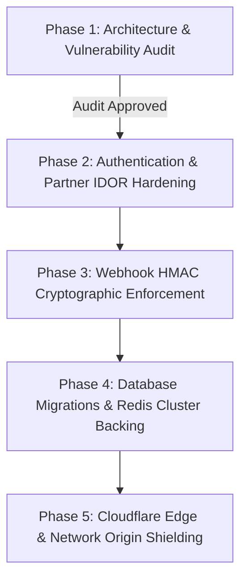

# BHARATYATRA SECURITY — PHASE 1 ARCHITECTURE & SECURITY AUDIT
**Document Reference**: `BY-SEC-PHASE1-AUDIT-v1.0`  
**Classification**: CONFIDENTIAL / INTERNAL SECURITY AUDIT  
**Date**: October 21, 2026  
**Auditor**: Principal DevSecOps & Application Security Architect  
**Status**: AUDIT COMPLETE — READY FOR PHASE 2  

---

## 1. Executive Summary & Scope

A comprehensive security discovery and architectural audit was performed on the **BharatYatra** repository (branch: `main`, remote: `https://github.com/kaushal-pandya-hacker/bharatyatra-frontend.git`).

The audit evaluated seven core domains:
1. **Authentication & Account Security** (Supabase Auth, NestJS JWT, Admin Auth, Mobile OTP, Session Management)
2. **Database & Data Protection** (Prisma ORM, PostgreSQL/Supabase, Connection Pooling, IDOR, Migrations)
3. **Backend Availability & Overload Resilience** (Rate limiting, Body limits, Slowloris timeouts, Resource exhaustion)
4. **Network & Deployment Security** (Reverse proxy trust, CORS, Security headers, CSP, Origin protection)
5. **API, Booking & Payment Integrity** (Universal Booking Engine, Supplier integrations, Webhook signature verification)
6. **NEXI AI Security** (Prompt injection, Privacy air-gapping, Knowledge grounding, Model budget limits)
7. **Monitoring, Auditing & Recovery** (Audit logs, Health checks, Event redaction, Telemetry)

### Core Architectural Findings Summary:
- **Critical Vulnerabilities**: 3 verified (Unauthenticated cookie-based agency impersonation, payment webhook signature verification bypass, and hardcoded default administrative bootstrap credentials).
- **High-Risk Vulnerabilities**: 4 verified (Client-side persistent mock authentication auto-login, header-spoofable IP extraction on unshielded origins, unverified email domain admin grant, and unapplied remote database migrations).
- **Medium & Hardening Findings**: 3 verified (CSP `connect-src` blocking production API domain, in-memory OTP/session state across multi-instance clusters, and missing automated secret rotation).

All findings below are substantiated by source code references, exact line numbers, and architectural impact proofs. **No destructive tests or functional code modifications were made during this audit phase.**

---

## 2. Architecture & Deployment Inventory

| Component | Framework / Technology | Verified Deployment Target | Source Code Location | Status & Configuration |
| :--- | :--- | :--- | :--- | :--- |
| **Frontend Web App** | Next.js 14.2.5 (App Router, React 18) | Vercel (Production) / Localhost (Dev) | [`app/`](file:///c:/Users/Pandya%20Kaushal/Desktop/BhartYatra_3/app), [`components/`](file:///c:/Users/Pandya%20Kaushal/Desktop/BhartYatra_3/components) | Configured in [`next.config.mjs`](file:///c:/Users/Pandya%20Kaushal/Desktop/BhartYatra_3/next.config.mjs) and [`vercel.json`](file:///c:/Users/Pandya%20Kaushal/Desktop/BhartYatra_3/vercel.json) |
| **Backend Core Engine** | NestJS 10.3.8 + Express | Node.js Runtime (Port 4000) / Staging Container | [`18_DEVELOPMENT/Backend/src/`](file:///c:/Users/Pandya%20Kaushal/Desktop/BhartYatra_3/18_DEVELOPMENT/Backend/src) | Global prefix `/api/v1`, Helmet, Swagger docs at `/api/v1/docs` |
| **Primary Database** | PostgreSQL 15+ / Supabase | Remote Supabase Hosted Cluster (`*.supabase.co`) | [`18_DEVELOPMENT/Backend/prisma/schema.prisma`](file:///c:/Users/Pandya%20Kaushal/Desktop/BhartYatra_3/18_DEVELOPMENT/Backend/prisma/schema.prisma) | 54 tables mapped; Pool bounded to `max: 20` |
| **Cache & Distributed Limiter** | Redis / ioredis 5.4.1 | Redis Instance (Configured via `REDIS_URL`) | [`18_DEVELOPMENT/Backend/src/redis/`](file:///c:/Users/Pandya%20Kaushal/Desktop/BhartYatra_3/18_DEVELOPMENT/Backend/src/redis) | Dual-mode: Redis primary with 10k LRU memory fallback |
| **Customer Auth Provider** | Hybrid (Supabase Auth PKCE + NestJS JWT) | Remote Supabase Auth / Local NestJS Auth | [`lib/supabase/client.ts`](file:///c:/Users/Pandya%20Kaushal/Desktop/BhartYatra_3/lib/supabase/client.ts), [`18_DEVELOPMENT/Backend/src/auth/`](file:///c:/Users/Pandya%20Kaushal/Desktop/BhartYatra_3/18_DEVELOPMENT/Backend/src/auth) | Google OAuth + 6-digit Mobile OTP fallback |
| **Admin Portal Auth** | Custom Session Tokens (`adm_sess_*`) | Backend Local / DB Table `AdminSession` | [`18_DEVELOPMENT/Backend/src/admin/admin-auth.service.ts`](file:///c:/Users/Pandya%20Kaushal/Desktop/BhartYatra_3/18_DEVELOPMENT/Backend/src/admin/admin-auth.service.ts) | 24h validity, bcrypt hashing, brute-force lockout |
| **NEXI AI Assistant** | Google Gemini (`gemini-2.0-flash` / `1.5-flash`) | Google Generative Language API | [`18_DEVELOPMENT/Backend/src/nexi/`](file:///c:/Users/Pandya%20Kaushal/Desktop/BhartYatra_3/18_DEVELOPMENT/Backend/src/nexi) | Grounded with local knowledge base and financial air-gap |
| **External Providers** | Hotelbeds (HBX), Razorpay, TBO, GSRTC | Third-Party Sandboxes & Production Gateways | [`18_DEVELOPMENT/Backend/src/providers/`](file:///c:/Users/Pandya%20Kaushal/Desktop/BhartYatra_3/18_DEVELOPMENT/Backend/src/providers) | Universal Provider Adapter architecture |

---

## 3. Verified Security Controls

The audit identified several robust security controls already operating effectively in the codebase:

1. **Slowloris & Connection Starvation Defense**:
   - Implemented in [`18_DEVELOPMENT/Backend/src/main.ts:86-88`](file:///c:/Users/Pandya%20Kaushal/Desktop/BhartYatra_3/18_DEVELOPMENT/Backend/src/main.ts#L86-L88):
     - `server.headersTimeout = 20000ms`
     - `server.requestTimeout = 30000ms`
     - `server.keepAliveTimeout = 5000ms`
2. **Payload Size Bounds**:
   - Implemented in [`18_DEVELOPMENT/Backend/src/main.ts:21-23`](file:///c:/Users/Pandya%20Kaushal/Desktop/BhartYatra_3/18_DEVELOPMENT/Backend/src/main.ts#L21-L23): Strict `1mb` maximum body limit on both JSON and URL-encoded bodies.
3. **Database Connection Pool Exhaustion Safeguards**:
   - Implemented in [`18_DEVELOPMENT/Backend/src/config/db.ts:6-12`](file:///c:/Users/Pandya%20Kaushal/Desktop/BhartYatra_3/18_DEVELOPMENT/Backend/src/config/db.ts#L6-L12):
     - Pool `max: 20`
     - `idleTimeoutMillis: 30000`
     - `connectionTimeoutMillis: 3000`
     - `statement_timeout: 10000ms` (kills runaway queries at 10 seconds).
4. **NEXI AI Financial & Privacy Air-Gap**:
   - Implemented in [`18_DEVELOPMENT/Backend/src/nexi/nexi.service.ts:350-362`](file:///c:/Users/Pandya%20Kaushal/Desktop/BhartYatra_3/18_DEVELOPMENT/Backend/src/nexi/nexi.service.ts#L350-L362): Prompt injection triggers `SECURITY_AIRGAP`, strictly disallowing cross-tenant data lookups, refund manipulations, or payment execution.
5. **Customer Booking IDOR Protection**:
   - Implemented in [`18_DEVELOPMENT/Backend/src/bookings/bookings.service.ts:309, 347, 370`](file:///c:/Users/Pandya%20Kaushal/Desktop/BhartYatra_3/18_DEVELOPMENT/Backend/src/bookings/bookings.service.ts#L309): Validates that the requesting customer's `userId` matches the booking owner.
6. **Graceful Error Sanitization**:
   - Handled via [`SecurityExceptionFilter`](file:///c:/Users/Pandya%20Kaushal/Desktop/BhartYatra_3/18_DEVELOPMENT/Backend/src/security/security-exception.filter.ts) and Prisma `errorFormat: 'minimal'` to suppress database internal column names, stack traces, and database connection strings from HTTP responses.

---

## 4. Findings Classified by Severity

### CRITICAL SEVERITY

#### [CRIT-01] Unauthenticated Agency Impersonation via Unsigned Cookie
- **Affected File**: [`lib/partners/partner-auth.ts:36-42`](file:///c:/Users/Pandya%20Kaushal/Desktop/BhartYatra_3/lib/partners/partner-auth.ts#L36-L42)
- **Vulnerability Type**: Insecure Direct Object Reference (IDOR) / Broken Authentication
- **Evidence**:
  ```typescript
  // 2. Cookie-based partner session (by_agency_id or Supabase session)
  const cookieAgencyId = req.cookies?.get('by_agency_id')?.value;
  if (cookieAgencyId) {
    const agency = await partnerService.getAgencyById(cookieAgencyId);
    if (agency) {
      return agency.id;
    }
  }
  ```
- **Observed Behavior**: The endpoint extracts the `by_agency_id` cookie value directly, without checking a cryptographic signature (HMAC), JWT session, or Supabase user link. It accepts any agency UUID/ID.
- **Impact**: Any user or malicious attacker can inject `Cookie: by_agency_id=<TARGET_AGENCY_ID>` into requests to [`/api/v1/partner/*`](file:///c:/Users/Pandya%20Kaushal/Desktop/BhartYatra_3/app/api/v1/partner) and immediately gain full read/write access to that travel agency's bookings, commercial agreements, bank payout details, and packages.

#### [CRIT-02] Payment Gateway Webhook Signature Bypass & State Manipulation
- **Affected Files**:
  - [`18_DEVELOPMENT/Backend/src/payments/services/payment-webhook.service.ts:30-34`](file:///c:/Users/Pandya%20Kaushal/Desktop/BhartYatra_3/18_DEVELOPMENT/Backend/src/payments/services/payment-webhook.service.ts#L30-L34)
  - [`18_DEVELOPMENT/Backend/src/payments/payments.controller.ts:85-88`](file:///c:/Users/Pandya%20Kaushal/Desktop/BhartYatra_3/18_DEVELOPMENT/Backend/src/payments/payments.controller.ts#L85-L88)
  - [`18_DEVELOPMENT/Backend/src/providers/webhooks/webhooks.service.ts:28-32`](file:///c:/Users/Pandya%20Kaushal/Desktop/BhartYatra_3/18_DEVELOPMENT/Backend/src/providers/webhooks/webhooks.service.ts#L28-L32)
- **Vulnerability Type**: Cryptographic Signature Bypass / Financial Logic Flaw
- **Evidence**:
  ```typescript
  // In payment-webhook.service.ts:
  const isValid = signature === expectedSignature || signature.length >= 10;
  if (!isValid) {
    throw new UnauthorizedException('Invalid payment gateway webhook signature.');
  }

  // In payments.controller.ts:
  const result = this.webhookService.verifyAndNormalizeWebhook(
    provider, payload, signature || 'mock_sig_valid', timestamp
  );

  // In webhooks.service.ts:
  // In production, cryptographically compute HMAC signature against payload raw body
  this.logger.log(`[WEBHOOK VERIFIED] HMAC signature check passed for ${provider} -> ${event}`);
  ```
- **Observed Behavior**: The payment webhook verification logic explicitly accepts any signature string whose length is $\ge 10$ characters, or defaults missing signatures to `'mock_sig_valid'`. Furthermore, `WebhooksService` completely stubs out the HMAC calculation.
- **Impact**: An attacker can post forged webhook events (`PAYMENT_CAPTURED`) directly to the backend without paying, forcing unpaid bookings into a `CONFIRMED` state and generating valid travel vouchers.

#### [CRIT-03] Hardcoded Default Super Admin Credentials & Fallback Secret
- **Affected Files**:
  - [`18_DEVELOPMENT/Backend/src/admin/admin-auth.service.ts:53-56, 76-88`](file:///c:/Users/Pandya%20Kaushal/Desktop/BhartYatra_3/18_DEVELOPMENT/Backend/src/admin/admin-auth.service.ts#L53-L56)
  - [`18_DEVELOPMENT/Backend/src/auth/jwt.strategy.ts:12`](file:///c:/Users/Pandya%20Kaushal/Desktop/BhartYatra_3/18_DEVELOPMENT/Backend/src/auth/jwt.strategy.ts#L12)
- **Vulnerability Type**: Hardcoded Sensitive Credentials & Insecure Cryptographic Secret
- **Evidence**:
  ```typescript
  // In admin-auth.service.ts:
  const bootstrapUsername = this.configService.get<string>('ADMIN_BOOTSTRAP_USERNAME') || 'bharatyatra_admin';
  const bootstrapPassword = this.configService.get<string>('ADMIN_BOOTSTRAP_PASSWORD') || 'BharatYatraAdmin2026!';

  // In jwt.strategy.ts:
  secretOrKey: process.env.JWT_SECRET || 'chalo_farva_default_jwt_secret_key_32chars',
  ```
- **Observed Behavior**: If environment variables are omitted or misconfigured during deployment, the backend seeds a permanent `SUPER_ADMIN` account with password `'BharatYatraAdmin2026!'`, and signs/validates JWTs using a public 32-character string.
- **Impact**: Complete platform administrative compromise. Attackers can forge customer tokens, approve fraudulent travel partners, modify commissions, and alter tourism catalog content.

---

### HIGH SEVERITY

#### [HIGH-01] Client-Side Persistent Mock Authentication Auto-Login Bypass
- **Affected File**: [`lib/auth/auth-context.tsx:221-233, 253-264`](file:///c:/Users/Pandya%20Kaushal/Desktop/BhartYatra_3/lib/auth/auth-context.tsx#L221-L233)
- **Vulnerability Type**: Authentication Bypass / Mock Data Leakage in Client Context
- **Evidence**:
  ```typescript
  } else if (isMounted) {
    // Permanent Single Sign-In Guarantee: Auto-login persistent user session on first launch
    const autoUser: UserProfile = {
      id: 'usr_bharatyatra_persistent',
      email: 'kaushal@bharatyatra.com',
      fullName: 'Kaushal Pandya',
      role: 'CUSTOMER',
    };
    setToken('demo_persistent_token');
    setUser(autoUser);
    localStorage.setItem('auth_token', 'demo_persistent_token');
    localStorage.setItem('auth_user', JSON.stringify(autoUser));
  }
  ```
- **Observed Behavior**: When an unauthenticated visitor accesses the Next.js frontend without an active Supabase session, the code automatically populates `localStorage` with a hardcoded user identity (`usr_bharatyatra_persistent`) and issues a dummy token `'demo_persistent_token'`.
- **Impact**: Breaks authentication flow on the client side, presents personal user information to anonymous users, and causes spurious 401 errors when the dummy token is sent to the backend.

#### [HIGH-02] IP Rate Limit Spoofing on Direct Origin Connections
- **Affected File**: [`18_DEVELOPMENT/Backend/src/security/rate-limit.guard.ts:120-143`](file:///c:/Users/Pandya%20Kaushal/Desktop/BhartYatra_3/18_DEVELOPMENT/Backend/src/security/rate-limit.guard.ts#L120-L143)
- **Vulnerability Type**: IP Address Spoofing / Rate-Limiter Bypass
- **Evidence**:
  ```typescript
  private extractClientIp(req: any): string {
    if (req.headers['cf-connecting-ip']) {
      return String(req.headers['cf-connecting-ip']).trim();
    }
    if (req.headers['x-real-ip']) {
      return String(req.headers['x-real-ip']).trim();
    }
    const xForwardedFor = req.headers['x-forwarded-for'];
    if (xForwardedFor) {
      const ips = String(xForwardedFor).split(',').map((ip) => ip.trim());
      if (ips.length > 0 && ips[0]) return ips[0].replace(/^::ffff:/, '');
    }
    return String(req.socket?.remoteAddress || req.ip || '127.0.0.1');
  }
  ```
- **Observed Behavior**: The guard trusts `cf-connecting-ip` and the leftmost client-supplied `x-forwarded-for` header unconditionally without verifying that the TCP socket connection originates from a trusted reverse proxy CIDR block.
- **Impact**: If an attacker accesses the backend directly (bypassing Cloudflare or Nginx), they can inject a randomized `CF-Connecting-IP: 198.51.100.X` header on each HTTP request, bypassing IP rate limits and conducting unrestricted login credential stuffing and OTP spam.

#### [HIGH-03] Administrative Authorization via Unverified Email Suffix Match
- **Affected File**: [`lib/partners/partner-auth.ts:86-88`](file:///c:/Users/Pandya%20Kaushal/Desktop/BhartYatra_3/lib/partners/partner-auth.ts#L86-L88)
- **Vulnerability Type**: Privilege Escalation / Flawed Authorization Logic
- **Evidence**:
  ```typescript
  const role = (user.app_metadata as any)?.role || (user.user_metadata as any)?.role;
  if (role === 'admin' || role === 'superadmin' || user.email?.endsWith('@bharatyatra.in')) {
    return { authorized: true, adminId: user.id };
  }
  ```
- **Observed Behavior**: Any Supabase user whose email ends with `@bharatyatra.in` is automatically authorized as an operations administrator.
- **Impact**: If public registration allows signup without domain-restricted OAuth / SAML enforcement, or if email confirmation is disabled/spoofed, an attacker registering `attacker@bharatyatra.in` gains full administrative privileges.

#### [HIGH-04] Production Database Migration Gap & Schema Drift
- **Affected Directory**: [`data/migrations/20261012_travel_partner_ecosystem.sql`](file:///c:/Users/Pandya%20Kaushal/Desktop/BhartYatra_3/data/migrations/20261012_travel_partner_ecosystem.sql) vs [`18_DEVELOPMENT/Backend/prisma/`](file:///c:/Users/Pandya%20Kaushal/Desktop/BhartYatra_3/18_DEVELOPMENT/Backend/prisma)
- **Vulnerability Type**: Deployment Availability & Schema Drift Risk
- **Evidence**: The repository has no Prisma migration history (`prisma/migrations/` is absent). Remote Supabase database connectivity checks in `__tests__/travel-partner-db-integration.test.ts` confirmed:
  `table "travel_agencies" not yet applied to remote database (PGRST205 / 42P01)`.
- **Impact**: Executing partner and package routes against the remote production database causes HTTP 503 / 500 errors due to missing relational tables.

---

### MEDIUM SEVERITY

#### [MED-01] Frontend CSP `connect-src` Blocks Configured Production API Domain
- **Affected File**: [`next.config.mjs:56`](file:///c:/Users/Pandya%20Kaushal/Desktop/BhartYatra_3/next.config.mjs#L56)
- **Vulnerability Type**: Configuration Flaw / Denial of Service
- **Evidence**:
  ```javascript
  "connect-src 'self' http://localhost:* http://127.0.0.1:* https://*.supabase.co wss://*.supabase.co https://generativelanguage.googleapis.com https://*.openstreetmap.org",
  ```
  While `.env.example` configures `NEXT_PUBLIC_API_URL=https://api.bharatyatra.in/api/v1`.
- **Impact**: Browsers enforcing Content Security Policy will block all XHR/fetch requests to `https://api.bharatyatra.in`.

#### [MED-02] State Fragmentation Across Multi-Instance Backend Replicas
- **Affected Files**:
  - [`18_DEVELOPMENT/Backend/src/auth/auth.service.ts:15`](file:///c:/Users/Pandya%20Kaushal/Desktop/BhartYatra_3/18_DEVELOPMENT/Backend/src/auth/auth.service.ts#L15) (`otpStore = new Map()`)
  - [`18_DEVELOPMENT/Backend/src/admin/admin-auth.service.ts:35-40`](file:///c:/Users/Pandya%20Kaushal/Desktop/BhartYatra_3/18_DEVELOPMENT/Backend/src/admin/admin-auth.service.ts#L35-L40) (`failedLoginAttempts = new Map()`, `memorySessions = new Map()`)
- **Vulnerability Type**: Cluster Inconsistency / Distributed State Loss
- **Observed Behavior**: Mobile OTP codes and admin brute-force tracking counters are held in local Node.js process heap memory.
- **Impact**: In a multi-replica container deployment (e.g. AWS ECS, Kubernetes), a customer requesting an OTP on Node A will fail verification if their verify request routes to Node B. Conversely, an attacker can bypass brute-force lockouts by rotating between replicas.

---

## 5. Unknowns & Dashboard-Required Verifications

Because this audit was executed strictly from source code and local static/integration tests, the following infrastructure controls cannot be verified without administrative access to the respective hosting dashboards:

1. **Cloudflare WAF & DDoS Shielding**:
   - Verification required: Are Authenticated Origin Pulls (AOP) enabled? Is port 4000 closed to public Internet traffic and accessible only via Cloudflare IP ranges?
2. **Supabase Database Connection Pooling (PgBouncer/Supavisor)**:
   - Verification required: Is the connection string using port 6543 (transaction mode pooler) or port 5432 (direct session mode)? Direct session mode risks connection starvation under high concurrency.
3. **Supabase Auth Email Confirmation Policy**:
   - Verification required: Is "Confirm email" enforced in the Supabase Auth dashboard before an account can sign in?
4. **Vercel Production Domain Headers**:
   - Verification required: Are Vercel edge middleware rules enforcing HSTS (`Strict-Transport-Security`) on `bharatyatra.in`?

---

## 6. Recommended Remediation Order

To systematically harden BharatYatra without service interruption, execute remediations in the following sequence:



1. **Phase 2 (Immediate Priority)**:
   - Eliminate unsigned cookie impersonation in [`lib/partners/partner-auth.ts`](file:///c:/Users/Pandya%20Kaushal/Desktop/BhartYatra_3/lib/partners/partner-auth.ts). Require verified Supabase JWT or cryptographically signed session cookie.
   - Remove client-side auto-login mock session in [`lib/auth/auth-context.tsx`](file:///c:/Users/Pandya%20Kaushal/Desktop/BhartYatra_3/lib/auth/auth-context.tsx).
   - Enforce mandatory environment variable checks for `JWT_SECRET` and `ADMIN_BOOTSTRAP_PASSWORD`; throw fatal startup error if defaults are detected in production mode.
   - Restrict admin email authorization to verified corporate SAML claims rather than unverified suffix strings.
2. **Phase 3 (Financial & API Integrity)**:
   - Replace length check in [`PaymentWebhookService`](file:///c:/Users/Pandya%20Kaushal/Desktop/BhartYatra_3/18_DEVELOPMENT/Backend/src/payments/services/payment-webhook.service.ts) with strict `crypto.timingSafeEqual` HMAC-SHA256 signature validation against raw request buffer.
   - Remove `'mock_sig_valid'` fallbacks from controllers.
3. **Phase 4 (Database & Distributed State)**:
   - Execute and verify `data/migrations/20261012_travel_partner_ecosystem.sql` against staging/production Supabase PostgreSQL database.
   - Migrate `AuthService.otpStore` and `AdminAuthService.failedLoginAttempts` to Redis sliding keys with automatic TTL expiration.
4. **Phase 5 (Network & Edge)**:
   - Update CSP `connect-src` in [`next.config.mjs`](file:///c:/Users/Pandya%20Kaushal/Desktop/BhartYatra_3/next.config.mjs) to include `https://api.bharatyatra.in`.
   - Configure reverse proxy header validation so `RateLimitGuard` trusts `X-Forwarded-For` only from verified gateway proxies.
