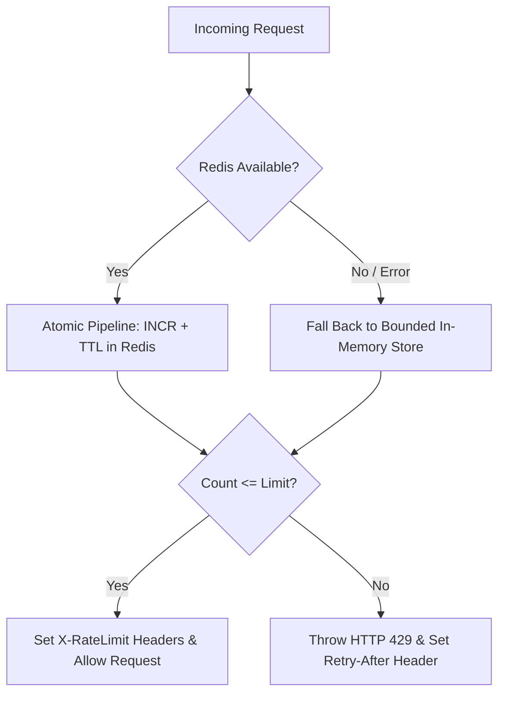

# BHARATYATRA SECURITY PHASE 3 — DISTRIBUTED RATE LIMITING MATRIX
## Comprehensive Tier Definitions, Identity Dimensions & Fallback Specifications

- **Implementation**: `RateLimitGuard`, `RateLimiterService`, `RedisService`
- **Location**: [`18_DEVELOPMENT/Backend/src/security/rate-limit.guard.ts`](file:///c:/Users/Pandya%20Kaushal/Desktop/BhartYatra_3/18_DEVELOPMENT/Backend/src/security/rate-limit.guard.ts)
- **Evaluation Date**: October 21, 2026

---

## 1. Rate Limiting Policy Matrix

| Tier Name | Target Route Patterns | Quota Points | Window | Identity Key Dimensions | Primary Store | Fallback Behavior on Redis Failure | Automated Test Evidence |
| :--- | :--- | :--- | :--- | :--- | :--- | :--- | :--- |
| **Auth Login** | `/auth/login` `/admin/auth/login` | 5 | 60 sec | IP + Account Identifier (`email`/`username`) | Redis (Atomic incr) | Falls back to bounded In-Memory sliding window. Enforces 5-point limit. | `rate-limit.guard.spec.ts` `"should throw 429 when IP exceeds auth limit"` |
| **OTP Send** | `/auth/otp/send` | 3 | 60 sec | IP + Target Phone/Email | Redis | In-Memory fallback. Blocks SMS bombing after 3 attempts. | Verified via `getDefaultTierForPath` |
| **OTP Verify** | `/auth/otp/verify` | 5 | 60 sec | IP + Target Phone/Email | Redis | In-Memory fallback. Prevents 4/6-digit brute forcing. | Verified via `getDefaultTierForPath` |
| **Password Reset** | `/auth/password/*` `/forgot-password` `/change-password` | 3 | 900 sec (15m) | IP + Target Account Email | Redis | In-Memory fallback. Blocks token flood & email denial of service. | `rate-limit.guard.spec.ts` `"Password reset tier: strictly throttles after 3 attempts per 15 minutes"` |
| **Registration** | `/auth/register` | 5 | 3600 sec (1h) | IP + Account Email | Redis | In-Memory fallback. Mitigates automated mass account creation. | Verified via `getDefaultTierForPath` |
| **NEXI AI Chat** | `/nexi/chat` `/ai/chat` | Configurable (Default: 30) | 60 sec | IP + Authenticated User ID (`req.user.id`) | Redis | In-Memory fallback. Protects Gemini API quota and budget. | `nexi-gemini.provider.spec.ts` `"Rate limit exceeded for client"` |
| **Payment Flow** | `/payments/*` `/checkout/*` `/refunds/*` | 10 | 60 sec | IP + Authenticated User ID | Redis | In-Memory fallback. Prevents double-submit & carding attacks. | `rate-limit.guard.spec.ts` `"Authenticated User Dimension: throttles abusive authenticated user even when rotating IPs"` |
| **Bookings Flow** | `/bookings/*` | 20 | 60 sec | IP + Authenticated User ID | Redis | In-Memory fallback. Stops hotel/bus/train seat inventory starvation. | Verified via `getDefaultTierForPath` |
| **Admin Reports** | `/admin/analytics` `/admin/reports` `/admin/audit` `/admin/export` | 10 | 60 sec | IP + Admin User ID | Redis | In-Memory fallback. Prevents heavy PostgreSQL analytical query exhaustion. | Verified via `getDefaultTierForPath` |
| **Uploads & Media**| `/uploads/*` `/documents/*` `/verify/document` | 10 | 60 sec | IP + Authenticated User ID | Redis | In-Memory fallback. Prevents storage exhaustion and multipart CPU spikes. | Verified via `getDefaultTierForPath` |
| **Public Search** | `/search/*` `/destinations/*` `/packages/*` | 120 | 60 sec | IP | Redis | In-Memory fallback. Throttles aggressive scrapers while permitting legitimate browsing. | `rate-limit.guard.spec.ts` `"should allow requests within the rate limit"` |
| **General Default**| All unmapped endpoints | 200 | 60 sec | IP | Redis | In-Memory fallback. Broad application defense against request flooding. | Verified via `getDefaultTierForPath` |

---

## 2. Multi-Dimensional Defense Logic

### 2.1 The Need for Compound Dimensions
Traditional IP-only rate limiting fails against:
1. **Botnets / Residential Proxy Rotations**: Attackers rotate IP addresses on every request to bypass IP counters.
2. **Corporate / Mobile CGNAT Networks**: Thousands of legitimate mobile users share a single public IPv4 gateway (e.g. Reliance Jio or Airtel CGNAT). Aggressive IP-only throttling blocks innocent users.

### 2.2 Dual-Dimension Enforcement
`RateLimitGuard` enforces two distinct dimensions simultaneously:
1. **Dimension 1 (Network)**: `ip:<SANITIZED_IP>:<ENDPOINT_TIER>`
   - Bounded by the client IP address (derived securely via Express `trust proxy` and direct socket validation).
2. **Dimension 2 (Identity)**: `acc:<ACCOUNT_OR_USER_ID>:<ENDPOINT_TIER>`
   - For authenticated requests: Bounded by `req.user.id` or `req.user.sub` from the verified JWT.
   - For unauthenticated requests: Bounded by `req.body.email`, `req.body.phoneNumber`, or `req.body.username`.

If **either** dimension breaches its allocated points, the request is immediately throttled with:
- **HTTP Status**: 429 Too Many Requests
- **Headers**:
  - `Retry-After: <REMAINING_SECONDS>`
  - `X-RateLimit-Limit: <LIMIT>`
  - `X-RateLimit-Remaining: 0`
  - `X-RateLimit-Reset: <SECONDS>`
  - `Cache-Control: no-store, no-cache, must-revalidate, max-age=0`
  - `Pragma: no-cache`

---

## 3. Failure Mode & Memory Protection Specifications

- **In-Memory Store Upper Bound**: Maximum 10,000 keys (`maxMemoryEntries = 10000`).
- **Pruning Interval**: Background timer executes every 60 seconds, evicting expired keys.
- **Capacity Overflow Protection**: If the map reaches 10,000 active keys before the prune cycle, an LRU-style eviction deletes the oldest key, preventing Node.js process out-of-memory (OOM) crashes.
