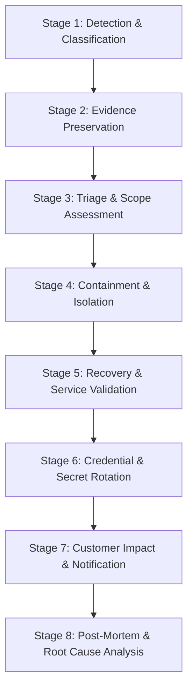

# BharatYatra Security Incident Response Runbook
## Document Reference: `BHARATYATRA_SECURITY_PHASE7_INCIDENT_RUNBOOK.md`
**Phase**: Phase 7 — Security Monitoring, Threat Detection, Alerting & Incident Response  
**Service Engine**: BharatYatra Operations & Security Incident Management  
**Status**: CODE CHECKS PASS, MONITORING DEPLOYMENT VERIFICATION REQUIRED  
**Timestamp**: 2026-10-21  

---

## 1. Incident Response Principles & Safety Guardrails

During an active security event or operational anomaly:
1. **Never Execute Blanket Destructive Actions**: Do not bulk-delete records, drop database tables, mass-cancel bookings, or issue automated refunds without manual executive sign-off.
2. **Preserve Evidence Before Remediation**: Capture raw audit logs, correlation IDs, timestamps, and network request artifacts before restarting services or blocking IP ranges.
3. **Minimize Blast Radius**: Use targeted session revocation and route-level rate limiting rather than taking down entire service clusters.
4. **Assume Unverified Alerts**: Verify telemetry signals against backend logs before executing major infrastructure interventions.

---

## 2. Incident Roles & Operational Responsibilities

Incident team assignments are structured by functional responsibility rather than static individual names:

- **Incident Commander (IC)**: Holds single-threaded authority over response decisions, directs containment strategies, and authorizes major operational interventions.
- **Security Lead**: Analyzes attack vectors, inspects structured log feeds via correlation IDs, coordinates credential rotation, and determines scope of compromise.
- **Engineering / Operations Lead**: Implements technical mitigations, modifies WAF rate limits, manages database connection pools, and monitors application health telemetry.
- **Communications / Legal Officer**: Evaluates regulatory reporting obligations (e.g., India CERT-In guidelines, customer notifications), and coordinates public/partner updates.

---

## 3. Eight-Stage Incident Response Procedure



### Stage 1: Detection & Severity Classification
- **P1 (Critical)**: Webhook signature tampering, database exhaustion, price manipulation exploit, active administrative account takeover, unauthorized secret exposure. (SLA: 15-minute response).
- **P2 (High)**: Repeated BOLA/IDOR attempts, automated credential stuffing spike, NEXI tool injection attempts, sustained 5xx errors > 2%. (SLA: 1-hour response).
- **P3 (Medium)**: Redis cache connectivity drops, duplicate webhook bursts, localized route rate-limit alerts. (SLA: 4-hour response).

### Stage 2: Evidence Preservation
1. Query structured security logs for matching `correlationId` and `eventType`:
   ```bash
   grep '"eventType":"WEBHOOK_SIGNATURE_FAILURE"' /var/log/bharatyatra/security.log > incident_evidence_$(date +%s).json
   ```
2. Export relevant metrics from `/api/v1/health/metrics` including heap memory, CPU, and active alert counters.
3. Take snapshots of active database queries (`SELECT pid, query, state, age(clock_timestamp(), query_start) FROM pg_stat_activity WHERE state != 'idle';`).
4. Record exact UTC timestamps and export Cloudflare WAF event logs.

### Stage 3: Triage & Scope Assessment
- Determine if the attack is automated (bot/scraper) or targeted human adversary.
- Identify affected endpoints, user IDs, or agency partner accounts.
- Verify whether data integrity was compromised (e.g. check for orders created with zero or negative amounts).

### Stage 4: Containment Options & Authorization Matrix

| Scenario | Immediate Containment Action | Required Authorization | Technical Execution |
| :--- | :--- | :---: | :--- |
| **Credential Stuffing / Brute Force** | Temporary IP ban at Cloudflare WAF; enforce CAPTCHA | Engineering Lead | Add IP/CIDR to WAF Block Rule |
| **Suspected User Compromise** | Revoke Supabase refresh token; terminate active sessions | Security Lead | Invalidate session in Supabase Auth |
| **Partner Agency Abuse** | Suspend agency account in partner portal | Incident Commander | Set agency `status = 'SUSPENDED'` |
| **Payment Webhook Tampering** | Block calling IP; refuse unverified webhook processing | Incident Commander | WebhooksService drops unverified requests |
| **Database Pool Exhaustion** | Terminate long-running non-critical queries | Operations Lead | Run `pg_terminate_backend(pid)` |
| **Traffic Spike / DDoS** | Enable Cloudflare "Under Attack" mode | Incident Commander | Cloudflare Dashboard toggle |

### Stage 5: Recovery & Service Validation
- Verify `/api/v1/health/liveness` returns `status: "UP"`.
- Verify `/api/v1/health/readiness` confirms `dependencies.database == "HEALTHY"`.
- Run synthetic smoke test (`npm test` in backend / check test endpoints) to confirm normal request routing.

### Stage 6: Credential & Secret Rotation (When Compromise Suspected)
1. **Supabase JWT Secret**: Update in Supabase dashboard; update `SUPABASE_JWT_SECRET` in production secrets vault; restart backend cluster.
2. **Razorpay Webhook Secret**: Regenerate webhook secret in Razorpay dashboard; update `RAZORPAY_WEBHOOK_SECRET` in backend environment.
3. **Database Credentials**: Trigger password rotation in Supabase; update `DATABASE_URL` with connection limit parameter; perform rolling container restart.
4. **NEXI Gemini API Key**: Generate new key in Google Cloud console; update `GEMINI_API_KEY`; verify NEXI health response.

### Stage 7: Customer Impact Assessment & Notification
- Review transaction logs to determine if customer financial data was impacted.
- Assess obligations under Indian regulatory frameworks (CERT-In 6-hour cybersecurity reporting directive for critical infrastructure / financial incidents).
- Prepare transparent, non-technical customer communication if customer PII or bookings were touched.

### Stage 8: Post-Mortem & Root-Cause Analysis
- Conduct blameless post-mortem within 72 hours of incident resolution.
- Document root cause, detection timeline, containment efficacy, and preventative engineering tasks.
- Add regression tests to `__tests__/` verifying the specific exploit vector is permanently blocked.

---

## 4. Threat-Specific Playbooks

### Playbook A: Suspected Secret Exposure
1. **Immediate Step**: If a secret was committed to GitHub or exposed in logs, treat it as immediately compromised.
2. **Access Audit**: Inspect audit logs for requests using the exposed token.
3. **Rotate**: Issue new secret via provider console; deploy updated configuration to production.
4. **Revoke**: Invalidate the compromised token at the identity/payment provider.
5. **Verify**: Ensure `/health/readiness` confirms service stability with new credentials.

### Playbook B: Payment Webhook Signature Anomaly
1. **Evidence**: Extract webhook raw payload, signature header, and calling IP from structured log `WEBHOOK_SIGNATURE_FAILURE`.
2. **Check Provider**: Log in to Razorpay Dashboard > Webhooks > Delivery Logs. Check if Razorpay experienced delivery errors or URL misconfiguration.
3. **Verification**: Confirm `RAZORPAY_WEBHOOK_SECRET` in production container matches the secret in Razorpay dashboard.
4. **Hold Transitions**: Prevent automatic order fulfillment for any transaction lacking verified webhook confirmation until manual reconciliation.

### Playbook C: Database Saturation / Connection Drops
1. **Metrics**: Check active connections and pool exhaustion signals in `DB_CONNECTION_FAILURE`.
2. **Query Inspection**: Execute `SELECT pid, age(clock_timestamp(), query_start), query FROM pg_stat_activity WHERE state != 'idle' ORDER BY age DESC LIMIT 5;`.
3. **Mitigate**: If runaway query found, terminate it using `SELECT pg_cancel_backend(pid);`.
4. **Pool Review**: Verify `DB_POOL_MAX` in `db.ts` does not exceed Supabase tier allocation (20 connections).

---

## 5. Backup & Disaster Recovery Signals

### Provider Capability Assessment (Supabase & PostgreSQL)
- **Automated Backups**: Managed Supabase projects provide point-in-time recovery (PITR) and daily automated snapshots.
- **Backup Verification Principle**: Creating a backup does **not** equal disaster recovery readiness. Recovery readiness requires verified restoration testing in an isolated staging environment.
- **Monitoring Strategy**:
  1. Monitor Supabase project health API or log shipper for backup failure signals (`BACKUP_FAILED`).
  2. Maintain off-site logical backup verification logs in `security-audit/`.
  3. Never expose backup storage URLs, AWS S3 bucket names, or database restoration credentials in public health or API endpoints.
